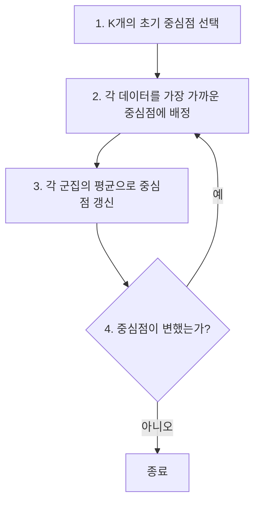
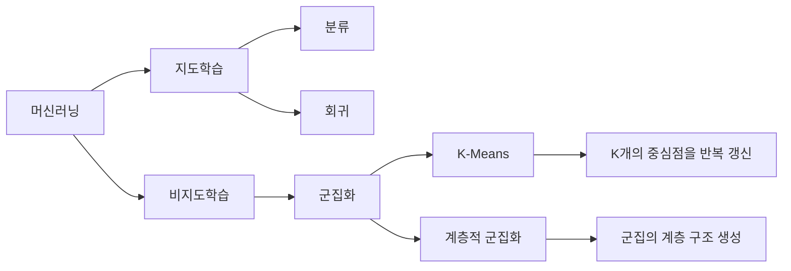

# 머신러닝 4강 — 군집화(Clustering)

> **대상:** 군집화를 처음 배우는 사람  
> **목표:** 군집화의 개념, K-평균 군집화, 계층적 군집화를 직관적으로 이해하고 시험 전에 다시 볼 수 있도록 정리

---

# 1. 군집화가 뭐야?

군집화(Clustering)는 **정답이 없는 데이터를 서로 비슷한 것끼리 묶는 방법**이다.

예를 들어 아래처럼 고객 데이터가 있다고 하자.

| 고객 | 월 구매금액 | 월 방문횟수 |
|---|---:|---:|
| A | 10만 원 | 2회 |
| B | 12만 원 | 3회 |
| C | 80만 원 | 15회 |
| D | 75만 원 | 13회 |
| E | 30만 원 | 5회 |

여기에는 `VIP`, `일반`, `저활동` 같은 **정답 라벨이 미리 붙어 있지 않다.**

그런데 데이터를 보면 대충

- A, B는 서로 비슷하고
- C, D도 서로 비슷하며
- E는 그 중간 정도

처럼 보인다.

군집화 알고리즘은 이런 **데이터 내부의 구조와 분포를 스스로 찾아서 그룹을 만든다.**

즉,

> **분류:** 정답을 보고 학습해서 새 데이터의 정답을 맞힌다.  
> **군집화:** 정답 없이 데이터끼리 비교해서 비슷한 것끼리 묶는다.

---

# 2. 지도학습과 비지도학습의 차이

## 지도학습

입력 `X`와 함께 정답 `y`가 존재한다.

```text
입력 X                     정답 y
---------------------------------------
공부시간 5시간     →        합격
공부시간 1시간     →        불합격
공부시간 7시간     →        합격
```

모델은 `X → y`의 관계를 학습한다.

대표적인 문제:

- 분류(Classification)
- 회귀(Regression)

---

## 비지도학습

입력 데이터 `X`만 있고 정답 `y`가 없다.

```text
입력 X

고객 A → 구매금액 10, 방문 2
고객 B → 구매금액 12, 방문 3
고객 C → 구매금액 80, 방문 15
고객 D → 구매금액 75, 방문 13
```

모델이 직접 데이터의 구조를 찾아야 한다.

대표적인 문제:

- 군집화(Clustering)
- 차원 축소(Dimensionality Reduction)

---

# 3. 군집화의 입력과 출력

군집화의 입력은 보통 여러 특징(feature)을 가진 데이터이다.

예를 들어 고객을

```text
[월 구매금액, 월 방문횟수]
```

두 특징으로 표현할 수 있다.

```text
A = [10, 2]
B = [12, 3]
C = [80, 15]
D = [75, 13]
```

군집화 알고리즘을 실행하면 이런 결과가 나올 수 있다.

```text
A → 군집 1
B → 군집 1
C → 군집 2
D → 군집 2
```

중요한 점은 `군집 1`, `군집 2`라는 이름 자체에는 의미가 없다는 것이다.

예를 들어 알고리즘이 다시 실행되면

```text
A → 군집 2
B → 군집 2
C → 군집 1
D → 군집 1
```

처럼 번호가 바뀌어도 실제 그룹 구조는 같다.

---

# 4. 군집화의 핵심 아이디어

군집화에서 가장 중요한 생각은 이것이다.

> **같은 군집 안의 데이터는 서로 비슷해야 하고, 다른 군집의 데이터와는 서로 달라야 한다.**

그림으로 보면:

```text
● ● ●                 ▲ ▲
 ● ●                 ▲ ▲ ▲
● ●                    ▲

군집 A                군집 B
```

같은 모양끼리는 서로 가깝고 다른 군집끼리는 멀리 떨어져 있다.

이때 "비슷하다"를 판단하기 위해 주로 **거리(distance)** 를 사용한다.

---

# 5. 거리란?

가장 흔한 것은 **유클리드 거리(Euclidean Distance)** 이다.

두 점

```text
A = (x1, y1)
B = (x2, y2)
```

사이의 거리는

```text
거리 = √((x1-x2)² + (y1-y2)²)
```

이다.

예를 들어

```text
A = (1, 1)
B = (4, 5)
```

이면

```text
거리
= √((4-1)² + (5-1)²)
= √(9 + 16)
= √25
= 5
```

이다.

즉, 거리 값이 작을수록 두 데이터가 서로 비슷하다고 볼 수 있다.

---

# 6. K-평균 군집화(K-Means Clustering)

K-평균은 가장 대표적인 군집화 알고리즘이다.

핵심 아이디어는 아주 단순하다.

> **K개의 중심점을 만들고, 각 데이터를 가장 가까운 중심점에 배정한 뒤, 중심점을 다시 계산한다.**

여기서 `K`는 만들고 싶은 군집의 개수이다.

예:

```text
K = 2 → 2개의 군집
K = 3 → 3개의 군집
K = 5 → 5개의 군집
```

---

# 7. 왜 이름이 K-Means일까?

- `K` = 군집 개수
- `Means` = 평균

각 군집의 중심을 **해당 군집 데이터들의 평균값**으로 계산하기 때문에 K-Means라고 한다.

예를 들어 어떤 군집에

```text
(1,1)
(3,3)
(5,5)
```

가 들어 있다면 중심은

```text
x 평균 = (1+3+5) / 3 = 3
y 평균 = (1+3+5) / 3 = 3
```

따라서

```text
중심점 = (3,3)
```

이 된다.

이 중심점을 **centroid(센트로이드, 대표 벡터)** 라고 부른다.

---

# 8. K-Means 전체 흐름

K-Means는 크게 4단계이다.



핵심은

```text
배정 → 평균 계산 → 배정 → 평균 계산 → ...
```

을 반복한다는 것이다.

---

# 9. K-Means를 진짜 예제로 이해하기

다음 6개의 데이터가 있다고 하자.

```text
A = (1,1)
B = (1,2)
C = (2,1)

D = (8,8)
E = (8,9)
F = (9,8)
```

그림으로 보면:

```text
y

9                     E●
8                     D● F●

2    B●
1    A● C●
0
     1 2            8 9         x
```

눈으로 보면 왼쪽 3개와 오른쪽 3개가 자연스럽게 두 그룹으로 보인다.

따라서

```text
K = 2
```

로 설정해 보자.

---

## 1단계: 초기 중심점 선택

예를 들어 임의로

```text
중심 1 = A = (1,1)
중심 2 = D = (8,8)
```

을 선택한다.

---

## 2단계: 각 데이터를 가까운 중심에 배정

각 데이터가 어느 중심에 가까운지 계산한다.

대략 보면

```text
A, B, C → 중심 1에 가까움
D, E, F → 중심 2에 가까움
```

따라서

```text
군집 1 = {A, B, C}
군집 2 = {D, E, F}
```

가 된다.

---

## 3단계: 중심점 다시 계산

군집 1의 평균:

```text
A = (1,1)
B = (1,2)
C = (2,1)
```

x 평균:

```text
(1 + 1 + 2) / 3 = 1.33
```

y 평균:

```text
(1 + 2 + 1) / 3 = 1.33
```

따라서 새로운 중심은

```text
(1.33, 1.33)
```

이다.

군집 2도 같은 방식으로 평균을 계산한다.

---

## 4단계: 다시 데이터 배정

새로운 중심점을 기준으로 다시 데이터를 배정한다.

그런데 여전히

```text
A, B, C → 군집 1
D, E, F → 군집 2
```

라면 중심도 더 이상 거의 움직이지 않는다.

따라서 알고리즘을 종료한다.

---

# 10. K-Means가 실제로 최소화하려는 것

K-Means는 단순히 아무렇게나 그룹을 만드는 것이 아니다.

각 데이터와 자신이 속한 군집 중심 사이의 거리를 최대한 줄이려고 한다.

보통 다음 값을 최소화한다.

```text
각 데이터와 군집 중심 사이의 거리²의 합
```

수식으로 쓰면:

```text
J = Σ ||xi - μk||²
```

여기서

- `xi` = 데이터
- `μk` = 해당 데이터가 속한 군집의 중심
- `J` = 목적함수(Objective Function)

이다.

쉽게 말하면:

```text
군집 안의 점들이 중심점 주변에 최대한 뭉쳐 있게 만들자.
```

라는 뜻이다.

---

# 11. 왜 거리의 제곱을 사용할까?

예를 들어 중심점과 데이터의 거리가

```text
1, 2, 5
```

라면 거리의 제곱은

```text
1, 4, 25
```

가 된다.

멀리 떨어진 점에 더 큰 벌점을 주게 된다.

그래서 K-Means는

> **군집 안의 데이터가 중심점에서 너무 멀리 떨어지는 것을 싫어한다.**

라고 이해하면 된다.

---

# 12. K-Means는 항상 최고의 답을 찾을까?

아니다.

K-Means는 반복할 때마다 목적함수 값을 줄여 나가기 때문에 결국 어떤 지점에서는 멈춘다.

하지만 그 지점이 전체 가능한 답 중에서 가장 좋은 답이라는 보장은 없다.

이걸 **지역 최적해(Local Minimum)** 문제라고 한다.

예를 들어 산이 여러 개 있다고 생각해 보자.

```text
          /\             /\
         /  \           /  \
____\___/____\_____\___/____\____
       A             B
```

어떤 골짜기에 먼저 들어가느냐에 따라 최종 위치가 달라질 수 있다.

K-Means도 처음 중심점을 어디에 두느냐에 따라 다른 결과가 나올 수 있다.

---

# 13. 초기 중심점이 중요한 이유

예를 들어 데이터가 이렇게 있다고 하자.

```text
● ● ●          ● ● ●          ● ● ●
```

K=3일 때 이상적인 초기 중심은

```text
★              ★              ★
● ● ●          ● ● ●          ● ● ●
```

처럼 각 그룹에 하나씩 있는 것이다.

그런데 운 나쁘게 초기 중심을

```text
★★★
● ● ●          ● ● ●          ● ● ●
```

처럼 한쪽에 몰아서 뽑으면 이상한 군집 결과가 나올 수 있다.

그래서 실제 머신러닝 라이브러리에서는 보통

```text
K-Means++
```

라는 초기화 방법을 많이 사용한다.

K-Means++는 초기 중심점을 서로 너무 가까운 곳에 뽑지 않도록 선택한다.

---

# 14. K값은 어떻게 정할까?

K-Means의 가장 큰 문제 중 하나다.

알고리즘을 실행하기 전에

```text
K = ?
```

를 우리가 정해야 한다.

하지만 현실에서는 군집 개수를 모르는 경우가 많다.

예:

```text
고객 유형이 2개인가?
3개인가?
5개인가?
```

쉽게 알 수 없다.

---

# 15. 엘보우 방법(Elbow Method)

K를 정할 때 자주 사용하는 방법이다.

K를 바꾸면서 K-Means를 여러 번 실행한다.

```text
K = 1
K = 2
K = 3
K = 4
K = 5
...
```

그리고 군집 내부 거리의 합을 본다.

보통 K가 증가하면 오차는 감소한다.

```text
오차
│
│ ●
│
│   ●
│
│      ●
│         ●
│           ●
└──────────────── K
  1  2  3  4  5
```

어느 순간부터 감소 폭이 확 줄어드는 지점을 찾는다.

사람 팔꿈치처럼 꺾여 보여서 **Elbow Method**라고 한다.

---

# 16. K-Means의 장점

K-Means는

- 알고리즘이 단순하다.
- 구현이 쉽다.
- 계산 속도가 비교적 빠르다.
- 데이터가 많아도 비교적 잘 동작한다.

그래서 실제 머신러닝에서 매우 널리 사용된다.

---

# 17. K-Means의 단점

하지만 단점도 있다.

### 1. K를 미리 정해야 한다.

```text
K = ?
```

를 사용자가 정해야 한다.

### 2. 초기 중심에 따라 결과가 달라질 수 있다.

초기화에 따라 지역 최적해에 빠질 수 있다.

### 3. 이상치(outlier)의 영향을 많이 받는다.

평균을 사용하기 때문이다.

### 4. 복잡한 모양의 군집에는 약하다.

예를 들어 이런 데이터:

```text
○ ○ ○ ○ ○
○       ● ●
○       ● ●
○ ○ ○ ○ ○
```

처럼 군집 모양이 둥근 원 형태가 아니면 K-Means가 잘못 나눌 수 있다.

---

# 18. 계층적 군집화(Hierarchical Clustering)

K-Means는 처음부터

```text
K = 3
```

처럼 군집 개수를 결정해야 했다.

계층적 군집화는 다르게 접근한다.

데이터들을

```text
작은 군집 → 큰 군집
```

또는

```text
큰 군집 → 작은 군집
```

으로 단계적으로 구성한다.

즉, 군집 사이의 **계층 구조**를 만든다.

---

# 19. 계층적 군집화의 두 종류

## 1. 병합적 방법(Agglomerative)

작은 군집에서 시작해서 점점 합친다.

```text
A   B   C   D

↓

AB      C   D

↓

AB      CD

↓

ABCD
```

처음에는 데이터 하나하나가 군집이다.

가장 가까운 군집끼리 계속 합친다.

실무와 강의에서 가장 많이 다루는 방식이다.

---

## 2. 분할적 방법(Divisive)

반대로 전체 데이터를 하나의 군집에서 시작한다.

```text
ABCD

↓

AB      CD

↓

A B     C D
```

큰 군집을 계속 쪼개는 방식이다.

계산 비용 등의 이유로 병합적 방법보다 덜 사용된다.

---

# 20. 병합적 계층 군집화 알고리즘

데이터가

```text
A B C D
```

4개 있다고 하자.

처음에는:

```text
{A} {B} {C} {D}
```

즉 군집이 4개이다.

---

## 1단계

모든 군집 사이의 거리를 계산한다.

```text
A-B
A-C
A-D
B-C
B-D
C-D
```

가장 가까운 두 군집을 찾는다.

예를 들어

```text
A-B
```

가 가장 가깝다면 합친다.

```text
{AB} {C} {D}
```

---

## 2단계

다시 군집 사이의 거리를 계산한다.

```text
AB-C
AB-D
C-D
```

가장 가까운 군집을 합친다.

예:

```text
C-D
```

가 가장 가까우면

```text
{AB} {CD}
```

가 된다.

---

## 3단계

마지막 두 군집을 합친다.

```text
{ABCD}
```

이제 하나의 군집만 남았다.

---

# 21. 덴드로그램(Dendrogram)

계층적 군집화의 결과를 나무처럼 표현한 그림이다.

예:

```text
거리
│
│              ┌───────────────┐
│              │               │
│        ┌─────┴─────┐    ┌────┴────┐
│        │           │    │         │
│        A           B    C         D
└────────────────────────────────────
```

또는

```text
        ┌───────────────┐
        │               │
    ┌───┴───┐       ┌───┴───┐
    A       B       C       D
```

`A와 B가 먼저 합쳐졌다`는 것은 둘이 가까웠다는 뜻이다.

`C와 D도 가까웠다`.

그리고 `{AB}`와 `{CD}`가 훨씬 나중에 합쳐졌다면 두 그룹 사이의 거리는 상대적으로 멀다는 뜻이다.

---

# 22. 덴드로그램으로 군집 개수 정하기

덴드로그램을 특정 높이에서 가로로 자르면 군집 개수를 정할 수 있다.

```text
        ┌───────────────┐
--------|---------------|------ ← 여기서 자름
    ┌───┴───┐       ┌───┴───┐
    A       B       C       D
```

이 높이에서 자르면

```text
{A,B}
{C,D}
```

두 개의 군집이 된다.

더 낮게 자르면:

```text
A
B
C
D
```

처럼 더 많은 군집이 생긴다.

즉 계층적 군집화는

> 먼저 전체 계층 구조를 만든 뒤, 나중에 군집 개수를 정할 수 있다.

는 장점이 있다.

---

# 23. 군집과 군집 사이 거리는 어떻게 계산할까?

여기서 중요한 문제가 하나 생긴다.

데이터 하나와 데이터 하나 사이 거리는 쉽다.

하지만

```text
군집 A = 여러 데이터
군집 B = 여러 데이터
```

라면 두 군집 사이 거리를 어떻게 계산할까?

이 기준을 **Linkage(연결법)** 라고 한다.

---

# 24. 최단 연결법(Single Linkage)

두 군집에서 가장 가까운 두 점의 거리를 사용한다.

```text
군집 A: ● ● ●

               ← 가장 가까운 두 점

군집 B:       ▲ ▲ ▲
```

수식 느낌으로 쓰면

```text
distance(A, B)
= 두 군집 점들 중 최소 거리
```

장점:

- 길쭉하거나 복잡한 군집을 찾을 수 있다.

단점:

- 중간에 점들이 연결되면서 긴 사슬처럼 군집이 이어지는 현상이 생길 수 있다.

이를 **chaining effect**라고 한다.

---

# 25. 최장 연결법(Complete Linkage)

두 군집에서 가장 멀리 떨어진 두 점의 거리를 사용한다.

```text
distance(A, B)
= 두 군집 점들 중 최대 거리
```

군집 내부가 너무 넓게 퍼지는 것을 방지한다.

그래서 비교적 조밀한 군집을 만든다.

---

# 26. 평균 연결법(Average Linkage)

두 군집에 있는 모든 점 쌍의 거리를 계산하고 평균을 사용한다.

```text
distance(A, B)
= 모든 A-B 점 쌍 거리의 평균
```

Single과 Complete의 중간 성격을 가진다.

---

# 27. 중심 연결법(Centroid Linkage)

각 군집의 중심점을 구한다.

```text
군집 A 중심 = μA
군집 B 중심 = μB
```

그리고

```text
distance(A,B)
= distance(μA, μB)
```

로 계산한다.

즉 군집의 대표점끼리 비교한다.

---

# 28. Ward 방법

Ward 방식은 단순한 거리보다는

> 두 군집을 합쳤을 때 군집 내부의 오차가 얼마나 증가하는가?

를 기준으로 병합한다.

즉

```text
합쳤을 때 데이터들이 너무 퍼지는 조합은 피한다.
```

그래서 상대적으로 균형 잡힌 군집을 만드는 경우가 많다.

실제 계층적 군집화에서 자주 사용된다.

---

# 29. K-Means vs 계층적 군집화

| 항목 | K-Means | 계층적 군집화 |
|---|---|---|
| 학습 종류 | 비지도학습 | 비지도학습 |
| 군집 개수 | K를 미리 정해야 함 | 나중에 결정 가능 |
| 방식 | 중심점을 반복해서 수정 | 가까운 군집을 반복해서 병합 |
| 결과 | 최종 K개 군집 | 계층 구조 |
| 중심점 | 사용함 | 필수 아님 |
| 대표 시각화 | 산점도 | 덴드로그램 |
| 데이터가 많을 때 | 상대적으로 유리 | 계산량이 커질 수 있음 |
| 초기값 영향 | 있음 | K-Means보다 적음 |

---

# 30. 가장 중요한 차이

K-Means:

```text
"군집을 3개 만들어!"
```

라고 먼저 알려준다.

알고리즘:

```text
알겠습니다. 3개로 나눠볼게요.
```

---

계층적 군집화:

```text
데이터가 어떻게 묶이는지 전체 구조부터 보여줘.
```

알고리즘:

```text
A-B가 제일 가깝고,
그다음 C-D가 가깝고,
마지막에 두 그룹이 합쳐집니다.
```

사용자:

```text
그럼 두 그룹으로 나누는 게 자연스럽겠네.
```

이런 차이다.

---

# 31. 군집화가 사용되는 곳

군집화는 정답 라벨을 만들기 어려운 현실 데이터에서 매우 유용하다.

### 고객 분석

```text
고객 구매 데이터
↓
군집화
↓
VIP 고객
일반 고객
저활동 고객
```

### 이미지 분할

비슷한 색이나 특징을 가진 픽셀끼리 묶어서 이미지를 영역별로 나눈다.

### 문서 군집화

```text
뉴스 기사
↓
정치 / 스포츠 / 경제 / 연예
```

처럼 유사한 문서끼리 그룹을 만들 수 있다.

### 이상 탐지

대부분의 데이터 군집에서 멀리 떨어진 데이터를 이상치로 판단할 수 있다.

---

# 32. 시험에서 특히 기억해야 할 내용

## 군집화

```text
정답 라벨이 없다.
→ 비지도학습
→ 데이터 내부 구조를 찾아 비슷한 것끼리 그룹화
```

---

## K-Means

순서:

```text
1. K개의 초기 중심점 선택
2. 각 데이터를 가장 가까운 중심에 배정
3. 각 군집의 평균으로 중심점 갱신
4. 중심이 변하지 않을 때까지 반복
```

암기:

```text
중심 선택
→ 데이터 배정
→ 중심 갱신
→ 반복
```

---

## K-Means의 문제

```text
초기 중심점에 따라 결과가 달라질 수 있음
K를 미리 정해야 함
지역 최적해 가능
이상치에 민감
```

---

## 계층적 군집화

```text
군집의 계층 구조를 만든다.
```

병합적:

```text
각 데이터가 하나의 군집
→ 가까운 군집 병합
→ 반복
→ 하나의 군집
```

분할적:

```text
전체 데이터가 하나의 군집
→ 계속 나눔
```

---

## 덴드로그램

```text
군집들이 어떤 순서로 합쳐졌는지를 보여주는 트리
```

가로선을 어디에 긋느냐에 따라 군집 개수가 결정된다.

---

# 33. 한눈에 보는 전체 흐름



---

# 34. 이해도 체크

## 문제 1

다음 중 군집화에 가장 적합한 문제는?

```text
① 사진을 보고 고양이인지 강아지인지 맞히기
② 집 크기를 보고 집값 예측하기
③ 고객 구매 데이터를 보고 비슷한 고객끼리 그룹 만들기
④ 공부시간을 보고 시험점수 예측하기
```

정답: **③**

이유:

정답 라벨 없이 고객 데이터 내부에서 비슷한 패턴을 찾는 문제이기 때문이다.

---

## 문제 2

K-Means에서 K가 의미하는 것은?

```text
① 데이터 개수
② 특징 개수
③ 군집 개수
④ 반복 횟수
```

정답: **③**

---

## 문제 3

K-Means에서 각 군집의 중심점은 어떻게 계산하는가?

```text
① 가장 큰 값
② 가장 작은 값
③ 데이터들의 평균
④ 랜덤한 값
```

정답: **③**

---

## 문제 4

K-Means에서 초기 중심점이 중요한 이유는?

정답:

```text
초기 중심점에 따라
최종 군집 결과가 달라질 수 있기 때문이다.
```

---

## 문제 5

다음 설명에 해당하는 군집화 방법은?

```text
처음에는 데이터 각각을 하나의 군집으로 만든다.
가장 가까운 군집끼리 계속 합친다.
```

정답:

**병합적 계층 군집화(Agglomerative Hierarchical Clustering)**

---

# 35. 마지막 핵심 정리

머신러닝에서 군집화의 핵심은 하나다.

```text
정답이 없는 데이터에서
비슷한 것끼리 묶는다.
```

대표적인 방법은 두 가지이다.

```text
K-Means
→ 군집 개수 K를 먼저 정한다.
→ 중심점을 반복해서 수정한다.

계층적 군집화
→ 데이터가 합쳐지는 전체 구조를 만든다.
→ 덴드로그램을 보고 군집 개수를 결정할 수 있다.
```

K-Means의 핵심 반복:

```text
중심 선택
↓
가까운 중심으로 데이터 배정
↓
평균으로 중심 이동
↓
다시 배정
↓
변화가 없을 때 종료
```

계층적 군집화의 핵심:

```text
각 데이터가 하나의 군집
↓
가장 가까운 군집 병합
↓
반복
↓
하나의 군집
```

이 흐름만 확실히 이해하면 이번 강의의 큰 줄기는 잡힌 것이다.
