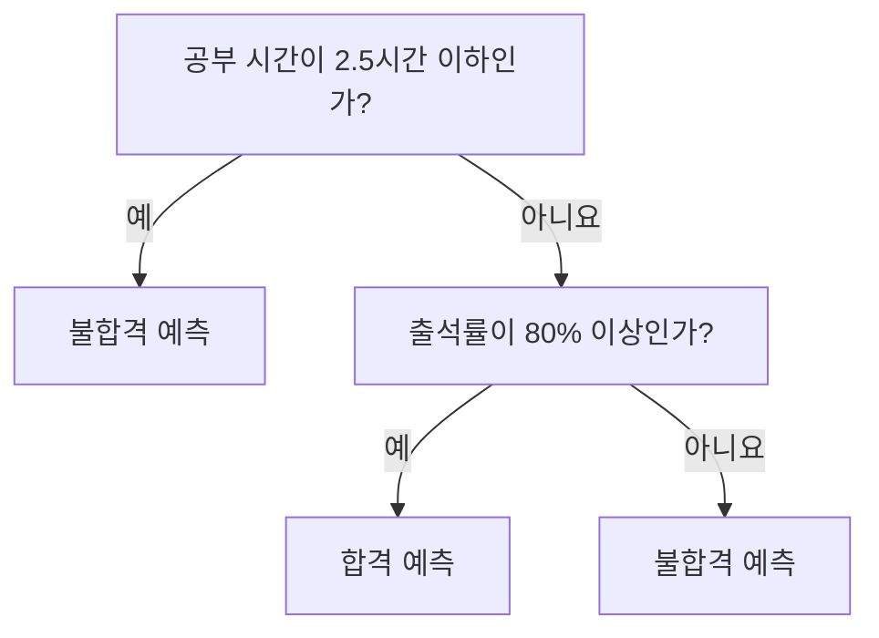
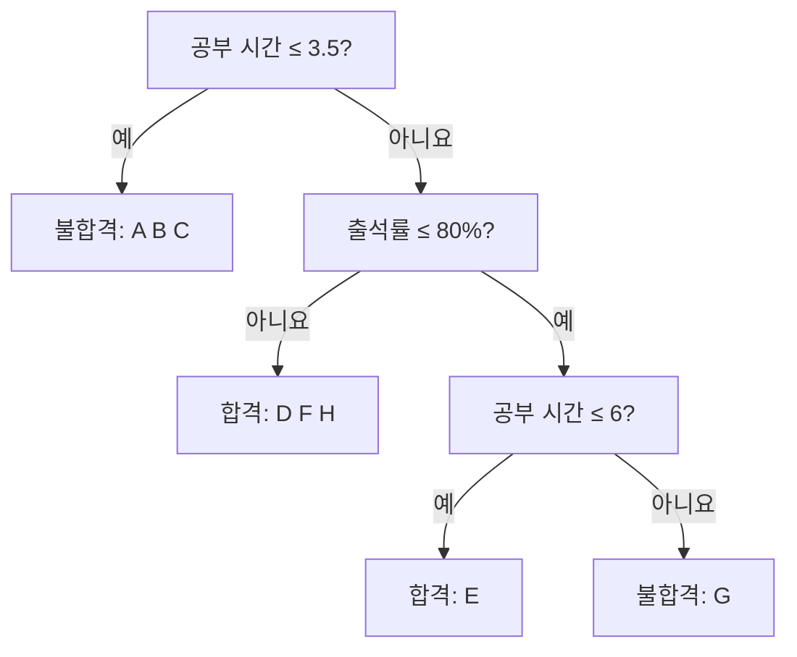
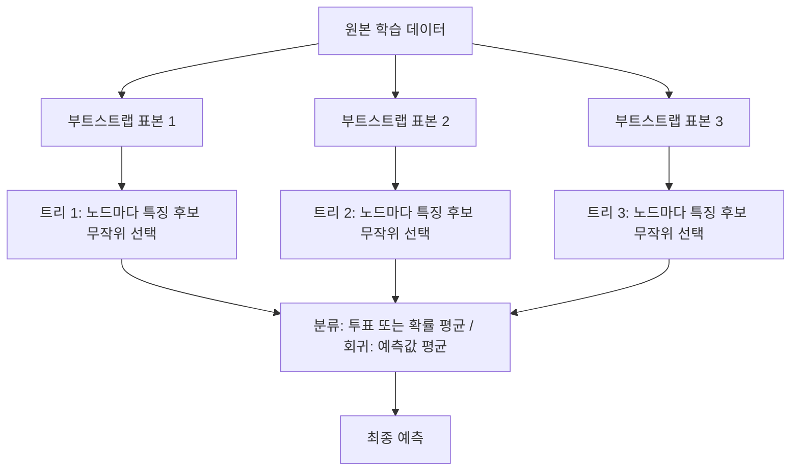

# 머신러닝 7강 — 결정 트리와 랜덤 포레스트

> **대상:** 머신러닝 수업을 처음 듣는 학습자  
> **바탕 자료:** 사용자가 제공한 7강 학습개요·학습목표·정리하기  
> **읽는 순서:** 기본 용어 → 트리로 예측하기 → 지니 불순도로 학습하기 → 회귀 → 과다적합 → 랜덤 포레스트 → 복습  
> 예제의 데이터는 이해를 돕기 위한 가상 자료다. 강의 영상·교재 전체를 확인한 문서는 아니며, 제공된 요약을 자세히 풀고 일부 표현을 보완했다.

## 먼저, 이번 강의를 한 문장으로

**결정 트리는 데이터를 보고 ‘예/아니요 질문을 이어 가는 판단 규칙’을 배우는 모델이고, 랜덤 포레스트는 서로 다르게 학습한 여러 트리의 답을 합치는 모델이다.**

병원 문진을 떠올려 보자. “열이 있나요?”, “기침이 있나요?”처럼 앞 질문의 답에 따라 다음 질문이 달라진다. 결정 트리도 이와 비슷하게 작동한다. 다만 머신러닝에서는 사람이 질문을 전부 정해 주는 것이 아니라, **정답이 붙어 있는 예시를 보고 알고리즘이 질문과 기준을 고른다.**

처음 읽을 때는 수식보다 “이 질문으로 나누면 정답이 더 잘 구별되나?”에 집중하자. 지니 불순도의 수식은 그 생각을 숫자로 바꾼 것이다.

## 목차

1. 출발점: 데이터, 특징, 정답, 분류와 회귀
2. 결정 트리는 어떻게 답을 내는가
3. 트리의 구조와 용어
4. 트리를 학습한다는 말의 의미
5. 지니 불순도: 얼마나 섞여 있는가
6. 지니 평가지수: 어떤 질문이 좋은가
7. 학습을 끝까지 따라가 보기
8. 회귀 트리: 숫자를 예측하는 방법
9. 트리의 깊이와 과다적합
10. 과다적합을 줄이는 방법
11. 랜덤 포레스트가 필요한 이유
12. 랜덤 포레스트를 만드는 전 과정
13. 트리가 많아지면 무엇이 달라지는가
14. 결정 경계와 두 모델의 특징
15. 강의 문장을 쉬운 말로 다시 읽기
16. 시험 직전 요약과 복습 문제

---

## 1. 출발점: 데이터, 특징, 정답, 분류와 회귀

“학생이 시험에 합격할까?”를 예측한다고 하자. 다음처럼 과거 학생의 공부 기록과 시험 결과를 모을 수 있다.

| 학생 | 공부 시간 | 출석률 | 시험 결과 |
|---|---:|---:|---|
| A | 1시간 | 60% | 불합격 |
| B | 2시간 | 90% | 불합격 |
| C | 3시간 | 70% | 합격 |
| D | 4시간 | 95% | 합격 |

- **데이터 한 개 / 표본:** 학생 한 명의 기록이다.
- **특징 / 속성 / 입력:** 예측의 재료다. 여기서는 공부 시간과 출석률이다.
- **정답 / 목표값:** 맞히려는 결과다. 여기서는 시험 결과다.
- **학습:** 과거 입력과 정답을 보고 판단 규칙을 만드는 과정이다.
- **예측:** 만들어진 규칙에 새 학생의 입력을 넣어 결과를 내는 과정이다.
- **일반화:** 학습할 때 보지 못한 학생에게도 예측이 잘 맞는 성질이다.

학습에서는 정답을 보지만, 새 학생을 예측할 때는 그 학생의 정답을 아직 모른다. **정답을 미리 알아야만 사용할 수 있는 정보를 질문에 넣으면 안 된다.**

### 분류와 회귀의 차이

| 구분 | 예측하는 것 | 질문 예시 | 답 예시 |
|---|---|---|---|
| 분류 | 종류, 범주 | 합격할까? | 합격 / 불합격 |
| 회귀 | 수치 | 몇 점을 받을까? | 78.5점 |

“분류”는 상자 중 하나를 고르는 일이고, “회귀”는 수치를 추정하는 일이라고 생각하자. 점수처럼 수치로 표현되는 목표를 회귀로 다룰 수 있으며, 정답이 정수라고 해서 반드시 분류인 것은 아니다.

## 2. 결정 트리는 어떻게 답을 내는가

다음은 설명용으로 사람이 그린 아주 작은 트리다. 실제 학습에서는 데이터로 질문을 고른다.



그림이 표시되지 않을 때:

```text
공부 시간 ≤ 2.5시간?
├─ 예     → 불합격
└─ 아니요 → 출석률 ≥ 80%?
             ├─ 예     → 합격
             └─ 아니요 → 불합격
```

새 학생이 **공부 4시간, 출석률 90%**라면 다음처럼 이동한다.

1. 공부 시간이 2.5시간 이하인가? → 아니요.
2. 출석률이 80% 이상인가? → 예.
3. 마지막 칸에 도착했다. → 합격 예측.

이렇게 질문을 따라가는 과정이 예측이다. 예측할 때 트리 전체를 다시 학습하지는 않는다.

### 왜 설명력이 좋다고 할까?

“왜 합격이라고 했나요?”라는 질문에 **“공부 시간이 2.5시간보다 많고 출석률이 80% 이상이어서”**라고 경로를 설명할 수 있기 때문이다.

다만 이것은 **모델이 판단한 근거**다. 공부 시간을 늘리면 반드시 합격한다는 인과관계를 입증한 것은 아니다. 또 트리가 너무 커지면 사람이 전체 구조를 이해하기 어려워진다.

## 3. 트리의 구조와 용어

식물의 나무와 달리, 보통 맨 위에 뿌리를 놓고 아래로 그린다.

| 용어 | 뜻 | 위 예제에서 해당하는 것 |
|---|---|---|
| 노드 | 질문이나 결과를 담은 칸 | 그림의 각 사각형 |
| 루트 노드 | 맨 처음 시작하는 노드 | 공부 시간 질문 |
| 내부 노드 | 중간에서 분할하는 질문 노드 | 출석률 질문 |
| 가지 | 답에 따라 이어지는 길 | 예 / 아니요 화살표 |
| 자식 노드 | 어떤 노드의 바로 다음 노드 | 질문 이후 도착하는 칸 |
| 리프 노드 | 더 나누지 않고 답을 내는 마지막 노드 | 합격 / 불합격 |
| 깊이 | 루트에서 내려온 간선 수 | 루트 깊이는 0, 자식은 1 |
| 트리의 최대 깊이 | 가장 깊은 리프까지의 거리 | 위 예제에서는 2 |

엄밀히 말하면 루트도 리프가 아니라면 내부 노드다. 강의에서 “루트와 내부 노드”라고 나누어 부를 때는 시작 질문과 그 아래의 질문들을 구별하려는 표현으로 이해하면 된다.

질문 노드에는 단순한 속성 이름만 들어가는 것이 아니라 **‘공부 시간 ≤ 2.5’처럼 속성과 분할 기준이 함께 들어간다.** 같은 속성이 아래쪽에서 다른 기준으로 다시 쓰일 수도 있다.

### CART라는 이름

**CART = Classification And Regression Trees**, 즉 분류와 회귀를 위한 트리라는 뜻이다. 분류와 회귀에 모두 쓰이는 대표적인 결정 트리 알고리즘이다.

강의에서는 결정 트리를 넓게 CART라고 표현하지만, **모든 결정 트리 알고리즘이 CART인 것은 아니다.** ID3, C4.5 같은 다른 방법도 있다. 대표적인 CART는 한 노드에서 **두 갈래로 나누는 이진 분할**을 사용한다. 따라서 속성값이 5종류라고 해서 CART의 가지가 반드시 5개가 되는 것은 아니다.

## 4. 트리를 학습한다는 말의 의미

이제부터는 다음 **8명짜리 예제**를 계속 사용하자. 앞 절의 작은 예제와는 별개의 데이터다.

| 학생 | 공부 시간 | 출석률 | 정답 |
|---|---:|---:|---|
| A | 1 | 50% | 불합격 |
| B | 2 | 90% | 불합격 |
| C | 3 | 60% | 불합격 |
| D | 4 | 95% | 합격 |
| E | 5 | 70% | 합격 |
| F | 6 | 90% | 합격 |
| G | 7 | 65% | 불합격 |
| H | 8 | 95% | 합격 |

알고리즘은 다음과 같은 질문 후보들을 비교할 수 있다.

- 공부 시간 ≤ 3.5인가?
- 공부 시간 ≤ 5.5인가?
- 출석률 ≤ 80%인가?

연속적인 숫자 특징에서는 정렬한 값 사이의 중간값을 분할 후보로 사용하는 방식이 흔하다. 예를 들어 공부 시간 3과 4 사이에서 나누면 기준을 3.5로 둘 수 있다.

**학습은 이런 질문들 중 데이터를 잘 나누는 질문을 선택하고, 나누어진 집단 안에서 다시 질문을 고르는 작업이다.**

```text
모든 학습 데이터
      ↓
질문 후보 비교 → 가장 잘 나누는 질문 선택
      ↓
두 집단으로 분할
      ↓
각 집단 안에서 다시 질문 후보 비교
      ↓
멈출 조건을 만족하면 결과를 담은 리프로 확정
```

문제는 “잘 나눈다”를 어떻게 판단하느냐다. 그 기준 중 하나가 **지니 불순도**다.

## 5. 지니 불순도: 얼마나 섞여 있는가

### 5.1 ‘불순하다’는 말의 의미

여기서 불순도는 좋고 나쁜 사람을 구별하는 말이 아니다. **한 노드 안에 여러 정답 종류가 얼마나 섞여 있는지**를 뜻한다.

```text
● = 합격, ○ = 불합격

● ● ● ● ● ● ● ●   → 모두 합격: 불순도 0
● ● ● ● ● ● ○ ○   → 주로 합격: 불순도 0.375
● ● ● ● ○ ○ ○ ○   → 반반:      불순도 0.5
```

모두 합격인 집단이라면 그 집단에 “합격”이라는 이름을 붙이기 쉽다. 반반이면 어느 한쪽으로 단정하기 어렵다. **결정 트리는 나눈 뒤의 집단이 가능하면 한 종류 위주가 되도록 질문을 고른다.**

### 5.2 수식은 비율을 제곱해서 빼는 것

노드의 지니 불순도는 다음과 같다.

$$
G = 1 - \sum_{k=1}^{K} p_k^2
$$

- $K$: 정답 종류의 수.
- $p_k$: 현재 노드에서 정답이 $k$인 데이터의 비율.
- $\sum$: 각 종류에 대한 값을 모두 더하라는 뜻.

합격과 불합격의 두 종류만 있다면 다음처럼 읽으면 된다.

$$
G = 1 - (\text{합격 비율})^2 - (\text{불합격 비율})^2
$$

**예제 ① 합격 4명, 불합격 4명**

$$
G = 1-(4/8)^2-(4/8)^2=1-0.25-0.25=0.5
$$

**예제 ② 합격 6명, 불합격 2명**

$$
G = 1-(6/8)^2-(2/8)^2=1-0.5625-0.0625=0.375
$$

**예제 ③ 합격 8명, 불합격 0명**

$$
G = 1-1^2-0^2=0
$$

핵심은 **작을수록 덜 섞여 있다는 것**이다. 합격만 있어도, 불합격만 있어도 0이다.

### 5.3 비율에 따른 변화 도표

두 종류일 때 합격 비율을 $p$라고 하면 $G=2p(1-p)$다.

| 합격 비율 | 불합격 비율 | 지니 불순도 | 막대로 본 크기 |
|---:|---:|---:|---|
| 0% | 100% | 0 | |
| 25% | 75% | 0.375 | ██████ |
| 50% | 50% | 0.5 | ████████ |
| 75% | 25% | 0.375 | ██████ |
| 100% | 0% | 0 | |

**두 종류에서는 반반일 때 가장 높고 최대값은 0.5다.** 종류가 $K$개이면 최대값은 $1-1/K$이므로, “지니 불순도의 최대는 항상 0.5”라고 외우면 안 된다.

지니 불순도를 모델의 오답률로 읽어서도 안 된다. 합격 75%, 불합격 25%인 노드를 모두 합격이라고 예측하면 그 노드의 학습 오답률은 0.25지만, 지니 불순도는 0.375다. 서로 다른 지표다.

## 6. 지니 평가지수: 어떤 질문이 좋은가

지니 불순도는 **노드 하나**의 혼합 정도다. 질문의 품질을 평가하려면, 그 질문으로 만들어진 **자식 노드들을 함께** 봐야 한다.

$$
\text{분할 후 지니 평가지수}
=\sum_j \frac{n_j}{n}G_j
$$

- $n$: 부모 노드의 데이터 수.
- $n_j$: 자식 $j$의 데이터 수.
- $G_j$: 그 자식의 지니 불순도.

말로 읽으면 **‘각 자식의 불순도 × 그 자식에 들어간 데이터의 비율’을 모두 더한다**는 뜻이다. 이 값이 작은 질문이 좋다.

### 6.1 후보 A: 공부 시간 ≤ 3.5인가?

8명짜리 표에서 학생을 직접 나누어 보자.

| 자식 | 학생 | 합격 | 불합격 | 지니 불순도 |
|---|---|---:|---:|---:|
| 예: 3.5 이하 | A, B, C | 0 | 3 | 0 |
| 아니요: 3.5 초과 | D, E, F, G, H | 4 | 1 | 0.32 |

두 번째 집단의 불순도는 다음과 같다.

$$
1-(4/5)^2-(1/5)^2=1-0.64-0.04=0.32
$$

따라서 질문 A의 평가지수는 다음과 같다.

$$
\frac{3}{8}\times0+\frac{5}{8}\times0.32=\boxed{0.20}
$$

### 6.2 후보 B: 출석률 ≤ 80%인가?

| 자식 | 학생 | 합격 | 불합격 | 지니 불순도 |
|---|---|---:|---:|---:|
| 예: 80% 이하 | A, C, E, G | 1 | 3 | 0.375 |
| 아니요: 80% 초과 | B, D, F, H | 3 | 1 | 0.375 |

$$
\frac{4}{8}\times0.375+\frac{4}{8}\times0.375=\boxed{0.375}
$$

### 6.3 두 후보의 비교

| 질문 후보 | 분할 후 평가지수 | 판단 |
|---|---:|---|
| A: 공부 시간 ≤ 3.5 | **0.20** | 두 후보 중 더 좋은 분할 |
| B: 출석률 ≤ 80% | 0.375 | A보다 많이 섞여 있음 |

그래서 **이 두 후보 중에서는 A를 선택한다.** 실제 학습에서는 설정과 알고리즘에 따라 더 많은 특징과 기준값을 비교한다.

분할 전에는 합격 4명, 불합격 4명이므로 불순도가 0.5였다. 후보 A를 택하면 0.20이므로 감소량은 $0.5-0.20=0.30$이다. 같은 부모에서 비교할 때 **분할 후 불순도 최소화와 불순도 감소량 최대화는 같은 선택**을 한다.

### 6.4 왜 단순 평균이 아니라 가중평균인가?

후보 A에서 $(0+0.32)/2=0.16$으로 계산하면 틀린다. 왼쪽에는 3명, 오른쪽에는 5명이 있으므로 오른쪽 상태가 더 많은 학생에게 해당한다. 그래서 각각 $3/8$, $5/8$을 곱한다.

**‘자식 노드마다 똑같이 한 표’가 아니라 ‘데이터 한 명마다 똑같이 한 표’라고 생각하면 된다.**

## 7. 학습을 끝까지 따라가 보기

공부 시간 3.5로 나눈 뒤 왼쪽 A, B, C는 모두 불합격이다. 이쪽은 더 나눌 필요가 없다. 오른쪽 D, E, F, G, H는 합격 4명과 불합격 1명이므로 추가로 나눌 수 있다.

오른쪽 집단에서 출석률 80%를 기준으로 나누면 다음과 같다.

- 출석률 80% 초과: D, F, H → 모두 합격.
- 출석률 80% 이하: E, G → 합격 1명, 불합격 1명.

E와 G는 공부 시간을 6으로 나누면 구별된다. 이렇게 이어서 만든 트리는 다음과 같다. 이 그림은 **앞에서 고른 분할을 이어 가는 한 가지 예**이며, 동점 처리 등에 따라 다른 트리도 가능하다.



```text
공부 시간 ≤ 3.5?
├─ 예     → 불합격 [A, B, C]
└─ 아니요 → 출석률 ≤ 80%?
             ├─ 아니요 → 합격 [D, F, H]
             └─ 예     → 공부 시간 ≤ 6?
                          ├─ 예     → 합격 [E]
                          └─ 아니요 → 불합격 [G]
```

### 여기서 꼭 구분할 두 가지

**첫째, ‘자식 노드를 다시 루트로 둔다’는 말은 그 집단 안에서 같은 작업을 반복한다는 뜻이다.** 전체 트리의 시작점이 바뀌거나 여러 개의 독립적인 트리가 생기는 것이 아니다. 이런 반복 방식을 재귀적 분할이라고 한다.

**둘째, 보통의 트리 학습은 현재 단계에서 좋은 분할을 고른다.** 가능한 모든 완성된 트리를 만들어 미래의 성능까지 비교하는 방식이 아니다. 이를 탐욕적 선택이라고 한다. 첫 질문이 당장 좋아 보여도 전체적으로 최적인 트리를 보장하지는 않는다.

### 모두 같은 정답이 아니어도 멈출 수 있다

최대 깊이에 도달하거나, 데이터가 너무 적거나, 더 유용한 분할이 없으면 섞인 상태에서도 리프가 된다. 분류 리프는 일반적으로 **가장 많은 클래스**를 예측한다.

예를 들어 합격 4명, 불합격 1명에서 멈추면 “합격”을 예측한다. 단순한 비가중 설정에서 합격 비율 0.8을 확률 추정값으로 내보낼 수도 있지만, 실제 합격 가능성이 반드시 정확히 80%라는 보장은 없다.

## 8. 회귀 트리: 숫자를 예측하는 방법

이번에는 합격 여부 대신 **점수**를 예측하자.

| 학생 | 공부 시간 | 실제 점수 |
|---|---:|---:|
| A | 1 | 40 |
| B | 2 | 50 |
| C | 3 | 60 |
| D | 4 | 80 |
| E | 5 | 90 |
| F | 6 | 100 |

공부 시간 3.5를 기준으로 나누고 멈추면 다음과 같다.

```text
공부 시간 ≤ 3.5?
├─ 예     → [40, 50, 60]의 평균 = 50점
└─ 아니요 → [80, 90, 100]의 평균 = 90점
```

**새 학생이 도착한 리프 안의 학습 정답들을 평균 내어 예측값으로 사용한다.** 따라서 공부 시간이 2.7시간인 새 학생의 예측값은 50점이다. 이 예에서는 “2.7시간이니까 57점”처럼 선형 보간하지 않는다.

### 회귀에서는 무엇을 기준으로 나누나?

점수는 합격/불합격 같은 클래스가 아니므로, 일반적인 회귀 트리에서는 지니 불순도 대신 **제곱오차** 같은 기준을 사용한다.

$$
\text{리프의 제곱오차 합}=\sum_i(y_i-\bar y)^2
$$

- $y_i$: 그 리프의 학생 $i$가 받은 실제 점수.
- $\bar y$: 그 리프의 평균 점수이자 예측값.
- 오차를 제곱해서 더하면 큰 실수에 더 큰 벌점을 준다.

나누기 전 전체 평균은 70점이고 제곱오차 합은 다음과 같다.

$$
900+400+100+100+400+900=2800
$$

나눈 뒤 왼쪽은 평균 50점, 오른쪽은 평균 90점이다.

$$
\text{왼쪽}=100+0+100=200
$$
$$
\text{오른쪽}=100+0+100=200
$$
$$
\text{분할 후 전체 제곱오차 합}=200+200=400
$$

**2800이 400으로 줄었으므로, 이 분할은 점수가 비슷한 학생들을 잘 모았다고 볼 수 있다.** 실제 학습에서는 다른 후보와도 비교한다. 자식의 평균제곱오차를 표본 수로 가중평균하는 방식도 같은 부모의 분할을 비교할 때 같은 선택을 한다.

제곱오차 합을 가장 작게 만드는 대표값이 평균이기 때문에 평균을 쓴다. 다른 손실함수를 사용하는 회귀 트리는 중앙값 등을 사용할 수도 있다. 이번 강의에서는 제곱오차와 평균의 조합을 이해하면 충분하다.

## 9. 트리의 깊이와 과다적합

아까 8명짜리 트리는 학습 데이터의 정답을 모두 맞혔다. 그렇다면 완벽한 모델일까?

**아니다. 우리가 원하는 것은 이미 본 학생을 외우는 능력이 아니라, 새로운 학생을 잘 예측하는 능력이다.**

예를 들어 G 학생은 공부 시간이 길지만 불합격했다. 시험 당일 컨디션이 나빴거나 기록에 오류가 있었을 수 있다. 이런 불규칙한 변동을 노이즈라고 한다. 물론 실제 이유가 있는 사례일 수도 있다. 데이터만으로 G가 무조건 노이즈라고 단정할 수는 없다.

트리를 계속 깊게 만들면 소수의 특이한 사례에 맞춘 질문까지 만들 수 있다. 그러면 학습 성적은 좋아져도 새 데이터에서는 성능이 떨어질 수 있다. 이것이 **과다적합**, 또는 **과적합**이다. 두 표현은 같은 뜻이다.

| 상태 | 규칙의 모습 | 학습 데이터 | 새 데이터 |
|---|---|---|---|
| 과소적합 | 너무 단순해 중요한 차이도 놓침 | 잘 못 맞힘 | 잘 못 맞힘 |
| 적절한 복잡도 | 반복되는 패턴을 잡음 | 비교적 잘 맞힘 | 비교적 잘 맞힘 |
| 과다적합 | 우연한 예외까지 세세하게 반영 | 매우 잘 맞힘 | 성능이 나빠질 수 있음 |

### 깊이와 오차의 관계: 개념도

```text
트리 깊이 증가 →     얕음          중간          깊음

학습 오차            ███████       ███           █
검증 오차            ███████       ██            █████
                     과소적합      적절          과다적합 가능
```

위 막대는 실제 실험 결과가 아니라 원리를 보여 주는 개념도다. **같은 학습 기준에서 제약을 풀고 더 나누면 학습 손실은 대체로 줄거나 유지되지만, 새 데이터의 오차까지 계속 줄어든다는 보장은 없다.** 실제 검증 곡선은 데이터에 따라 들쭉날쭉할 수 있다.

‘깊으면 반드시 과적합’, ‘얕으면 무조건 안전’도 틀린 말이다. 필요한 복잡도는 데이터 수와 문제의 구조에 따라 달라진다.

## 10. 과다적합을 줄이는 방법

### 10.1 트리를 자라기 전에 제한하기

| 조절할 것 | 쉬운 뜻 | 효과와 주의점 |
|---|---|---|
| 최대 깊이 | 질문을 몇 단계까지 이어 갈지 제한 | 너무 작으면 중요한 패턴도 놓침 |
| 리프의 최소 표본 수 | 마지막 집단에 최소 몇 명이 있어야 하는지 지정 | 한두 명 전용 규칙을 억제 |
| 분할의 최소 표본 수 | 질문을 더 만들려면 최소 몇 명이 필요한지 지정 | 작은 집단에서의 추가 분할을 제한 |
| 최소 불순도 감소 | 충분히 좋아질 때만 분할 | 개선이 미미한 질문을 억제 |

### 10.2 자란 뒤 가지치기하기

큰 트리에서 얻는 추가 이득이 복잡도에 비해 작은 부분을 잘라 더 단순하게 만들 수 있다. 이를 **가지치기**라고 한다. 대표적인 비용 복잡도 가지치기는 오차와 리프 수에 따른 복잡도 벌점을 함께 고려한다.

### 10.3 어느 정도로 제한할지는 검증으로 정하기

```text
학습 데이터 → 질문과 기준을 학습
검증 데이터 → 깊이와 최소 표본 수 같은 설정을 비교
테스트 데이터 → 설정을 결정한 뒤 최종 성능 평가
```

검증 데이터는 모의고사, 테스트 데이터는 마지막 시험이라고 생각하면 된다. 교차 검증은 데이터를 여러 번 나누어 검증 결과를 비교하는 방법이다. 테스트 결과를 보며 설정을 계속 바꾸면 최종 평가의 신뢰도가 떨어진다.

다음 절의 랜덤 포레스트는 **여러 트리를 결합해서 단일 트리의 불안정성을 줄이는 접근**이다. 깊이 제한과 랜덤 포레스트를 함께 사용할 수도 있다.

## 11. 랜덤 포레스트가 필요한 이유

결정 트리는 데이터가 조금만 달라져도 첫 질문이 바뀔 수 있다. 첫 질문이 바뀌면 아래 구조도 크게 달라질 수 있다. 이렇게 학습 데이터의 작은 차이에 예측이 크게 흔들리는 성질을 **분산이 크다**고 표현한다.

앞의 6강 앙상블 학습과 연결해 보자. 앙상블은 **여러 모델의 답을 합치는 것**이다. 랜덤 포레스트에서는 그 여러 모델이 결정 트리다.

‘Forest’는 숲이라는 뜻이다. 나무 하나가 트리라면 나무 여러 개를 모은 것이 포레스트다.

하지만 **똑같은 트리를 복사해서 100개 두면 답도 똑같으므로 새로운 이점이 거의 없다.** 서로 다른 트리들이 어느 정도 다른 실수를 해야 결합 효과가 생긴다.

랜덤 포레스트는 대표적으로 다음 두 곳에 무작위성을 넣는다.

1. **트리마다 학습 데이터를 다르게 뽑는다.** 보통 부트스트랩 표본을 사용한다.
2. **각 질문을 고를 때 고려하는 특징 후보를 무작위로 제한한다.**

이 두 번째 특징이 중요하다. 단순히 배깅으로 결정 트리를 여러 개 만든 설명만으로는 랜덤 포레스트의 핵심을 충분히 설명하지 못한다.

## 12. 랜덤 포레스트를 만드는 전 과정

### 12.1 첫 번째 무작위성: 복원 추출

원본 학습 데이터가 A, B, C, D, E **다섯 개** 있다고 하자. 표본 하나를 뽑은 뒤 다시 넣고 다음 표본을 뽑는다. 이것이 복원 추출이다. 이렇게 만든 표본 묶음을 부트스트랩 표본이라고 한다.

| 용도 | 뽑힌 표본의 예 |
|---|---|
| 원본 | A, B, C, D, E |
| 트리 1 학습 | A, A, C, D, E |
| 트리 2 학습 | B, B, C, E, E |
| 트리 3 학습 | A, C, C, D, D |

원본과 같은 개수를 뽑아도 중복이 있으므로 어떤 원본 표본은 빠질 수 있다. 즉, 단순히 원본을 겹치지 않는 세 묶음으로 나눈 것이 아니다.

**배깅**은 이런 재표집으로 여러 모델을 학습하고 답을 합치는 방법이다. 원본 데이터가 제공하는 정보 자체가 새로 늘어나는 것은 아니다. 서로 다른 관점으로 학습하게 만드는 것이다.

### 12.2 두 번째 무작위성: 질문 후보 특징을 제한

입력 특징이 공부 시간, 출석률, 과제 점수, 수면 시간의 네 개라고 하자. 어떤 노드에서는 무작위로 뽑은 두 특징만 후보로 고려할 수 있다.

```text
트리 1의 첫 노드: [공부 시간, 과제 점수] 중 좋은 질문 선택
트리 2의 첫 노드: [출석률, 수면 시간] 중 좋은 질문 선택
트리 1의 다음 노드: [출석률, 과제 점수] 중 좋은 질문 선택
```

보통은 **노드마다 후보를 다시 뽑는다.** 트리 하나가 평생 같은 두 특징만 쓴다고 이해하면 안 된다.

또한 후보 특징을 무작위로 고른다고 해서 질문을 아무렇게나 고르는 것은 아니다. **선택된 후보들 안에서는 지니 불순도나 제곱오차 같은 기준으로 좋은 분할을 찾는다.**

왜 이렇게 할까? 공부 시간이 너무 강력한 특징이면 모든 트리가 공부 시간부터 물을 수 있다. 후보를 제한하면 다른 특징도 사용하게 되어 트리들이 지나치게 비슷해지는 것을 줄일 수 있다. 다만 후보 수를 너무 적게 하면 각 트리의 예측력이 약해질 수도 있다.

### 12.3 각 트리를 학습하고 답을 합치기



```text
원본 → 서로 다른 부트스트랩 표본 → 여러 트리를 각각 학습
                                ↑ 각 노드에서 특징 후보도 무작위 선택

새 입력 → 학습된 모든 트리에 입력 → 답을 모음 → 최종 답
```

**학습은 여러 트리를 만드는 단계이고, 예측은 같은 새 입력을 여러 트리에 넣어 답을 모으는 단계다.**

### 12.4 분류: 여러 답 중 많이 나온 답

| 트리 | 새 학생에 대한 답 |
|---|---|
| 1 | 합격 |
| 2 | 불합격 |
| 3 | 합격 |
| 4 | 합격 |
| 5 | 불합격 |

합격 3표, 불합격 2표이므로 **최종 예측은 합격**이다. 이를 다수결 보팅이라고 한다.

실제 구현에서는 각 트리가 내는 클래스 확률을 평균 내고 가장 높은 클래스를 택하기도 한다. 이런 방식은 트리의 최종 클래스만 세는 다수결과 결과가 다를 수 있다. 강의의 기본 원리는 “여러 트리의 판단을 모은다”로 이해하자.

### 12.5 회귀: 숫자 답의 평균

세 트리가 각각 70점, 80점, 90점을 예측했다면 다음과 같다.

$$
\text{최종 예측}=\frac{70+80+90}{3}=80\text{점}
$$

여기서는 두 번의 평균을 구별하자.

| 단계 | 평균 내는 대상 |
|---|---|
| 회귀 트리 한 그루의 리프 | 그 리프에 들어간 **학습 정답값** |
| 랜덤 포레스트의 최종 출력 | 새 입력에 대해 여러 트리가 낸 **예측값** |

## 13. 트리가 많아지면 무엇이 달라지는가

### 13.1 다른 실수들이 서로 완화될 수 있다

어떤 학생의 실제 점수가 80점이라고 하자. 한 트리는 70점, 다른 트리는 90점을 예측했다면 평균은 80점이다. 서로 다른 방향의 오차가 상쇄된 예다.

하지만 모두 60점이라고 예측하면 평균도 60점이다. **여러 개를 합친다고 공통된 착각이 저절로 사라지지는 않는다.**

랜덤 포레스트가 트리 사이의 유사성을 줄이는 이유가 여기에 있다. 트리의 오차가 지나치게 비슷하지 않을 때 평균과 투표가 더 효과적이다. 부트스트랩 표본들이 원본을 공유하므로 트리들이 완전히 독립적인 것은 아니다.

### 13.2 개수가 증가하면 보통 안정되지만 개선에는 한계가 있다

| 트리 수 증가에 따른 변화 | 이해할 점 |
|---|---|
| 일부 트리의 우연한 판단 영향 감소 | 예측의 변동이 줄어드는 경향 |
| 성능이 어느 수준에서 안정 | 계속 큰 폭으로 좋아지는 것은 아님 |
| 학습·예측 비용과 저장 공간 증가 | 트리가 많을수록 자원이 필요 |

단일 트리를 계속 깊게 하는 것과, 랜덤 포레스트의 트리 수를 늘리는 것은 다르다. 후자는 보통 예측을 안정시키지만 **매번 정확도가 단조롭게 증가한다거나 과적합을 완전히 없앤다고 보장하지 않는다.** 깊이, 특징 후보 수, 표본 수, 노이즈 등도 영향을 준다.

### 13.3 선택해서 읽기: OOB 평가

어떤 트리의 부트스트랩 표본에서 한 번도 뽑히지 않은 데이터를 **OOB(out-of-bag) 데이터**라고 한다. 그 데이터를 학습하지 않은 트리들의 예측을 모아 성능을 추정할 수 있다.

표본이 $N$개이고 $N$번 복원 추출하면 특정 표본이 빠질 확률은 $(1-1/N)^N$이다. $N$이 커지면 약 36.8%가 된다. 그래서 각 트리는 원본 중 고유 표본으로는 평균 약 63.2%를 보고 학습한다. **학습 표본 묶음의 총 길이가 63.2%라는 뜻은 아니다. 중복을 포함한 길이는 여전히 $N$이다.**

OOB는 유용한 내부 평가 방법이지만, 최종 평가를 위한 별도 테스트나 시간 순서·집단 구조를 고려한 검증의 필요성이 사라지는 것은 아니다. 이 내용은 기본 원리를 이해한 뒤 읽어도 된다.

## 14. 결정 경계와 두 모델의 특징

### 14.1 결정 경계는 무엇인가?

공부 시간을 가로축, 출석률을 세로축으로 놓고 학생을 점으로 찍는다고 하자. 입력 공간에서 합격으로 예측하는 영역과 불합격으로 예측하는 영역의 경계가 **결정 경계**다.

‘공부 시간 ≤ 3.5’는 세로선으로 공간을 나누고, ‘출석률 ≤ 80%’는 해당 영역을 가로선으로 나눈다. 일반적인 축 방향 결정 트리는 이런 직선 분할을 반복해 사각형 모양의 영역을 만든다.

```text
출석률
100% │ 불합격 예측 │         합격 예측
     │             │
 80% │             ├────────────────────
     │             │ 합격 예측 │ 불합격 예측
     │             │           │
     └─────────────┴───────────┴──────── 공부 시간
                  3.5          6
```

이 그림은 7절의 예제 트리가 만드는 영역을 단순화한 도식이다. 정확히 경계선 위인 경우는 트리의 `≤` 조건에 따라 들어갈 쪽이 결정된다.

여러 트리의 서로 다른 경계를 합치면 단일 트리보다 다양한 형태를 표현할 수 있다. 동시에 하나의 특이한 학습 사례에만 매달린 판단의 영향이 줄어들 수 있다. **‘표현할 수 있는 경계가 정교하다’와 ‘노이즈를 반드시 외운다’는 같은 말이 아니다.**

### 14.2 비교표

| 항목 | 결정 트리 한 그루 | 랜덤 포레스트 |
|---|---|---|
| 구성 | 하나의 트리 | 여러 결정 트리 |
| 예측 방법 | 질문 경로 하나를 따라감 | 여러 트리의 답을 합침 |
| 장점 | 작은 트리는 판단 경로를 설명하기 쉬움 | 단일 트리보다 예측이 안정적인 경우가 많음 |
| 약점 | 깊어지면 과적합하기 쉽고 데이터 변화에 민감 | 계산량·저장 공간이 늘고 전체 판단 설명이 어려움 |
| 분류 | 리프의 다수 클래스 등 | 투표 또는 클래스 확률 평균 등 |
| 회귀 | 리프의 정답 평균 등 | 트리들의 예측값 평균 |
| 과적합 대처 | 깊이 제한, 최소 표본 수, 가지치기 | 트리 다양성과 결합, 필요하면 각 트리도 제한 |

보통의 축 방향 트리는 거리 계산에 의존하지 않으므로 특징의 단위를 맞추는 표준화가 필수는 아니다. 그렇다고 데이터 준비가 전혀 필요 없는 것은 아니다. 누락값·범주형 입력을 다루는 방식은 사용하는 도구에 맞춰야 한다.

## 15. 강의 문장을 쉬운 말로 다시 읽기

### “결정을 내리는 함수를 트리 형태로 구성한다”

입력을 받아 답을 내는 규칙을 질문의 연결 구조로 표현한다는 뜻이다. 함수라는 말은 여기서 “입력을 넣으면 출력을 내는 규칙”으로 받아들이면 된다.

### “각 노드에 적절한 속성을 선택한다”

현재 노드에 모인 데이터를 대상으로 공부 시간, 출석률 등의 특징과 분할 기준을 비교한다. 위쪽에서 선택한 특징을 아래쪽에서 다시 써도 된다.

### “클래스 레이블이 모두 동일하면 리프가 된다”

그 집단의 정답이 전부 합격이라면 더 나누지 않고 합격이라고 답해도 된다는 뜻이다. 단, **리프가 되는 이유가 이것뿐인 것은 아니다.** 깊이 제한 등으로 섞인 상태에서 멈출 수도 있다.

### “지니 불순도의 가중합을 최소화한다”

질문으로 나눈 뒤 각 집단이 얼마나 섞였는지 계산하고, 집단 크기까지 반영해 합친 값이 작은 질문을 택한다는 뜻이다.

### “회귀에서는 목표 출력값의 평균을 사용한다”

리프에 모인 학습 정답이 70, 80, 90점이면 그 리프에 오는 새 학생에게 80점을 예측한다는 뜻이다. 입력 특징인 공부 시간을 평균 내는 것이 아니다.

### “학습 데이터의 노이즈까지 표현하여 일반화 성능이 저하된다”

반복될 패턴 대신 우연한 사건까지 규칙으로 외우면, 새 데이터에는 잘 맞지 않을 수 있다는 뜻이다. 학습 정확도 100%만 보고 모델이 좋다고 판단할 수 없다.

### “배깅으로 여러 결정 트리를 결합한다”

트리마다 복원 추출한 데이터로 따로 학습한 뒤 답을 모은다는 뜻이다. **일반적인 랜덤 포레스트는 각 노드에서 특징 후보를 무작위로 고르는 과정도 사용한다.**

### “트리 수가 증가하면 정교한 결정 경계가 만들어지고 과다적합이 완화된다”

여러 트리의 판단을 모으면서 다양한 경계를 표현하고 개별 트리의 우연한 오차를 줄일 수 있다는 뜻이다. 개수가 많아질수록 반드시 계속 좋아진다는 보장이나, 과적합이 불가능하다는 뜻으로 읽지는 말자.

## 16. 시험 직전 요약과 복습 문제

### 16.1 꼭 기억할 열 문장

1. 결정 트리는 **특징과 기준에 대한 질문을 이어 가며 예측하는 모델**이다.
2. 루트는 첫 질문, 내부 노드는 중간 질문, 리프는 최종 결과다.
3. 학습에서는 각 노드에서 좋은 분할을 찾고, 자식 노드에서 같은 과정을 반복한다.
4. 지니 불순도는 **한 노드에서 클래스가 섞인 정도**다.
5. 지니 평가지수는 **자식 불순도를 자식의 표본 비율로 가중평균한 값**이며 작은 분할을 선호한다.
6. 일반적인 회귀 트리는 제곱오차를 줄이도록 나누고, 리프의 목표값 평균을 출력한다.
7. 너무 복잡한 트리는 학습 데이터의 우연한 변동까지 반영해 과다적합할 수 있다.
8. 깊이 제한, 최소 표본 수, 가지치기, 검증으로 트리의 복잡도를 조절한다.
9. 랜덤 포레스트는 **데이터 재표집과 노드별 특징 후보 무작위 선택**으로 여러 트리를 다르게 학습한다.
10. 분류는 투표·확률 평균, 회귀는 예측값 평균으로 결합해 단일 트리의 변동을 줄인다.

### 16.2 계산할 때 볼 공식 세 개

$$
\boxed{\text{지니 불순도}=1-\sum_k p_k^2}
$$

$$
\boxed{\text{분할 후 지니 평가지수}=\sum_j\frac{n_j}{n}G_j}
$$

$$
\boxed{\text{제곱오차를 쓰는 회귀 리프의 예측}=\frac{\text{리프의 목표값 합}}{\text{리프의 표본 수}}}
$$

첫 공식은 **노드**, 두 번째는 **분할**, 세 번째는 **회귀 예측**을 위한 것이다. 셋을 구별하는 것이 암기보다 중요하다.

### 16.3 직접 풀어 보기

**문제 1.** 학생의 예상 점수 83.2를 출력하는 것은 분류인가, 회귀인가?

**문제 2.** 합격 3명, 불합격 1명이 있는 노드의 지니 불순도는?

**문제 3.** 부모 데이터는 10개다. 분할 X는 2개짜리 자식의 불순도가 0, 8개짜리 자식의 불순도가 0.5다. 분할 Y는 두 자식 모두 불순도가 0.3이다. 어느 분할이 더 좋은가?

**문제 4.** 회귀 리프의 학습 정답이 60, 70, 80이면 이 리프에 도착한 새 입력의 예측값은?

**문제 5.** 학습 정확도는 100%인데 검증 정확도는 65%다. 어떤 문제를 의심할 수 있는가?

**문제 6.** “랜덤 포레스트는 똑같은 결정 트리를 여러 번 복사한 모델이다.” 맞는가?

**문제 7.** 랜덤 포레스트에서 무작위성을 넣는 대표적인 두 지점은?

**문제 8.** 세 회귀 트리가 75, 81, 90을 예측했다면 평균을 쓰는 랜덤 포레스트의 최종 예측은?

**문제 9.** “리프는 반드시 정답이 한 종류인 데이터만 담는다.” 맞는가?

**문제 10.** “랜덤 포레스트는 트리 수를 늘릴수록 반드시 정확도가 올라간다.” 맞는가?

### 16.4 정답과 해설

1. **회귀.** 종류가 아니라 수치를 예측한다.
2. **0.375.** $1-(3/4)^2-(1/4)^2=0.375$다.
3. **Y.** X는 $(2/10)\times0+(8/10)\times0.5=0.4$다. Y는 자식 크기에 관계없이 가중평균이 0.3이므로 더 작다.
4. **70.** 목표값의 평균 $(60+70+80)/3$이다.
5. **과다적합 가능성.** 본 데이터에 비해 새 데이터에 약하다. 표본 수나 데이터 분포의 차이 같은 다른 원인도 확인해야 한다.
6. **틀리다.** 서로 다른 데이터를 보게 하고, 각 노드의 특징 후보도 무작위로 제한해 다양한 트리를 만든다.
7. **부트스트랩으로 학습 표본 뽑기, 각 노드에서 특징 후보 뽑기.**
8. **82.** $(75+81+90)/3=246/3=82$다.
9. **틀리다.** 깊이 제한, 표본 수 제한, 유용한 분할의 부재 등으로 정답이 섞여 있어도 리프가 된다.
10. **틀리다.** 일반적으로 안정되는 경향이 있지만 개선은 포화될 수 있고 매번 성능이 좋아진다고 보장하지 않는다.

### 16.5 말로 설명할 수 있으면 이해한 것

책을 덮고 다음 질문에 한두 문장씩 답해 보자.

- 결정 트리가 질문을 고를 때 ‘좋다’는 말은 어떤 뜻인가?
- 왜 자식 불순도를 단순 평균 내면 안 되는가?
- 회귀 트리에서 평균 내는 것은 입력값인가, 정답값인가?
- 학습 데이터를 전부 맞혔는데도 문제가 될 수 있는 이유는 무엇인가?
- 랜덤 포레스트에서 트리들이 서로 달라야 하는 이유는 무엇인가?

복습할 때는 **‘질문으로 나누기 → 나눈 집단의 혼합 정도 평가 → 반복하면 트리 → 복잡해지면 과적합 가능 → 다양한 트리의 답을 모아 안정화’**라는 흐름부터 떠올리자.
