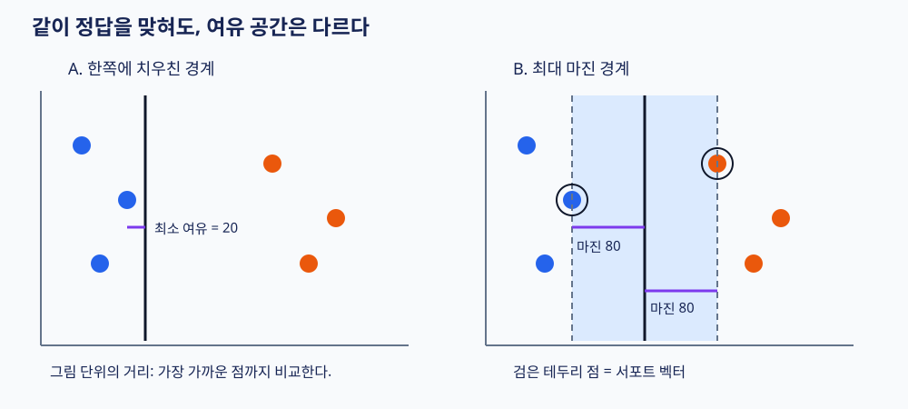
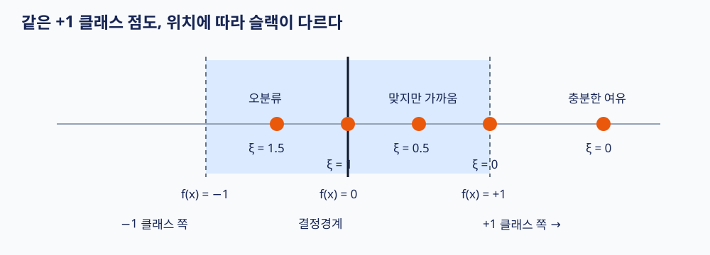
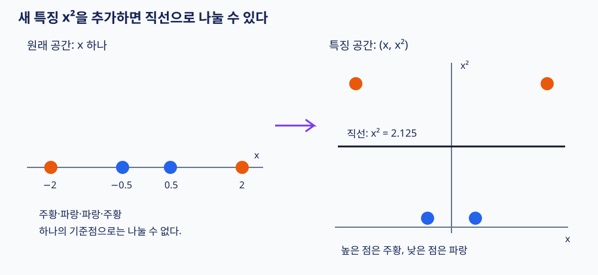

# 머신러닝 8강 — SVM과 커널법

> **대상:** 머신러닝 강의를 처음 듣는 학습자  
> **바탕:** 사용자가 제공한 8강 학습개요·학습목표·정리하기  
> **사용법:** 처음에는 1~8절과 그림을 읽고, 두 번째에 9~12절의 수식을 읽으세요. 마지막 복습 문제는 책을 덮고 풀어보세요.  
> 강의 영상과 교재 전체를 확인한 문서는 아닙니다. 제공된 요약을 바탕으로 개념을 풀고, 오해하기 쉬운 표현을 보완했습니다. 예제와 그림은 설명을 위해 직접 구성했습니다.

## 먼저 이번 강의를 한 문장으로

**SVM은 두 집단 사이에 가능한 한 넓은 ‘안전거리’를 두는 분류 기준을 배우고, 커널법은 원래 공간에서 휘어진 경계가 필요한 문제도 다룰 수 있게 해주는 방법입니다.**

강의는 다음 순서로 이해하면 됩니다.

```text
두 종류를 나누고 싶다
  → 직선으로 나누자: 선형 분류기
  → 가능한 직선이 여럿이다: 어느 직선이 좋을까?
  → 가장 가까운 점과도 여유를 두자: 최대 마진 SVM
  → 몇 개의 예외 때문에 직선 분리가 안 된다: 소프트 마진과 슬랙변수
  → 애초에 직선으로 나눌 수 없는 모양이다: 특징 매핑과 커널법
```

## 목차

1. 출발점: 데이터와 분류란 무엇인가
2. 선형 판별함수: 숫자 점수로 두 집단 나누기
3. 일반화 오차와 모델 복잡도
4. 마진과 최대 마진 분류기
5. 서포트 벡터는 무엇을 지탱하는가
6. 하드 마진과 소프트 마진
7. 슬랙변수를 위치별로 이해하기
8. C: 여유와 위반 사이의 균형
9. SVM 수식의 뜻을 차근차근 읽기
10. 학습 과정: Q(α), 라그랑주 승수, 이차계획법
11. 학습이 끝난 뒤 새 데이터를 분류하기
12. 커널법: 특징을 바꾸면 보이는 것이 달라진다
13. 자주 쓰는 커널과 조절값
14. 다중 클래스 분류와 실제 사용 순서
15. 강의 요약에서 주의할 표현
16. 시험 직전 요약과 복습 문제

---

## 1. 출발점: 데이터와 분류란 무엇인가

사과와 귤을 구분하는 기계를 만든다고 생각해봅시다. 기계는 ‘사과다!’라는 느낌을 바로 이해하지 못합니다. 그래서 과일의 무게, 색상 점수처럼 측정할 수 있는 숫자를 줍니다.

| 용어 | 쉬운 뜻 | 과일 예시 |
|---|---|---|
| 데이터 한 개, 샘플 | 판단할 대상 하나 | 과일 한 개 |
| 특징 | 판단에 쓰는 측정값 | 무게, 색상 점수 |
| 특징 벡터 x | 특징들을 묶은 숫자 목록 | x = (무게, 색상 점수) |
| 클래스 | 구분하려는 종류 | 사과, 귤 |
| 정답 레이블 y | 실제로 어느 종류인지 표시 | 사과 +1, 귤 −1 |
| 학습 | 정답이 있는 예시로 분류 기준을 찾기 | 과일 자료로 경계 정하기 |
| 예측·인식 | 배운 기준을 새 대상에 적용하기 | 처음 본 과일 분류하기 |

여기서 +1과 −1은 크고 작다는 뜻이 아니라 **두 종류에 붙인 이름표**입니다. 사과를 −1로 정해도 괜찮습니다. 다만 학습과 예측에서 같은 약속을 써야 합니다.

특징이 두 개면 과일 하나를 평면 위의 점 하나로 그릴 수 있습니다. 가로축을 무게, 세로축을 색상 점수로 정하면 됩니다. 이제 분류는 ‘점들을 어떤 선으로 나눌 것인가’라는 문제로 바뀝니다.

## 2. 선형 판별함수: 숫자 점수로 두 집단 나누기

기계가 다음 식으로 점수를 계산한다고 합시다.

$$
f(x)=w^T x+b
$$

기호가 낯설면 특징이 두 개인 식으로 풀어보세요.

$$
f(x)=w_1x_1+w_2x_2+b
$$

| 기호 | 읽는 법과 뜻 |
|---|---|
| x₁, x₂ | 입력 특징 두 개 |
| w₁, w₂ | 각 특징에 곱하는 가중치 |
| wᵀx | 같은 위치끼리 곱해서 모두 더하라는 뜻, 즉 내적 |
| b | 기준을 이동시키는 절편, 강의의 w₀에 해당 |
| f(x) | 분류에 쓰는 점수 |

분류 규칙은 단순합니다.

```text
f(x) > 0 → +1 클래스
f(x) < 0 → −1 클래스
f(x) = 0 → 결정경계 위; 구현에서 동점 처리 규칙이 필요
```

예를 들어 이미 학습한 식이 `f(x)=2x₁+x₂−5`라고 해봅시다. 단위를 조정해 둔 가상의 특징값을 사용하겠습니다.

| 새 입력 x | 점수 계산 | 예측 |
|---|---|---|
| (2, 3) | 2×2 + 3 − 5 = 2 | +1 |
| (1, 1) | 2×1 + 1 − 5 = −2 | −1 |

**f(x)=0인 위치들의 집합이 결정경계**입니다. 위 예에서는 `2x₁+x₂−5=0`이라는 직선입니다. 가중치 w는 경계가 향하는 방향을 정하고, b는 경계의 위치를 조절합니다.

특징이 1개면 경계는 점, 2개면 직선, 3개면 평면입니다. 더 많은 차원에서는 이를 ‘초평면’이라고 부릅니다. 무서운 말이지만, **여러 특징 공간에서 두 쪽을 나누는 평평한 경계**라는 뜻입니다.

> ‘선형’은 입력 특징의 가중합으로 경계를 만든다는 뜻입니다. b가 있어도 머신러닝에서는 보통 선형 분류기라고 부릅니다. 점수 자체가 확률인 것은 아닙니다.

## 3. 일반화 오차와 모델 복잡도

### 3.1 학습 자료를 잘 맞히면 끝일까?

시험 대비 문제집의 답만 외운 학생을 생각해봅시다. 문제집 점수는 높지만 숫자가 조금 바뀐 시험 문제에는 약할 수 있습니다.

머신러닝에서도 마찬가지입니다.

- **훈련 오차:** 학습에 사용한 자료에서 틀리는 정도.
- **일반화 오차:** 같은 문제의 새로운 자료에서 틀릴 것으로 기대되는 정도.
- **과다적합:** 훈련 자료의 우연한 잡음이나 예외까지 따라가서 새 자료에 대한 성능이 나빠지는 현상.
- **과소적합:** 규칙이 너무 단순해서 중요한 패턴조차 배우지 못하는 현상.

일반화 오차는 모집단 전체를 알 수 없으므로 보통 직접 알 수 없습니다. 따로 남겨둔 검증·시험 자료의 오차로 추정합니다.

### 3.2 복잡할수록 무조건 좋은가?

| 모델 상태 | 훈련 자료 | 새 자료에서 생길 수 있는 문제 |
|---|---|---|
| 지나치게 단순 | 중요한 패턴을 놓침 | 과소적합 |
| 적절한 유연성 | 주요 패턴을 학습 | 좋은 일반화 기대 |
| 지나치게 복잡 | 예외까지 따라감 | 과다적합 |

전형적인 개념도는 다음과 같습니다. 실제 실험에서 항상 정확히 U자 모양이 되는 법칙은 아닙니다.

```text
오차
높음 │ 시험/검증 오차  ＼       ／
     │                 ＼___／
     │ 훈련 오차        ＼________
낮음 └──────────────────────────→ 복잡도
        과소적합      적절      과다적합 위험
```

선형 경계는 구불구불한 경계보다 표현력이 제한적입니다. 그렇다고 **선형이면 성능이 나쁘다거나 과다적합이 아예 없다는 뜻은 아닙니다.** 데이터의 구조가 선형에 가깝거나 특징을 잘 만들었다면 매우 좋은 성능을 낼 수 있습니다. 특징 수가 아주 많고 자료가 적으면 선형 모델도 과다적합할 수 있습니다.

SVM은 이 문제에 대해 **‘자료를 맞히되, 경계 주변에 충분한 여유를 확보하자’**라는 원칙을 사용합니다. 마진은 일반화와 연결되는 중요한 단서지만, 큰 마진이 실제 시험 오차의 최솟값을 보장하는 것은 아닙니다.

## 4. 마진과 최대 마진 분류기

### 4.1 정답을 맞히는 직선은 하나가 아니다

파란 점들이 왼쪽, 주황 점들이 오른쪽에 모여 있다고 해봅시다. 두 무리 사이를 지나는 여러 직선이 모두 훈련 자료를 맞힐 수 있습니다.

그중 한 선이 파란 점 바로 옆을 스친다면 어떨까요? 측정값이 조금만 달라져도 그 점이 반대편으로 넘어갈 수 있습니다. 반면 양쪽 점에서 여유를 둔 선은 작은 변화에 더 버틸 수 있습니다.



**그림 읽기:** 두 그림은 같은 배치를 옆으로 옮겨 그린 것입니다. A는 가장 가까운 점까지 거리가 20이고, B는 양쪽에서 각각 80입니다. 이 거리는 설명용 그림 단위입니다. B의 점선 두 개 사이가 ‘도로’라면, 실선은 중앙선입니다.

### 4.2 마진은 가장 가까운 점을 기준으로 한다

하드 마진 상황에서 **결정경계와 가장 가까운 훈련 점 사이의 수직거리**를 한쪽 마진이라고 부르겠습니다.

평균 거리가 아닙니다. 멀리 있는 점이 100개여도, 딱 하나가 경계 바로 옆에 붙어 있으면 최소 여유는 작습니다.

**최대 마진 분류기**는 모든 점을 올바르게 나누는 경계 중에서 이 최소 거리를 가장 크게 만드는 경계를 찾습니다. 이것이 하드 마진 SVM의 기본 생각입니다.

> 책에 따라 ‘마진’을 한쪽 거리로 부르거나 양쪽 마진 경계 사이의 전체 폭으로 부릅니다. 본문에서는 한쪽 거리를 마진, 양쪽 간격을 전체 폭이라고 구분합니다.

## 5. 서포트 벡터는 무엇을 지탱하는가

벡터는 여기서 ‘특징값을 묶은 데이터 한 개’입니다. 서포트 벡터는 **학습된 경계를 결정하는 데 직접 기여하는 훈련 샘플**입니다.

하드 마진에서는 보통 마진 경계에 닿는 점을 떠올리면 됩니다. 그림의 검은 테두리 점입니다. 도로의 양옆을 받치는 말뚝처럼, 이 점들이 경계의 위치와 방향에 제약을 줍니다.

멀리 떨어진 일반 점은 조금 움직여도 경계가 그대로일 수 있습니다. 반면 마진을 지탱하는 점이 움직이면 경계가 달라질 수 있습니다. 다만 서포트 벡터 하나를 바꾸거나 지운다고 언제나 경계가 달라지는 것은 아닙니다. 다른 점이 같은 제약을 제공할 수도 있습니다.

**소프트 마진까지 포함한 정확한 기준은 학습된 계수 αᵢ가 0보다 큰 점**입니다. 이 경우 마진 경계 위뿐 아니라 마진 안쪽의 점과 오분류된 점도 서포트 벡터가 될 수 있습니다.

## 6. 하드 마진과 소프트 마진

### 6.1 하드 마진: 예외 없이 모두 맞혀라

하드 마진은 모든 훈련 점을 올바르게 분류하고, 각 점이 정해진 마진 바깥이나 경계에 있도록 요구합니다.

깨끗하게 직선으로 분리되는 데이터에서는 자연스럽습니다. 하지만 실제 데이터에는 측정 오류, 정답 표기 실수, 집단 간 겹침이 있습니다. 반대편에 점 하나가 섞이면 완벽한 직선 분리 자체가 불가능할 수 있습니다.

### 6.2 소프트 마진: 위반에는 벌점을 주되 허용하자

소프트 마진은 이렇게 요구합니다.

> “넓은 여유를 확보하자. 다만 너무 가까이 들어오거나 반대쪽으로 넘어간 점은 벌점을 내고 허용하자.”

즉, 아무 선이나 긋는 것이 아니라 **마진 확보와 위반 벌점의 합을 줄이는 방향**으로 학습합니다.

| 구분 | 하드 마진 | 소프트 마진 |
|---|---|---|
| 마진 위반 | 허용하지 않음 | 벌점을 주고 허용 |
| 직선 분리 불가능한 자료 | 제약을 만족하는 해가 없음 | 학습 가능 |
| 예외·잡음 | 민감할 수 있음 | C로 대응 정도를 조절 |

소프트 마진이 있다고 선형 경계가 원형이나 곡선으로 변하는 것은 아닙니다. **경계 모양의 한계와, 일부 위반을 허용하는 것은 별개**입니다. 모양 자체를 바꾸는 이야기가 뒤의 커널법입니다.

## 7. 슬랙변수를 위치별로 이해하기

슬랙변수는 그리스 문자 ξ(크시)로 쓰고, i번째 점의 값은 ξᵢ라고 씁니다.

**슬랙변수는 각 점이 ‘정답 쪽으로 충분히 떨어져 있어야 한다’는 조건을 얼마나 위반했는지 나타내는 값입니다.** 틀린 점에만 생기는 값이 아닙니다.



그림의 모든 주황 점은 실제 정답이 +1입니다. 오른쪽이 +1 예측 영역이고, 가운데 실선이 결정경계입니다. 같은 클래스의 점이라도 위치에 따라 슬랙이 달라집니다.

분류 점수에 정답 부호를 곱한 `yᵢf(xᵢ)`를 보면 두 클래스를 같은 기준으로 설명할 수 있습니다.

- 양수면 부호가 일치하므로 맞힌 것입니다.
- 음수면 부호가 다르므로 틀린 것입니다.
- 1 이상이면 정답 쪽으로 충분한 여유까지 확보한 것입니다.

표준 소프트 마진 목적함수에서, 주어진 w와 b에 대한 최소 슬랙은 다음과 같습니다.

$$
\xi_i=\max(0,\;1-y_i f(x_i))
$$

`max`는 둘 중 큰 값을 고르라는 뜻입니다. 위반이 없으면 0, 있으면 부족한 만큼입니다.

| yᵢf(xᵢ) | 최소 ξᵢ | 점의 상태 |
|---:|---:|---|
| 1.8 | 0 | 정답, 마진 밖 |
| 1 | 0 | 정답, 마진 경계 위 |
| 0.5 | 0.5 | 정답이지만 마진 안쪽 |
| 0 | 1 | 결정경계 위 |
| −0.5 | 1.5 | 오분류 |
| −2 | 3 | 반대편으로 더 크게 넘어간 오분류 |

**암기 기준:** `0 < ξ < 1`은 맞혔지만 여유 부족, `ξ = 1`은 결정경계, `ξ > 1`은 오분류입니다. 이는 최소 슬랙값을 기준으로 한 해석입니다.

### 슬랙은 그냥 센티미터 거리인가?

아닙니다. ξ는 **정규화된 점수 기준의 마진 위반량**입니다. 최소 슬랙이 양수일 때 해당 클래스의 마진 경계까지 수직으로 부족한 실제 거리는 `ξᵢ / ‖w‖`입니다. 따라서 강의의 ‘잘못 분류된 데이터로부터 경계까지 거리’라는 표현은 직관을 위한 축약으로 읽어야 합니다.

## 8. C: 여유와 위반 사이의 균형

소프트 마진에는 C라는 양의 조절값이 있습니다. C는 데이터마다 학습되는 슬랙과 달리, 학습 전에 정하고 검증 자료로 고르는 **하이퍼파라미터**입니다.

| 설정 | 벌점에 대한 태도 | 흔히 보이는 경향 |
|---|---|---|
| C가 큼 | 위반 하나하나를 무겁게 벌줌 | 훈련 위반을 줄이려 함, 잡음에 민감해질 수 있음 |
| C가 작음 | 위반 벌점의 비중이 작음 | 더 많은 위반을 감수하며 큰 마진을 선호, 너무 작으면 과소적합 가능 |

“C가 크면 무조건 좋다”도, “작으면 무조건 일반화가 좋다”도 아닙니다. 같은 특징 표현과 같은 목적함수 정의 안에서의 비교이며, 적절한 값은 검증으로 골라야 합니다.

> **슬랙 ξ:** 학습 결과 각 점이 얼마나 조건을 위반하는가.  
> **C:** 그 위반을 학습할 때 얼마나 비싸게 취급할 것인가.

## 9. SVM 수식의 뜻을 차근차근 읽기

이 절은 두 번째 읽을 때 천천히 보아도 됩니다. 수학의 목적은 앞의 ‘도로 넓히기’를 정확하게 적는 것입니다.

### 9.1 거리와 점수를 구별하자

점 x에서 결정경계까지 수직거리는 다음과 같습니다.

$$
\frac{|w^Tx+b|}{\|w\|}
$$

`| |`는 절댓값, `‖w‖`는 가중치 벡터의 길이입니다. 특징 두 개라면 `‖w‖=√(w₁²+w₂²)`입니다.

왜 나눌까요? `f(x)=2x₁+x₂−5`를 통째로 10배 해도 경계와 분류는 같습니다. 그런데 점수는 10배가 됩니다. 거리까지 10배가 되어서는 안 됩니다. 분모의 ‖w‖도 10배가 되므로 이 효과가 상쇄됩니다.

### 9.2 하드 마진의 식

분리 가능한 경우 가장 가까운 점의 정답 방향 점수가 1이 되도록 식의 크기를 맞추면, 두 마진 경계는 다음과 같습니다.

$$
w^Tx+b=+1,\qquad w^Tx+b=-1
$$

결정경계는 여전히 0입니다. 따라서:

$$
\text{한쪽 마진}=\frac{1}{\|w\|},\qquad
\text{전체 폭}=\frac{2}{\|w\|}
$$

마진을 키우려면 ‖w‖를 줄이면 됩니다. 이를 계산하기 편한 형태로 쓰면:

$$
\min_{w,b}\frac12\|w\|^2
\quad\text{단, 모든 }i\text{에 대해 }y_i(w^Tx_i+b)\ge1
$$

`min`은 가장 작게 만드는 값을 찾으라는 뜻입니다. 뒤의 조건은 ‘모든 점을 올바른 쪽 마진 경계 이상으로 보내라’입니다. 조건 없이 w만 줄이면 쓸모없는 분류기가 되므로 **목표와 제약을 함께** 읽어야 합니다.

### 9.3 소프트 마진의 식

$$
\min_{w,b,\xi}\underbrace{\frac12\|w\|^2}_{\text{마진 확보}}
+\underbrace{C\sum_{i=1}^{N}\xi_i}_{\text{위반 벌점}}
$$

$$
\text{단, }y_i(w^Tx_i+b)\ge1-\xi_i,\qquad\xi_i\ge0
$$

N은 전체 훈련 샘플 수이고, Σ는 모두 더하라는 기호입니다. 첫 항은 큰 마진을 원하고, 둘째 항은 작은 위반을 원합니다. 두 요구가 충돌할 때 C가 균형을 정합니다.

ξ를 앞 절의 최소값으로 대체하면 `max(0,1−yf(x))`가 나타납니다. 이를 **힌지 손실**이라고 합니다. ‘정답 여부뿐 아니라 충분한 여유까지 평가하는 벌점’이라고 이해하면 됩니다.

## 10. 학습 과정: Q(α), 라그랑주 승수, 이차계획법

강의의 학습 절차는 처음부터 외우면 어렵습니다. 먼저 각 용어의 역할을 보겠습니다.

| 어려운 말 | 이 강의에서의 역할 |
|---|---|
| 최적화 | 조건을 지키면서 가장 좋은 숫자 조합 찾기 |
| 목적함수 | 좋고 나쁨을 하나의 숫자로 평가하는 식 |
| 라그랑주 승수 αᵢ | 각 점의 제약과 연결된 계수; 최종 경계를 표현할 때 그 점의 기여 정도로 등장 |
| 쌍대 문제 | w를 직접 찾는 문제를 α를 찾는 동등한 최적화 문제로 바꾼 형태 |
| 이차계획법 | 제곱·곱 항이 있는 목적함수를 선형 제약 아래 최적화하는 방법 |

α는 사람이 정하는 중요도 점수가 아니라 **전체 최적화 문제를 풀어서 얻는 값**입니다. α가 크다는 이유만으로 오분류나 확률을 바로 알 수 있는 것은 아닙니다.

### 10.1 강의의 Q(α)를 최소화 형태로 쓰기

표준 소프트 마진 SVM의 쌍대 목적함수를 다음과 같이 쓸 수 있습니다.

$$
\min_\alpha Q(\alpha)
=\frac12\sum_{i=1}^{N}\sum_{j=1}^{N}
\alpha_i\alpha_j y_i y_j(x_i^Tx_j)-\sum_{i=1}^{N}\alpha_i
$$

조건은 다음과 같습니다.

$$
0\le\alpha_i\le C,\qquad \sum_{i=1}^{N}\alpha_i y_i=0
$$

하드 마진에서는 `αᵢ ≤ C`라는 상한이 없어집니다. **교재에 따라 Q의 부호를 반대로 정의하고 최대화하기도 합니다.** 위 식 전체에 −1을 곱해 최대화하면 같은 해를 찾습니다. 원문 Q의 실제 식이 제공되지 않았으므로 강의의 기호 정의가 정확히 같은지는 교재에서 확인해야 합니다.

처음에는 이 긴 식을 암산할 필요가 없습니다. 핵심은 **훈련 점끼리의 내적 xᵢᵀxⱼ만으로 α를 찾을 수 있다**는 것입니다. 이 구조가 커널법으로 연결됩니다.

### 10.2 학습 절차를 쉬운 말로 번역하기

1. **정답이 있는 예시를 준비한다.** xᵢ와 yᵢ를 모으고 특징의 단위를 맞춘다.
2. **Q(α)와 제약을 구성한다.** 어떤 계수 조합이 좋은지, 허용 범위는 무엇인지 정한다.
3. **최적화 도구로 α를 찾는다.** 실무에서는 SMO 같은 전용 풀이 방법도 쓴다.
4. **αᵢ가 0보다 큰 점을 찾는다.** 이 점들이 서포트 벡터다. 실제 수치 계산에서는 작은 오차를 감안한다.
5. **절편 b, 즉 강의의 w₀를 구한다.** 마진 경계 조건 등을 이용한다.
6. **예측에 필요한 값을 저장한다.** 서포트 벡터, 레이블, 계수, 절편과 전처리 기준을 저장한다. 커널을 썼다면 종류와 설정도 저장한다.

선형 SVM에서는 다음처럼 w를 복원할 수 있습니다.

$$
w=\sum_i\alpha_i y_i x_i
$$

소프트 마진에서 `0 < αₛ < C`인 서포트 벡터는 `yₛf(xₛ)=1`을 만족하므로:

$$
b=y_s-w^Tx_s
$$

여러 개면 수치 안정성을 위해 평균을 사용할 수 있습니다. 그런 점이 없으면 이 식을 아무 점에나 쓰지 않고, 최적화 조건이 정하는 b의 범위 등을 이용합니다.

> ‘아무 서포트 벡터나 골라 b를 계산한다’는 설명은 소프트 마진에서는 주의해야 합니다. 마진 안쪽이나 오분류된 서포트 벡터는 위 등식을 만족하지 않을 수 있습니다.

## 11. 학습이 끝난 뒤 새 데이터를 분류하기

예측할 때는 최적화 문제를 다시 풀지 않습니다. 저장한 분류 식에 새 데이터를 넣으면 됩니다.

$$
f(x)=\sum_{i\in SV}\alpha_i y_i(x_i^Tx)+b
$$

SV는 서포트 벡터들의 인덱스 집합입니다. α가 0인 점은 더해도 0이므로 빠집니다. 선형인 경우 미리 계산한 `wᵀx+b`를 써도 같은 결과입니다.

### 손으로 끝까지 따라가는 1차원 예제

훈련 자료가 다음 네 점이라고 해봅시다.

| x | −3 | −1 | +1 | +3 |
|---|---:|---:|---:|---:|
| 정답 y | −1 | −1 | +1 | +1 |

하드 마진 최적 경계는 `x=0`이고, 정규화한 식은 `f(x)=x`입니다. 가장 가까운 −1, +1이 서포트 벡터이고 한쪽 마진은 1입니다.

이 예에서는 두 서포트 벡터의 계수를 각각 `α=0.5`로 둘 수 있습니다. 다른 두 점의 계수는 0입니다.

$$
w=0.5\times(-1)\times(-1)+0.5\times(+1)\times(+1)=1
$$

절편은 `b=1−1×1=0`입니다. 새 입력 `x=0.4`가 오면:

$$
f(0.4)=0.5(-1)(-1\times0.4)+0.5(+1)(1\times0.4)=0.4
$$

양수이므로 +1로 분류합니다. `x=−0.8`이면 점수가 −0.8이므로 −1입니다. 여기서 **새 점이 훈련 때의 마진 안쪽에 있어도 예측은 가능합니다.** 예측에는 기본적으로 점수의 부호를 씁니다.

## 12. 커널법: 특징을 바꾸면 보이는 것이 달라진다

### 12.1 직선으로 나눌 수 없는 구조

다음 자료를 생각해봅시다.

| 입력 x | −2 | −0.5 | +0.5 | +2 |
|---|---:|---:|---:|---:|
| 정답 | +1 | −1 | −1 | +1 |

가운데가 −1이고 양끝이 +1입니다. 1차원에서 선형 분류기는 기준점 하나로 왼쪽과 오른쪽을 나눕니다. 기준점 하나로 양끝을 같은 클래스로 묶고 가운데만 다른 클래스로 만들 수는 없습니다.

### 12.2 새 특징을 추가하자

입력 x를 다음처럼 바꿉니다.

$$
\Phi(x)=(x,x^2)
$$

Φ는 ‘특징을 바꾸는 규칙’이라는 뜻입니다. 실제 데이터가 물리적으로 이동하는 것이 아니라, **표현에 새로운 좌표를 추가**하는 것입니다.

| x | 새 표현 Φ(x) | 정답 |
|---:|---|---:|
| −2 | (−2, 4) | +1 |
| −0.5 | (−0.5, 0.25) | −1 |
| +0.5 | (+0.5, 0.25) | −1 |
| +2 | (+2, 4) | +1 |



이제 두 클래스의 높이 x²이 각각 4와 0.25입니다. **특징 공간에서는 높이 2.125의 수평 직선**으로 완벽하게 분리할 수 있습니다. 이 예에서는 두 높이의 중간이므로 하드 마진의 최대 여유 경계이기도 합니다.

원래 입력으로 표현하면 경계는 `x²=2.125`, 즉 `x≈−1.458`과 `x≈+1.458` 두 지점입니다. 원래 x에 대한 선형 규칙 하나로는 못 하던 분류가 가능해졌습니다.

이 원리를 2차원으로 확장하면 원 모양으로 둘러싸인 점들도 `(x₁,x₂,x₁²+x₂²)`처럼 표현해 높이 방향으로 분리할 수 있습니다. 특징 공간의 평면이 원래 공간에서는 원형 경계로 보일 수 있는 것입니다.

### 12.3 그럼 특징을 무한히 만들면 될까?

특징을 많이 만들면 직접 저장하고 내적하는 비용이 커집니다. 또 특징을 늘린다고 모든 문제가 잘 풀리거나 일반화가 저절로 좋아지지는 않습니다.

그런데 SVM의 쌍대 학습 식과 예측 식에는 입력이 **내적 형태**로 나타났습니다. 특징을 바꾼 뒤에도 필요한 것은 결국 다음 값입니다.

$$
\Phi(x)^T\Phi(z)
$$

커널 함수는 이 값을 바로 계산합니다.

$$
k(x,z)=\Phi(x)^T\Phi(z)
$$

**고차원 좌표들을 전부 펼쳐 만들지 않고, 그 공간에서의 내적 결과를 직접 구하는 것이 커널 트릭**입니다. 커널값은 두 입력의 관계를 나타내는 가중된 비교 점수로 볼 수 있지만, 모든 커널이 0~1 유사도인 것은 아닙니다.

### 12.4 숫자로 커널 트릭 확인하기

간단한 다항식 커널을 골라봅시다.

$$
k(x,z)=(xz+1)^2
$$

이를 전개하면:

$$
(xz+1)^2=x^2z^2+2xz+1
$$

이는 다음 특징 매핑의 내적과 같습니다.

$$
\Phi(x)=(x^2,\sqrt2x,1)
$$

예를 들어 x=2, z=3이라면:

- 직접 매핑: `(4, 2√2, 1) · (9, 3√2, 1) = 36+12+1 = 49`.
- 커널 계산: `(2×3+1)² = 49`.

결과는 같습니다. **커널은 다른 문제를 근사해서 푸는 요령이 아니라, 해당 특징 공간의 내적을 다른 계산 경로로 얻는 방법**입니다. 여기의 Φ는 앞의 분리 그림에 쓴 `(x,x²)`와 다른 예시입니다.

임의의 함수에 커널이라는 이름을 붙인다고 모두 유효한 내적이 되는 것은 아닙니다. 표준 이론의 커널은 대칭이고, 임의의 유한한 입력들로 만든 커널 행렬이 양의 준정부호라는 조건을 만족해야 합니다. 처음에는 ‘내적에 해당하는 함수여야 한다’까지만 이해해도 충분합니다.

### 12.5 커널 SVM은 학습과 예측이 어떻게 달라지나?

10절의 Q(α)에서 **xᵢᵀxⱼ를 k(xᵢ,xⱼ)로 바꿉니다.** 나머지 계수 제약은 같습니다.

예측도 다음처럼 바뀝니다.

$$
f(x)=\sum_{i\in SV}\alpha_i y_i k(x_i,x)+b
$$

```text
학습: 훈련 점 사이의 커널값 → α와 b 찾기 → 서포트 벡터와 설정 저장
예측: 새 점과 각 서포트 벡터의 커널값 → αᵢyᵢ로 가중합 → b 더하기 → 부호로 분류
```

특징 공간에서는 `wΦ = ΣαᵢyᵢΦ(xᵢ)`라는 선형 분류기입니다. 다만 wΦ나 Φ를 직접 저장하지 않고 커널값으로 예측할 수 있습니다. **선형인 공간은 특징 공간이고, 원래 입력 공간의 경계는 비선형일 수 있습니다.**

커널 트릭은 고차원 특징의 명시적 계산 부담을 줄이지만, 모든 계산 비용을 없애지는 않습니다. 훈련 점이 N개면 점 쌍은 N²개이므로, 커널 행렬을 다루는 비용이 커질 수 있습니다. 구현에 따라 일부만 계산·캐시하기도 합니다.

## 13. 자주 쓰는 커널과 조절값

다음 식의 x와 z는 비교할 두 입력입니다.

| 커널 | 대표 식 | 직관·주의점 |
|---|---|---|
| 선형 | k(x,z)=xᵀz | 원래 특징에서 선형 경계를 사용 |
| 다항식 | k(x,z)=(γxᵀz+r)ᵈ | 특징의 곱과 거듭제곱 관계를 반영; d는 차수 |
| 가우시안·RBF | k(x,z)=exp(−γ‖x−z‖²) | 가까운 점은 큰 값, 먼 점은 작은 값 |
| 시그모이드 | k(x,z)=tanh(γxᵀz+r) | 신경망 활성함수와 닮은 형태; 매개변수에 따라 유효한 내적 커널이 아닐 수 있음 |

다항식은 보통 양의 정수 d와 적절한 γ, r을 사용합니다. RBF는 γ>0을 사용합니다. tanh는 결과가 −1과 +1 사이로 포화되는 함수입니다. 이름과 ‘입력 간 비교 방식이 달라진다’는 점부터 익히세요.

### RBF의 γ(감마)

γ는 **거리 차이에 얼마나 민감하게 반응할지** 정합니다.

- γ가 작으면 먼 점까지 비교적 큰 커널값을 가지므로 영향 범위가 넓습니다. 경계가 완만해지는 경향이 있습니다.
- γ가 크면 아주 가까운 점에만 큰 커널값을 줍니다. 개별 점 주변의 세밀한 패턴을 따라가며 과다적합할 수 있습니다.

거리 1인 두 점에 대해 γ=0.1이면 `exp(−0.1)≈0.905`, γ=10이면 `exp(−10)≈0.000045`입니다. 같은 거리인데 가까운 이웃으로 취급하는 정도가 크게 달라집니다.

**C와 γ는 다른 역할입니다.** C는 마진 위반의 벌점, γ는 RBF가 거리를 바라보는 범위입니다. 경계의 실제 모양은 두 값과 데이터가 함께 결정합니다.

RBF는 통상 무한 차원 특징 공간의 내적으로 해석됩니다. 그 좌표를 실제로 전부 만드는 것은 아닙니다. 또한 선형 커널처럼 차원을 늘리지 않는 커널도 있으므로, ‘커널은 언제나 차원 증가’라고 외우지는 마세요.

## 14. 다중 클래스 분류와 실제 사용 순서

### 14.1 세 종류 이상이면?

이번에 배운 기본 SVM 분류는 두 클래스를 나눕니다. 고양이·개·토끼처럼 여러 클래스는 이진 분류기를 묶어서 처리할 수 있습니다.

| 방법 | 세 클래스 예시 | K개 클래스일 때 |
|---|---|---:|
| 1대 나머지, OvR | 고양이 대 나머지, 개 대 나머지, 토끼 대 나머지 | K개 분류기 |
| 1대1, OvO | 고양이 대 개, 고양이 대 토끼, 개 대 토끼 | K(K−1)/2개 분류기 |

OvR은 보통 각 클래스에 대한 판별 점수를 비교하고, OvO는 쌍별 투표 등을 종합합니다. 동점이나 점수 처리 방식은 구현에 따라 다릅니다. ‘모든 다중 클래스 SVM이 한 방식만 쓴다’고 생각하지 않으면 됩니다.

### 14.2 특징의 단위를 맞춰야 하는 이유

무게는 수백 단위, 색상 점수는 0~1이라면 수치 범위가 큰 무게가 거리 계산을 지배할 수 있습니다. SVM은 마진과 거리를 사용하므로 특징 스케일의 영향을 받습니다.

대표적으로 각 특징에서 평균을 빼고 표준편차로 나누는 표준화를 사용합니다. **평균과 표준편차는 훈련 자료에서만 계산하고**, 검증·시험·새 입력에는 그 기준을 그대로 적용해야 합니다. 전체 자료에서 미리 계산하면 시험 정보가 학습에 섞일 수 있습니다.

### 14.3 실제 작업 순서

1. 특징 x와 정답 y를 준비하고, 누락·정답 오류 등을 확인한다.
2. 훈련·검증·시험 자료를 나눈다. 같은 사람이나 미래 정보가 양쪽에 섞이지 않도록 문제에 맞춰 분할한다.
3. 훈련 자료에서 전처리 기준을 배우고 다른 자료에도 동일하게 적용한다.
4. 선형 또는 커널 SVM을 학습한다.
5. 검증 자료나 교차검증으로 C와 커널 설정을 고른다. 교차검증 때도 각 훈련 부분에서 전처리를 배운다.
6. 선택을 마친 뒤 시험 자료로 최종 성능을 평가한다.
7. 실제 예측에서는 저장한 전처리와 분류기를 함께 적용한다.

## 15. 강의 요약에서 주의할 표현

| 강의의 축약 표현 | 이해할 때 덧붙일 내용 |
|---|---|
| 선형 분류기는 성능이 좋기 힘들다 | 데이터와 특징에 따라 선형 모델도 매우 좋을 수 있다. |
| 선형 분류기는 과다적합을 피한다 | 복잡도를 제한하는 장점은 있지만 과다적합이 불가능한 것은 아니다. |
| SVM은 일반화 오차를 최소화한다 | 마진과 벌점이라는 학습 원칙을 최적화한다. 실제 일반화 오차의 최솟값을 직접 보장하지 않는다. |
| 서포트 벡터는 결정경계에 가장 가까운 점 | 하드 마진의 직관이다. 소프트 마진에서는 αᵢ>0인 마진 안쪽·오분류 점도 포함된다. |
| 슬랙은 잘못 분류된 점의 거리 | 정답이어도 여유가 부족하면 양수다. 원래 거리 자체가 아니라 점수 기준의 위반량이다. |
| 슬랙이 크면 오분류를 더 허용한다 | 한 점의 위반 정도가 크다는 뜻이다. 전체 위반을 얼마나 벌줄지는 C가 조절한다. |
| 커널은 고차원으로 올려 계산량 문제를 해결한다 | 명시적 특징 계산을 피한다. 표본 수에 따른 학습 비용은 여전히 크며, 항상 분리 가능해지는 것도 아니다. |
| SVM은 선형 분류기다 | 선형 SVM은 입력 공간에서 선형이다. 커널 SVM은 특징 공간에서 선형이고 입력 공간에서는 비선형일 수 있다. |

## 16. 시험 직전 요약과 복습 문제

### 16.1 핵심 용어 사전

| 용어 | 한 문장 설명 |
|---|---|
| 판별함수 | 입력을 분류 점수로 바꾸는 함수 |
| 결정경계 | 두 클래스의 예측이 바뀌는 위치, 기본 SVM에서는 f(x)=0 |
| 마진 경계 | 정규화한 점수가 ±1인 위치 |
| 마진 | 결정경계에서 마진 경계까지의 거리; 하드 마진에서는 가장 가까운 훈련 점까지의 거리 |
| 서포트 벡터 | αᵢ>0으로 경계 표현에 기여하는 훈련 점 |
| 슬랙변수 ξᵢ | i번째 점의 마진 조건 위반량 |
| C | 위반 벌점의 비중을 정하는 조절값 |
| αᵢ | 쌍대 최적화로 구하는 각 점의 계수 |
| b, w₀ | 경계의 위치를 조정하는 절편 |
| Φ(x) | 입력을 새로운 특징 표현으로 바꾸는 규칙 |
| 커널 k(x,z) | 특징 공간에서의 내적 Φ(x)ᵀΦ(z)를 계산하는 함수 |

### 16.2 네 가지 학습목표에 답해보기

**① 복잡도와 일반화 오차의 관계는?**  
너무 단순하면 과소적합, 지나치게 유연하면 과다적합 위험이 있다. 훈련 오차만 보지 말고 검증 자료로 적절한 복잡도를 선택해야 한다.

**② SVM은 무엇을 어떻게 배우고 분류하는가?**  
마진을 크게 하고 위반 벌점을 줄이는 최적화로 경계를 배운다. 쌍대 형태에서는 α와 서포트 벡터, 절편을 구하고, 새 입력의 판별 점수 부호로 분류한다.

**③ 슬랙변수는 무엇인가?**  
각 훈련 점이 정답 쪽의 마진 조건을 위반하는 정도다. 오분류뿐 아니라 정답이어도 경계에 너무 가까운 점에 양수가 생긴다.

**④ 커널법은 어떻게 적용되는가?**  
입력 간 내적을 특징 공간의 내적에 해당하는 커널로 바꾼다. 고차원 좌표를 직접 계산하지 않고 학습과 예측을 수행하여 원래 공간의 비선형 경계를 만들 수 있다.

### 16.3 스스로 풀어보기

1. f(x)=3x₁−x₂−2일 때 x=(2,1)의 예측 클래스는?
2. 같은 자료를 모두 맞히는 경계가 여러 개면 하드 마진 SVM은 무엇을 기준으로 고르는가?
3. ‘서포트 벡터는 언제나 정답으로 분류된 점이다’는 참인가?
4. yᵢf(xᵢ)=0.3이면 최소 슬랙은? 이 점은 오분류인가?
5. yᵢf(xᵢ)=−0.4이면 최소 슬랙은?
6. C를 크게 하면 마진 위반의 벌점은 커지는가, 작아지는가?
7. 원래 공간에서 곡선으로 나뉘면 특징 공간에서도 반드시 곡선이어야 하는가?
8. 커널 트릭은 정확히 어떤 계산을 생략하는가?
9. k(x,z)=(xz+1)²일 때 x=1, z=2의 커널값은?
10. 클래스가 4개이면 OvR과 OvO에는 각각 몇 개의 이진 분류기가 필요한가?
11. w와 b를 함께 10배 해서 f가 10배 커졌다면, 같은 점에서 같은 결정경계까지의 거리도 10배가 되는가?
12. 커널 SVM의 훈련 정확도가 100%이면 일반화도 보장되는가?

### 16.4 정답과 해설

1. `3×2−1−2=3>0`이므로 +1.
2. 가장 가까운 점까지의 최소 수직거리가 가장 큰 경계를 고른다.
3. 거짓. 소프트 마진에서는 오분류 점도 서포트 벡터가 될 수 있다.
4. `1−0.3=0.7`. 점수가 정답과 같은 부호이므로 정답이지만 마진 안쪽이다.
5. `1−(−0.4)=1.4`. 음의 정답 방향 점수이므로 오분류다.
6. 커진다. 다만 실제 오류 수와 마진의 변화는 데이터와 다른 설정에 따라 달라진다.
7. 아니다. 특징 공간에서 직선·초평면으로 나뉘도록 표현을 바꿀 수 있다.
8. Φ(x)의 좌표를 명시적으로 생성하고 그 벡터끼리 내적하는 과정을 피한다. 내적 결과는 커널로 구한다.
9. `(1×2+1)²=9`.
10. OvR은 4개, OvO는 `4×3/2=6개`.
11. 아니다. 분자와 ‖w‖가 함께 10배 되므로 거리는 그대로다.
12. 아니다. 과다적합 여부와 새 자료의 성능을 별도로 평가해야 한다.

### 16.5 다시 읽을 때 기억할 다섯 문장

1. **SVM은 단지 가르는 선이 아니라, 여유를 확보하는 경계를 배운다.**
2. **마진은 평균 거리가 아니라 가장 가까운 점과의 거리에서 출발한다.**
3. **슬랙은 오분류뿐 아니라 여유 부족에도 생긴다.**
4. **C는 위반 벌점, γ는 RBF의 거리 민감도를 조절한다.**
5. **커널은 특징 공간의 내적을 직접 구해 원래 공간의 비선형 분류를 가능하게 한다.**

---

## 참고 자료와 문서 보관

핵심 설명은 제공된 강의 요약을 바탕으로 작성했습니다. 다음 공식·대학 자료로 수식과 용어를 대조했습니다. 아래는 원문을 옮긴 것이 아니라 추가 확인을 위한 읽을거리입니다.

- [Cornell CS 4/5780 — Lecture 9: SVM](https://www.cs.cornell.edu/courses/cs4780/2023fa/lectures/lecturenote09.html): 최대 마진과 소프트 제약의 기하학적 설명.
- [Cornell CS 4/5780 — Kernels continued](https://www.cs.cornell.edu/courses/cs4780/2023fa/lectures/lecturenote14.html): 커널의 내적 해석과 유효한 커널 조건.
- [scikit-learn 공식 SVM 안내](https://scikit-learn.org/stable/modules/svm.html): 표준 목적함수, 커널 식, 다중 클래스와 전처리 참고.

그림은 같은 위치의 `8강_그림` 폴더 안에 있습니다. 다른 컴퓨터로 옮길 때 **이 Markdown 파일과 8강_그림 폴더를 함께** 복사하면 됩니다. 수식 표시를 지원하는 Markdown 뷰어에서 읽으면 가장 편합니다.
