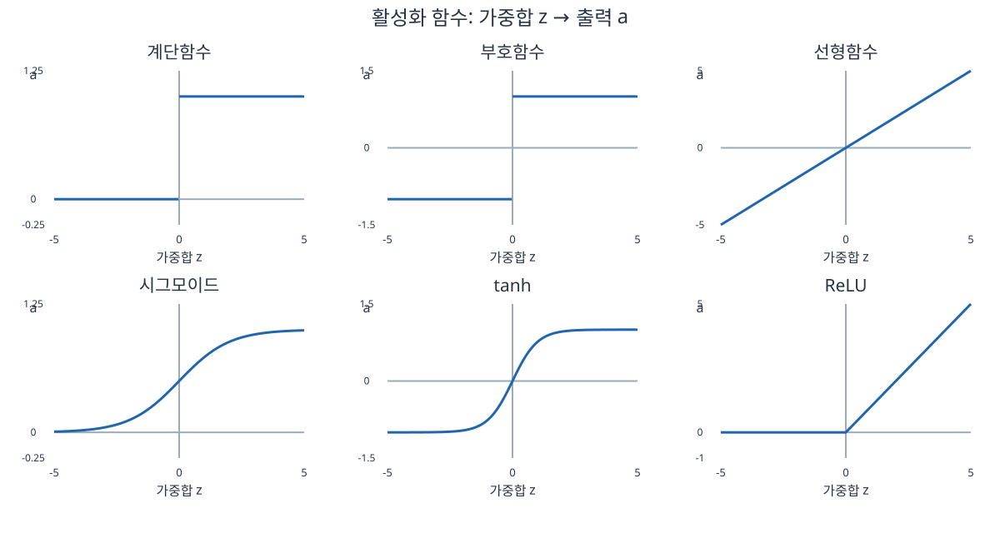
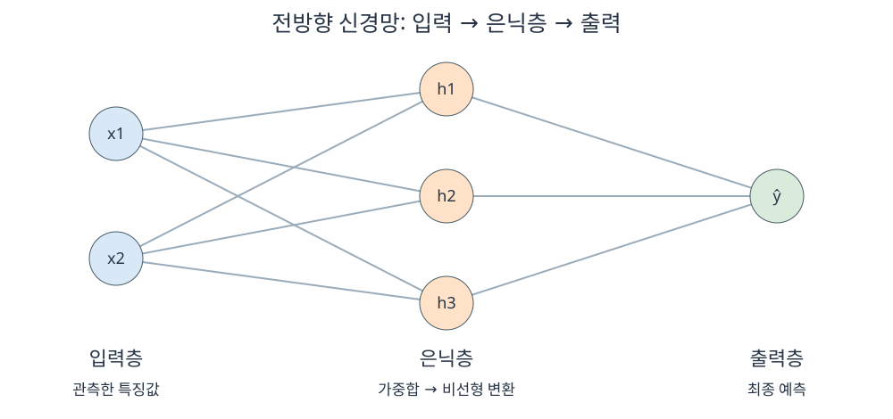
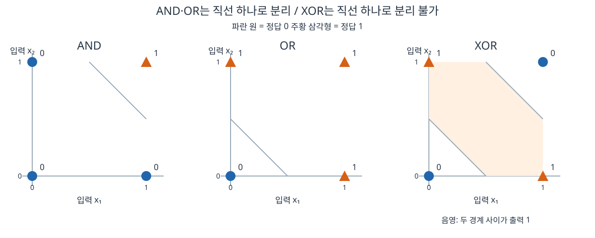

# 머신러닝 9강 — 신경망(1): 처음부터 이해하는 뉴런과 다층 퍼셉트론

> **대상:** 신경망을 처음 배우는 학습자  
> **바탕:** 사용자가 제공한 학습개요·학습목표·정리하기  
> **읽는 법:** 처음에는 수식보다 설명과 그림을 읽으세요. 두 번째에는 계산 예제를 직접 따라 하고, 마지막에는 복습 문제를 풀어보세요.  
> 강의 영상·교재 전체를 확인한 문서는 아닙니다. 제공된 요약을 풀어 설명하고, 오해하기 쉬운 표현에 조건을 덧붙였습니다. 숫자 예제와 그림은 학습용으로 직접 구성했습니다.

## 0. 오늘 수업의 큰 그림

여러분, 먼저 ‘뇌를 모방했다’는 말을 잠시 내려놓읍시다. 실제로 우리가 계산할 것은 **숫자를 입력받아 다른 숫자를 내보내는 함수**입니다.

예를 들어 이메일을 스팸인지 판단한다고 합시다.

- 입력: 광고 단어의 수, 링크의 수 같은 이메일의 특징
- 출력: 스팸인지에 대한 예측
- 학습: 정답이 있는 이메일들을 보고 판단 기준을 조정하는 과정

사람이 모든 판단 규칙을 직접 써 주는 대신, **데이터를 보고 가중치와 편향이라는 숫자를 조정하게 하는 것**입니다.

```text
숫자로 표현한 데이터
    ↓
뉴런 하나: 입력에 중요도를 곱해 더하고 출력으로 변환
    ↓
퍼셉트론: 점수가 기준을 넘는지 판단
    ↓
한계: 직선 하나로 나눌 수 없는 문제는 못 품
    ↓
다층 퍼셉트론: 중간 판단 여러 개를 조합
    ↓
복잡한 비선형 관계도 표현 가능
```

**이번 강의의 중심 질문은 “단순한 계산을 여러 개 연결하면 왜 복잡한 문제를 풀 수 있을까?”입니다.**

## 1. 먼저 알아둘 최소한의 용어

| 용어 | 쉬운 뜻 | 예시 |
|---|---|---|
| 데이터 한 개, 표본 | 판단할 대상 하나 | 이메일 한 통 |
| 특징, feature | 대상을 숫자로 나타낸 항목 | 링크 수, 광고 단어 수 |
| 입력 x | 모델에 넣는 특징값들 | x = (3, 2) |
| 정답 y | 실제로 맞혀야 하는 값 | 정상 0, 스팸 1 |
| 예측 ŷ | 모델이 계산한 답 | 모델이 스팸이라고 판단한 값 |
| 파라미터 | 학습으로 조정하는 모델 내부의 숫자 | 가중치 w, 편향 b |
| 함수 f | 입력을 출력으로 바꾸는 규칙 | ŷ = f(x) |
| 분류 | 범주를 맞히는 문제 | 스팸/정상 |
| 회귀 | 수치를 맞히는 문제 | 집값, 온도 |

`x = (x₁, x₂)`는 어려운 기호가 아닙니다. **한 대상에 관한 숫자 두 개를 묶었다**는 뜻입니다. ŷ는 ‘와이 햇’이라고 읽으며, 정답 y와 구분하기 위해 씁니다.

## 2. 뇌에서 어떤 아이디어를 가져왔을까?

### 2.1 생물학적 뉴런의 단순화된 모습

```text
다른 뉴런에서 오는 신호
    ↓
수상돌기: 신호를 받음
    ↓
세포체 등에서 입력을 통합
    ↓
충분한 조건이 갖춰지면 활동전위 발생
    ↓
축색: 신호를 전달
    ↓
시냅스를 거쳐 다른 뉴런에 영향
```

뉴런들은 혼자 일하지 않습니다. 서로 연결되어 있고, 어떤 연결은 다음 뉴런에 강한 영향을 주고 어떤 연결은 약한 영향을 줍니다. 인공신경망은 여기서 **“여러 입력을 모으고, 연결의 강도에 따라 처리하고, 결과를 다음 단위에 전달한다”**는 아이디어를 가져왔습니다.

| 생물학적 개념 | 인공신경망의 대응 개념 | 이해할 포인트 |
|---|---|---|
| 수상돌기가 받는 신호 | 입력값 x | 여러 정보를 받음 |
| 시냅스의 영향 | 가중치 w | 연결마다 영향이 다름 |
| 입력을 통합하는 과정 | 가중합 | 입력에 가중치를 곱해 더함 |
| 발화 특성에서 얻은 아이디어 | 활성화 함수 | 점수를 출력으로 변환 |
| 축색을 통한 전달 | 다음 뉴런으로 가는 출력 | 계산 결과를 전달 |

**대응 관계는 이해를 위한 비유입니다. 인공 뉴런이 실제 뇌세포의 생물학을 그대로 재현하는 것은 아닙니다.** 실제 뇌의 신호 처리와 연결 구조는 훨씬 복잡합니다. 뇌 전체가 단순한 일방통행 층으로만 이루어진 것도 아닙니다.

### 2.2 신경망을 정의하는 세 가지

1. **뉴런:** 계산 하나를 어떻게 할 것인가?
2. **연결 구조:** 뉴런들을 어떻게 연결할 것인가?
3. **학습 규칙:** 틀렸을 때 내부 숫자를 어떻게 바꿀 것인가?

요리로 비유하면 뉴런은 조리 작업, 연결 구조는 작업 순서, 학습 규칙은 시식한 뒤 조리법을 수정하는 방법입니다.

## 3. 뉴런 하나를 천천히 계산해 보자

뉴런의 기본 계산은 두 단계입니다.

```text
① 가중합: z = w₁x₁ + w₂x₂ + … + wₙxₙ + b
② 출력:   a = φ(z)
```

수식에서 φ는 ‘파이’라고 읽으며 여기서는 **활성화 함수의 이름을 나타내는 기호**입니다.

### 3.1 가중치는 무엇인가?

가중치는 **입력이 계산 점수에 미치는 영향**입니다.

- 양수 가중치: 다른 입력이 같을 때 그 입력이 커지면 점수를 올립니다.
- 음수 가중치: 다른 입력이 같을 때 그 입력이 커지면 점수를 내립니다.
- 0인 가중치: 이 뉴런의 가중합에 그 입력이 영향을 주지 않습니다.

예를 들어 `z = 2x₁ − 3x₂ + b`라면 x₁이 1 증가할 때 z는 2 증가하고, x₂가 1 증가할 때 z는 3 감소합니다.

단, 입력마다 단위나 크기가 다르면 **가중치 절댓값만 비교해 중요도를 단정할 수는 없습니다.** 원 단위 집값과 제곱미터 단위 면적처럼 입력의 척도도 함께 봐야 합니다.

### 3.2 편향 b는 무엇인가?

**편향은 입력과 관계없이 기본 점수를 조절하는 값**입니다. 여기서 편향은 일상어의 ‘편견’과 다른 수학 용어입니다.

가령 출력을 1로 만드는 조건을 다음처럼 정할 수 있습니다.

```text
2x₁ + x₂ ≥ 1.5
```

오른쪽 기준을 왼쪽으로 옮기면 다음과 같습니다.

```text
2x₁ + x₂ − 1.5 ≥ 0
```

따라서 `b = −1.5`라고 쓰면 됩니다. **임계값 θ를 넘기는 표현과 편향 b를 더해 0을 넘기는 표현은 b = −θ로 연결됩니다.**

### 3.3 실제 계산 예제

입력과 파라미터를 다음처럼 두겠습니다.

```text
x₁ = 1, x₂ = 0
w₁ = 2, w₂ = 1, b = −1.5
```

먼저 곱하고 더합니다.

```text
z = 2×1 + 1×0 − 1.5 = 0.5
```

다음으로 ‘0 이상이면 1, 0 미만이면 0’인 계단함수를 적용합니다.

```text
a = H(0.5) = 1
```

이 뉴런이 최종 출력 뉴런이라면 예측 ŷ는 1입니다. **입력 → 가중합 → 활성화 함수 → 출력**, 이 순서가 신경망 계산의 기본 단위입니다.

> 잠깐 확인: x₁=0, x₂=1이면? z = −0.5이므로 출력은 0입니다.

## 4. 활성화 함수는 왜 필요한가?

가중합 z는 하나의 점수입니다. 활성화 함수는 **그 점수를 어떤 출력으로 전달할지 정하는 규칙**입니다.



가로축 z는 뉴런에 모인 점수, 세로축 a는 다음으로 전달할 출력입니다. 그래프의 높이가 달라지는 방식에 주목하세요.

| 함수 | 식 또는 규칙 | 출력 범위 | 느낌 |
|---|---|---|---|
| 계단함수 | z≥0이면 1, 아니면 0 | {0, 1} | 합격/불합격처럼 딱 자름 |
| 부호함수 | 여기서는 z≥0이면 1, 아니면 −1 | {−1, 1} | 두 방향 중 하나를 선택 |
| 선형함수 | a=z | 모든 실수 | 점수를 그대로 전달 |
| 시그모이드 | a=1/(1+e^(−z)) | 0과 1 사이 | 부드럽게 켜지는 스위치 |
| tanh | a=tanh(z) | −1과 1 사이 | 음수와 양수를 부드럽게 연결 |
| ReLU | a=max(0,z) | 0 이상 | 음수는 0, 양수는 그대로 |

시그모이드 식의 e는 약 2.718인 수학 상수입니다. 지금은 **“점수가 작으면 0에 가깝고, 크면 1에 가까운 S자 곡선”**이라고 이해하면 충분합니다.

예를 들어 시그모이드는 z=0일 때 0.5, z=2일 때 약 0.881, z=−2일 때 약 0.119를 냅니다. 계단함수처럼 갑자기 뛰지 않고 부드럽게 변합니다.

> 계단함수·부호함수는 z=0에서 어떤 값을 줄지 정의가 다를 수 있습니다. 이 문서는 표의 규칙을 일관되게 씁니다. 일반적인 sign 함수는 sign(0)=0으로 정의하기도 합니다.

### 4.1 출력이 0.8이면 무조건 확률 80%인가?

아닙니다. **시그모이드가 0~1 값을 만든다는 사실만으로 확률 의미가 자동으로 생기지는 않습니다.** 이진 분류의 출력층에서 적절한 손실함수와 함께 학습하면 확률 예측값으로 사용할 수 있습니다. 이 경우에도 예측 확률이 실제 빈도와 얼마나 잘 맞는지는 별도로 평가할 문제입니다.

은닉 뉴런의 시그모이드 출력은 보통 중간 특징값으로 이해하면 됩니다.

### 4.2 ReLU는 왜 비선형인가?

양수 구간만 보면 직선이지만 전체를 보면 0에서 꺾입니다. **전체 구간을 하나의 직선으로 나타낼 수 없으므로 비선형 함수**입니다. 곡선처럼 매끈해야만 비선형인 것은 아닙니다.

또한 활성화 함수가 뉴런의 출력 변환 특성을 정하지만, 뉴런의 전체 동작은 가중치와 편향에도 영향을 받습니다.

## 5. 뉴런을 연결하면 신경망이 된다



그림은 입력 2개, 은닉 뉴런 3개, 출력 뉴런 1개인 예입니다. 선은 값이 전달되는 연결이며 각 연결에는 학습할 가중치가 있습니다. 편향은 그림의 복잡도를 줄이기 위해 생략했습니다.

### 5.1 입력층

데이터의 특징값을 받아 전달합니다. 앞의 예에서는 링크 수나 광고 단어 수가 될 수 있습니다. 기본적인 다층 퍼셉트론에서 입력층 자체는 보통 가중합과 활성화를 계산하는 층으로 세지 않습니다.

### 5.2 은닉층

입력과 출력 사이에서 **중간 표현을 계산하는 층**입니다. 정답 데이터에 ‘이 은닉 뉴런은 얼마를 출력해야 한다’라는 값이 직접 주어지지 않으므로 은닉층이라고 부릅니다.

이를테면 이메일의 여러 단서를 조합하는 중간 점수를 만들 수 있습니다. 다만 ‘첫 뉴런은 광고성, 둘째 뉴런은 수상함’처럼 사람이 이해하는 의미가 자동으로 하나씩 대응하는 것은 아닙니다.

### 5.3 출력층

문제에 맞는 최종 예측값을 만듭니다.

| 문제 | 출력층 구성의 예 | 해석 |
|---|---|---|
| 이진 분류 | 출력 1개 + 시그모이드 | 한 범주에 속할 예측 확률 |
| 여러 범주 중 하나 선택 | 범주 수만큼 출력 + 소프트맥스 | 범주별 예측 확률의 합이 1 |
| 수치 예측 | 출력 1개 + 선형 출력 | 예측한 실수값 |

소프트맥스는 여러 점수를 범주별 확률 형태로 바꾸는 함수입니다. 이번에는 이름과 역할만 알아두면 됩니다.

### 5.4 단층/다층과 전방향/순환은 서로 다른 구분이다

| 구분 기준 | 종류 | 뜻 |
|---|---|---|
| 계산층의 깊이 | 단층 | 기본적으로 은닉층 없이 출력 계산층만 있음 |
| 계산층의 깊이 | 다층 | 하나 이상의 은닉층과 출력층이 있음 |
| 연결 방향 | 전방향 | 입력에서 출력으로 진행하며 순환 연결이 없음 |
| 연결 방향 | 순환·회귀 신경망 | 이전 상태가 이후 계산에 영향을 주는 순환적 연결이 있음 |

강의의 ‘회귀 신경망’은 문맥상 recurrent neural network, 즉 **순환 신경망**을 뜻합니다. 집값 같은 수치를 예측하는 regression의 ‘회귀’와 혼동하지 마세요.

층 수를 셀 때도 주의해야 합니다. 입력층-은닉층-출력층을 구조상 ‘3개 층’이라고 부를 수 있지만, 가중치를 학습하는 계산층만 세면 ‘2층’이라고 부르기도 합니다. **은닉층이 몇 개인지를 확인하면 혼동이 줄어듭니다.**

## 6. 신경망의 학습은 정확히 무엇을 바꾸는가?

학습 전후에 달라지는 대표적인 값은 **가중치 w와 편향 b**입니다.

```text
① 입력 x와 정답 y를 준비
② 현재 가중치·편향으로 예측 ŷ 계산: 순전파
③ 예측과 정답의 차이를 손실 L로 계산
④ 각 파라미터가 손실에 미친 영향을 계산: 역전파
⑤ 손실을 줄이는 방향으로 파라미터 수정
⑥ 여러 데이터를 이용해 반복
```

**손실함수**는 ‘얼마나 틀렸는지’를 숫자로 나타내는 규칙입니다. 값이 작을수록 해당 기준에서 예측이 잘 맞습니다.

### 6.1 역전파와 파라미터 갱신은 구분해서 이해하자

- **역전파:** 출력 쪽에서 입력 쪽으로 계산을 거슬러 올라가며, 각 가중치·편향에 대한 손실의 기울기를 효율적으로 구합니다.
- **최적화 방법:** 그 기울기를 사용해 파라미터를 실제로 갱신합니다. 경사하강법이 대표적인 예입니다.

경사하강법의 기본 모양은 다음과 같습니다.

```text
새 가중치 = 기존 가중치 − 학습률 × 손실의 기울기
```

기울기가 양수라면 가중치를 조금 줄이고, 음수라면 조금 늘리는 방식입니다. 학습률은 한 번에 얼마나 움직일지를 정합니다. 편향도 같은 원리로 바꿉니다.

지금은 미분 계산까지 외울 필요가 없습니다. **정답과 비교한 뒤, 어느 연결을 어떻게 고치면 손실이 줄어들지 계산한다**는 의미가 중요합니다.

> 계단함수는 거의 모든 곳에서 기울기가 0이고 경계에서는 미분이 안 되어, 보통의 기울기 기반 역전파 학습에 적합하지 않습니다. 고전적 퍼셉트론은 별도의 퍼셉트론 학습 규칙을 사용합니다.

## 7. 활용 관점: 결국 ŷ = f(x; θ)다

θ는 ‘세타’라고 읽으며 모든 가중치와 편향을 묶어 부르는 기호입니다.

```text
구조와 활성화 함수: 만들 수 있는 함수의 가족을 정함
학습: 그 안에서 데이터에 맞는 θ를 찾음
예측: 찾은 θ로 새 입력의 출력을 계산
```

신경망을 평가할 때는 세 능력을 나누어 봅니다.

| 능력 | 핵심 질문 | 실패 예 |
|---|---|---|
| 표현 능력 | 이 구조로 원하는 관계를 나타낼 수 있는가? | 단층 퍼셉트론으로 XOR를 표현하려 함 |
| 학습 능력 | 학습 과정이 좋은 파라미터를 찾을 수 있는가? | 구조는 충분하지만 학습 설정 때문에 잘 못 찾음 |
| 일반화 능력 | 처음 보는 데이터에도 잘 맞는가? | 훈련 예제만 외워서 새 데이터에 틀림 |

**표현할 수 있다 → 실제 학습이 반드시 성공한다 → 새 데이터에도 잘 맞는다**, 이 세 단계가 자동으로 보장되는 것은 아닙니다.

모델이 지나치게 복잡하면 훈련 데이터의 우연한 잡음까지 따라갈 수 있습니다. 이를 **과적합**이라고 합니다. 그래서 훈련에 쓰지 않은 검증·시험 데이터로 성능을 확인해야 합니다.

## 8. 퍼셉트론: 기준을 넘으면 1을 내는 분류기

퍼셉트론은 초기 신경망 모델로, 고전적인 이진 분류 형태에서는 가중합에 계단함수를 적용합니다.

```text
z = w₁x₁ + w₂x₂ + b
ŷ = H(z)
```

앞에서 사용한 뉴런 계산이 바로 기본적인 퍼셉트론 계산입니다. 여러 출력 뉴런을 병렬로 둘 수도 있지만, **각 출력 뉴런의 기본 분류 경계는 여전히 선형**입니다.

강의의 M–P 뉴런은 McCulloch–Pitts 뉴런을 뜻합니다. 입력을 통합해 임계값에 따라 출력을 내는 초기 논리 뉴런 모델입니다. 퍼셉트론은 이런 임계값 뉴런의 흐름을 잇되, **데이터를 이용해 가중치를 학습하는 점**을 함께 이해하면 좋습니다.

### 8.1 ‘지도학습’은 정답을 보고 배운다는 뜻

지도학습에서는 `(입력 x, 정답 y)` 쌍을 줍니다. 퍼셉트론 학습 규칙의 한 표현은 다음과 같습니다.

```text
오차 e = y − ŷ
wᵢ ← wᵢ + η e xᵢ
b  ← b  + η e
```

η는 학습률입니다. `←`는 ‘오른쪽 값으로 바꾼다’는 뜻입니다. 여기서는 0/1 출력과 앞서 정한 계단함수 규칙을 사용합니다.

예를 들어 x=(1,1), 정답 y=1인데 현재 w=(0,0), b=−1이면 ŷ=0으로 틀립니다. 학습률 η=1일 때 한 번 수정하면 다음과 같습니다.

```text
e = 1−0 = 1
w₁ = 0+1×1×1 = 1
w₂ = 0+1×1×1 = 1
b  = −1+1×1 = 0
```

같은 입력을 다시 넣으면 z=2라서 출력은 1입니다. 다만 **한 예제를 고쳤다고 전체 데이터에 모두 맞는 것은 아니므로 반복해서 확인**해야 합니다.

데이터가 선형 분리 가능하면 고전적 퍼셉트론 학습은 적절한 조건에서 분리하는 해를 찾습니다. 선형 분리 불가능한 데이터에서는 모든 예제를 맞히는 해를 찾도록 보장할 수 없습니다.

### 8.2 고전적인 설명의 범위

강의 요약의 ‘이진 입출력’은 논리 문제를 중심으로 한 고전적 설명입니다. 퍼셉트론은 **실수 입력도 받을 수 있습니다.** 이진 분류의 0/1 출력과 입력값이 반드시 0/1이어야 한다는 조건을 구별하세요.

## 9. 왜 결정경계가 직선일까?

결정경계란 **예측 범주가 바뀌는 경계**입니다. 퍼셉트론에서는 z가 0을 지나는 곳입니다.

```text
w₁x₁ + w₂x₂ + b = 0
```

이 식은 2차원에서 직선의 방정식입니다. 예를 들어 `x₁+x₂−1.5=0`이면 `x₂=1.5−x₁`이라는 직선입니다.

- 직선 한쪽에서는 z≥0이므로 출력 1
- 반대쪽에서는 z<0이므로 출력 0

입력이 3개면 경계는 평면, 더 높은 차원이면 초평면입니다. 그래서 정확한 표현은 **선형 결정경계**입니다.

## 10. AND·OR·XOR를 비교해 보자

0은 ‘아니오’, 1은 ‘예’라고 생각하세요.

| x₁ | x₂ | AND: 둘 다 1? | OR: 하나라도 1? | XOR: 서로 다른가? |
|---:|---:|---:|---:|---:|
| 0 | 0 | 0 | 0 | 0 |
| 0 | 1 | 0 | 1 | 1 |
| 1 | 0 | 0 | 1 | 1 |
| 1 | 1 | 1 | 1 | 0 |



그림의 점 옆 숫자는 정답입니다. AND와 OR의 회색 선은 실제로 두 정답 집단을 나눕니다. XOR 그림은 **두 개의 경계를 조합하면** 가운데 띠 모양 영역을 만들 수 있음을 보여줍니다.

### 10.1 AND는 가능하다

```text
ŷ = H(x₁+x₂−1.5)
```

두 입력이 모두 1일 때만 합이 2이므로 기준 1.5를 넘습니다.

### 10.2 OR도 가능하다

```text
ŷ = H(x₁+x₂−0.5)
```

하나라도 1이면 합이 1 이상이어서 기준 0.5를 넘습니다.

### 10.3 XOR는 왜 불가능한가?

XOR에서는 정답 1인 두 점이 대각선으로 마주 보고, 정답 0인 두 점도 반대 대각선으로 마주 봅니다. **어느 방향으로 직선을 그어도 두 종류를 완전히 나눌 수 없습니다.**

이를 부등식으로도 확인해 봅시다. 정확히 분류하려면 다음 네 조건이 동시에 성립해야 합니다.

```text
(0,0) → 0: b < 0
(1,0) → 1: w₁+b ≥ 0
(0,1) → 1: w₂+b ≥ 0
(1,1) → 0: w₁+w₂+b < 0
```

가운데 두 조건을 더하면 `w₁+w₂ ≥ −2b`입니다. 그러면 `w₁+w₂+b ≥ −b > 0`이 되어 마지막 조건과 모순됩니다.

**학습을 덜 해서 못 푸는 것이 아니라, 그 구조로는 만족하는 가중치 자체가 없습니다.**

> 범위에 주의: 원래 입력 x₁,x₂를 그대로 쓰는 단층 퍼셉트론의 한계입니다. 사람이 x₁x₂ 같은 새 특징을 만들어 주면 상황이 달라질 수 있습니다. 신경망의 은닉층은 중간 특징을 데이터로부터 학습할 수 있게 해 줍니다.

## 11. 다층 퍼셉트론은 XOR를 어떻게 푸는가?

다층 퍼셉트론, MLP는 **하나 이상의 은닉층을 가진 전방향 신경망**입니다. 작은 판단 여러 개를 만들고 마지막에 조합합니다.

XOR는 말로 이렇게 바꿀 수 있습니다.

> “적어도 하나는 1이지만, 둘 다 1인 것은 아니다.”

이번에는 은닉 뉴런 두 개를 다음과 같이 만듭니다.

```text
h₁ = H(x₁+x₂−0.5)    → OR: 적어도 하나가 1인가?
h₂ = H(x₁+x₂−1.5)    → AND: 둘 다 1인가?

ŷ = H(h₁−2h₂−0.5)    → OR 신호는 살리고, AND 신호는 억제
```

계산 구조를 그림 대신 글로 그리면 다음과 같습니다.

```text
x₁ ─┬─→ h₁: OR  ── 가중치 +1 ──┐
    │                           ├─→ H(h₁−2h₂−0.5) → XOR
x₂ ─┴─→ h₂: AND ── 가중치 −2 ──┘

※ 실제 연결은 x₁과 x₂ 모두 h₁과 h₂에 들어갑니다.
```

| 입력 | h₁: OR | h₂: AND | 출력층 점수 h₁−2h₂−0.5 | 최종 ŷ |
|---|---:|---:|---:|---:|
| (0,0) | 0 | 0 | −0.5 | 0 |
| (0,1) | 1 | 0 | 0.5 | 1 |
| (1,0) | 1 | 0 | 0.5 | 1 |
| (1,1) | 1 | 1 | −1.5 | 0 |

이제 네 경우를 모두 맞혔습니다.

### 11.1 은닉층이 한 일은 입력 표현을 바꾸는 것

원래 입력 공간에서는 (0,0)과 (1,1)이 모두 정답 0이라 대각선 배치 때문에 문제가 생겼습니다. 은닉층을 거치면 다음처럼 바뀝니다.

```text
원래 입력 (0,0) → 중간 표현 (0,0) → 정답 0
원래 입력 (0,1) → 중간 표현 (1,0) → 정답 1
원래 입력 (1,0) → 중간 표현 (1,0) → 정답 1
원래 입력 (1,1) → 중간 표현 (1,1) → 정답 0
```

**새로운 중간 표현에서는 출력 뉴런 하나의 선형 경계로 분류할 수 있습니다.** 은닉층이 분류하기 쉬운 표현을 만들어 준 것입니다.

위 예제는 원리를 정확히 보이기 위해 계단함수와 직접 정한 가중치를 사용했습니다. 실전의 MLP는 보통 시그모이드·tanh·ReLU 같은 활성화 함수와 역전파 학습을 사용합니다. **표현 가능한 구조를 직접 구성해 보인 것과 학습 알고리즘이 그 구조의 파라미터를 찾아낸 것은 다른 이야기**입니다.

## 12. 왜 은닉층에 비선형 활성화가 필요한가?

“계산을 여러 번 하면 복잡해지지 않을까요?”라고 생각하기 쉽습니다. 그런데 **선형 변환만 반복하면 결국 하나의 선형 변환으로 합쳐집니다.** 편향까지 포함하면 정확히는 아핀 변환이지만, 여기서는 흔히 쓰는 ‘선형 층’이라는 표현을 따릅니다.

숫자 하나로 계산해 보겠습니다.

```text
첫 번째 층: h = 2x+1
두 번째 층: ŷ = 3h−4

대입하면:
ŷ = 3(2x+1)−4 = 6x−1
```

두 층을 쌓았지만 하나의 직선식으로 줄어들었습니다. 입력이 여러 개여도 같은 원리입니다.

반면 중간에 ReLU를 넣으면 다음과 같습니다.

```text
h = max(0,2x+1)
ŷ = 3h−4

x < −0.5이면: ŷ = −4
x ≥ −0.5이면: ŷ = 6x−1
```

이제 구간에 따라 다른 식이 되어 전체가 하나의 직선으로 합쳐지지 않습니다.

따라서 강의의 **“은닉 뉴런에 반드시 비선형함수 사용”**이라는 말은, **층을 쌓아 비선형 표현 능력을 얻으려면 중간에 비선형 변환이 필요하다**는 뜻으로 이해하세요. 시그모이드와 tanh만 가능한 것은 아닙니다. ReLU도 가능합니다. 출력층은 문제에 따라 선형함수를 써도 됩니다.

## 13. ‘어떤 연속 함수도 근사’는 어느 정도의 능력일까?

### 13.1 근사는 완벽한 복사가 아니다

연속 함수는 직관적으로 입력이 조금 달라졌을 때 출력도 갑자기 뛰지 않는 함수입니다. 근사는 그 함수와 **충분히 비슷한 출력**을 내는 함수를 만드는 것입니다.

예를 들어 어떤 제한된 입력 범위에서 목표값과 예측값의 차이를 언제나 0.01보다 작게 만들 수 있다면 그 범위에서 0.01 이내로 근사한 것입니다. 오차 단위는 예측 대상의 단위에 따릅니다.

### 13.2 보편 근사 정리의 초보자용 해석

대표적인 형태는 다음과 같습니다.

> **일정한 조건을 만족하는 활성화 함수를 쓰고, 은닉 뉴런 수를 충분히 허용하면, 은닉층 하나인 신경망도 제한된 입력 범위의 연속 함수를 원하는 만큼 작은 오차로 근사할 수 있습니다.**

조금 더 정확히는 컴팩트한 입력 영역에서의 연속 함수를 다루며, 시그모이드나 ReLU처럼 해당 정리의 조건을 만족하는 활성화 함수를 사용합니다. 최종 값을 적절히 조합하는 출력층도 필요합니다.

### 13.3 이 정리가 보장하지 않는 것

- 작은 신경망이면 충분하다는 보장이 아닙니다. 아주 많은 뉴런이 필요할 수 있습니다.
- 유한한 뉴런으로 모든 함수를 오차 없이 정확히 표현한다는 뜻이 아닙니다.
- 임의의 활성화 함수를 사용해도 된다는 뜻이 아닙니다.
- 학습 알고리즘이 좋은 가중치를 반드시 찾는다는 보장이 아닙니다.
- 처음 보는 데이터에도 반드시 잘 맞는다는 보장이 아닙니다.
- 무한히 넓은 모든 입력 범위에서 한꺼번에 같은 오차를 보장한다는 뜻도 아닙니다.

이 정리는 우선 **표현 능력에 관한 존재 주장**입니다. 실제 학습 성공과 일반화는 별도로 확인해야 합니다.

### 13.4 은닉층 하나로 충분하다면 왜 깊게 쌓을까?

어떤 관계는 한 층에 뉴런을 아주 많이 두는 것보다 여러 층에서 중간 결과를 조합하는 편이 효율적으로 표현될 수 있습니다. 예를 들어 작은 패턴을 조합해 큰 패턴을 만드는 방식입니다.

다만 깊게 만든다고 항상 성능이 좋아지지는 않습니다. 데이터와 문제에 맞는 크기, 학습 방법, 과적합 방지가 필요합니다.

## 14. 강의의 주요 문장을 일상어로 번역하면

| 강의 표현 | 쉽게 풀어쓴 뜻 |
|---|---|
| 인간 뇌의 정보처리 메커니즘을 모방 | 여러 계산 단위가 연결되어 정보를 처리한다는 아이디어를 가져옴 |
| 시냅스의 연결 강도를 조정 | 가중치를 데이터에 맞게 바꿈. 일반적인 학습에서는 편향도 바꿈 |
| 가중합에 활성화 함수를 적용 | 입력별 영향력을 반영한 점수를 출력값으로 바꿈 |
| 은닉층 | 입력을 더 유용한 중간 특징으로 바꾸는 계산층 |
| 비선형 함수 표현 | 하나의 직선식만으로 설명할 수 없는 관계도 나타냄 |
| 퍼셉트론의 선형 결정경계 | 한 출력 뉴런은 입력 공간을 하나의 직선·평면·초평면으로 나눔 |
| XOR 문제 해결 불가 | 원래 두 입력으로는 직선 하나로 정답을 나눌 수 없음 |
| 다층 퍼셉트론 | 중간 뉴런의 비선형 계산을 거쳐 최종 판단을 하는 전방향 신경망 |
| 연속 함수의 근사 | 조건과 충분한 뉴런 수 아래, 제한된 입력 범위에서 원하는 정확도에 가까워질 수 있음 |

## 15. 자주 헷갈리는 질문

**Q. 뉴런이 많으면 무조건 똑똑해지나요?**  
A. 표현할 수 있는 관계는 풍부해질 수 있지만, 학습의 어려움이나 과적합도 생길 수 있습니다. 성능을 검증해야 합니다.

**Q. 은닉층은 데이터를 숨기는 곳인가요?**  
A. 아닙니다. 최종 정답을 직접 출력하지 않고 중간 계산을 하는 층이라는 뜻입니다.

**Q. 은닉층 하나인 MLP도 다층인가요?**  
A. 네. 가중치를 학습하는 은닉층과 출력층이라는 여러 계산층이 있기 때문입니다.

**Q. 비선형 활성화 함수를 쓰면 뉴런 하나도 XOR를 풀까요?**  
A. 시그모이드나 tanh처럼 단조로운 함수를 가중합에 적용하고 하나의 문턱으로 분류하면 여전히 경계는 선형입니다. 비선형 활성화를 썼다는 사실만으로 XOR 해결이 보장되지는 않습니다.

**Q. 학습 중에도 구조가 자동으로 바뀌나요?**  
A. 기본적인 MLP 학습에서는 층 수와 뉴런 수 등을 먼저 정하고, 가중치와 편향을 바꿉니다. 구조 탐색은 별도의 문제입니다.

**Q. 순전파와 역전파는 무엇이 다른가요?**  
A. 순전파는 입력으로 예측을 계산하는 과정입니다. 역전파는 학습할 때 손실의 기울기를 계산하는 과정입니다. 학습을 끝내고 예측만 할 때에는 보통 순전파만 합니다.

## 16. 시험 직전 한 장 요약

1. **뉴런 계산:** `z = Σwᵢxᵢ+b`, `a = φ(z)`.
2. **가중치:** 각 입력이 가중합에 미치는 영향. **편향:** 기본 점수·판단 기준 조절.
3. **신경망의 세 요소:** 뉴런, 연결 구조, 학습 규칙.
4. **기본 구조:** 입력층 → 은닉층(없거나 여러 개) → 출력층.
5. **학습:** 정답과 예측을 비교해 가중치·편향을 조정.
6. **역전파:** 각 파라미터에 대한 손실의 기울기를 효율적으로 계산.
7. **퍼셉트론:** 기본적으로 가중합에 계단함수를 적용하는 선형 분류기.
8. **한계:** 원래 입력 공간에서 선형 분리 불가능한 XOR는 단층 퍼셉트론으로 해결 불가.
9. **MLP:** 하나 이상의 은닉층을 가진 전방향 신경망. 중간 판단을 조합.
10. **비선형 활성화:** 선형 층만 쌓으면 하나의 선형 층으로 합쳐지므로 필요.
11. **보편 근사:** 조건과 충분한 뉴런 수 아래, 은닉층 하나로도 제한된 영역의 연속 함수를 원하는 오차로 근사 가능.
12. **세 능력 구분:** 표현할 수 있음 ≠ 학습이 반드시 성공함 ≠ 새 데이터에도 잘 맞음.

## 17. 복습 문제

먼저 답을 가리고 자신의 말로 설명해 보세요.

### 문제

1. 인공신경망이 뇌에서 가져온 핵심 아이디어를 두 문장으로 설명하세요.
2. x₁=2, x₂=1, w₁=0.5, w₂=−1, b=0.2일 때 가중합 z는 얼마인가요? 계단함수와 ReLU 출력은 각각 얼마인가요?
3. 임계값을 이용한 `w₁x₁+w₂x₂≥3`을 편향을 쓰는 식으로 바꾸면 b는 얼마인가요?
4. 은닉층이 무엇을 하는지 설명하세요.
5. 단층 퍼셉트론은 왜 XOR를 풀 수 없나요?
6. `h=4x+2`, `ŷ=2h−3`을 하나의 식으로 정리하세요. 이 계산이 활성화 함수와 어떤 관련이 있나요?
7. ReLU는 양수 구간에서 직선인데 왜 비선형 함수인가요?
8. 11절의 XOR 신경망에 (1,1)을 넣어 h₁, h₂, ŷ를 계산하세요.
9. 보편 근사 정리를 근거로 “큰 신경망은 무조건 학습에 성공한다”고 말할 수 있나요?
10. 훈련 데이터에서는 잘 맞지만 새 데이터에서는 틀립니다. 세 능력 중 어떤 문제를 먼저 의심해야 하나요?
11. 수치 예측을 하는 신경망의 출력층에 선형함수를 쓰면 안 되나요?
12. 역전파와 경사하강법의 역할을 구별해 설명하세요.

### 정답과 해설

1. 여러 뉴런이 연결되어 입력을 통합하고 결과를 전달한다는 아이디어입니다. 연결마다 영향이 다르고 이를 조정하며 학습한다는 관점도 가져왔습니다.
2. `z=0.5×2−1×1+0.2=0.2`. 계단함수 출력은 1, ReLU 출력은 0.2입니다. 같은 가중합이어도 활성화 함수에 따라 출력이 달라집니다.
3. `w₁x₁+w₂x₂−3≥0`이므로 b=−3입니다.
4. 입력을 여러 가중합과 비선형 변환으로 처리해 다음 층에서 쓸 중간 표현을 만듭니다.
5. XOR의 정답 배치는 하나의 직선으로 분리할 수 없는데, 원래 입력을 쓰는 단층 퍼셉트론의 경계는 직선이기 때문입니다.
6. `ŷ=2(4x+2)−3=8x+1`. 선형 계산만 쌓으면 여전히 하나의 선형 계산입니다. 비선형 관계를 표현하려면 중간에 비선형 변환이 필요합니다.
7. 음수 구간에서는 0, 양수 구간에서는 z이고 0에서 꺾이므로 전체를 하나의 직선으로 표현할 수 없습니다.
8. `h₁=H(1.5)=1`, `h₂=H(0.5)=1`. 출력층 점수는 `1−2−0.5=−1.5`이므로 ŷ=0입니다.
9. 아닙니다. 그 정리는 적절한 파라미터가 존재하는 표현 능력에 관한 것입니다. 학습이 그것을 찾는지와 일반화는 별도입니다.
10. 일반화 문제, 특히 과적합을 의심할 수 있습니다. 훈련·평가 데이터의 분포 차이 등도 확인해야 합니다.
11. 쓸 수 있습니다. 은닉층의 비선형성과 출력층의 활성화 선택을 구별해야 합니다.
12. 역전파는 손실의 기울기를 구하고, 경사하강법은 기울기를 이용해 파라미터를 갱신합니다.

## 18. 혼자 설명할 수 있으면 이해한 것

마지막으로 이 문장을 수식을 보지 않고 말해 보세요.

> 신경망의 뉴런은 입력에 가중치를 곱해 더하고 편향을 더한 다음, 활성화 함수로 출력을 정합니다. 단층 퍼셉트론은 선형 경계만 만들기 때문에 XOR를 풀 수 없습니다. 다층 퍼셉트론은 비선형 활성화를 가진 은닉층에서 중간 특징을 만들고 이를 조합하여 더 복잡한 관계를 표현합니다. 학습은 데이터의 정답과 예측을 비교하여 가중치와 편향을 조정하는 과정이며, 표현 능력이 크더라도 학습 성공과 일반화는 따로 확인해야 합니다.

---

**그림 보관 안내:** 이 Markdown 파일과 `9강_그림` 폴더를 같은 위치에 두세요. 파일을 다른 곳으로 옮길 때 폴더도 함께 옮기면 그림 링크가 유지됩니다. 수식은 전용 수식 표시 기능이 없는 편집기에서도 읽을 수 있도록 일반 문자로 작성했습니다.
