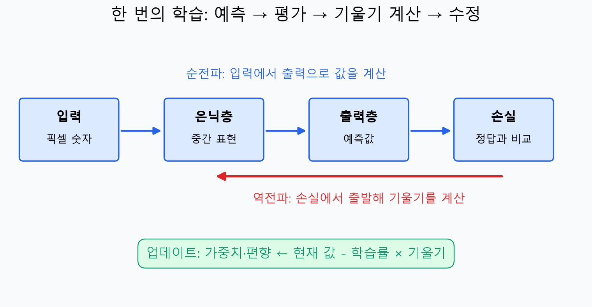
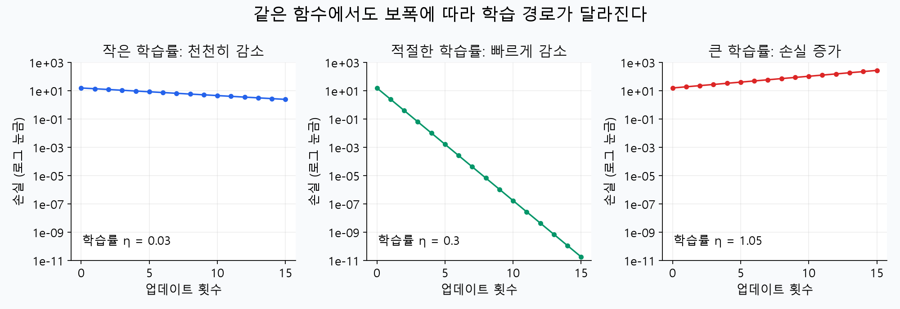
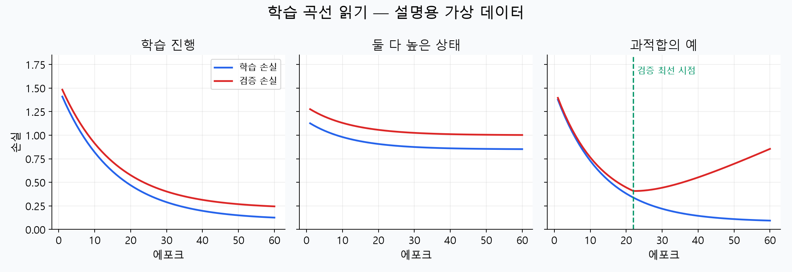
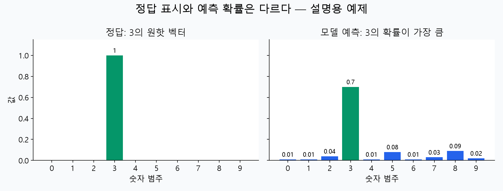

# 머신러닝 10강 — 신경망(2): 신경망은 어떻게 스스로 배울까?

> **대상:** 신경망 강의를 처음 듣는 학습자  
> **바탕:** 사용자가 제공한 학습개요·학습목표·정리하기  
> **읽는 법:** 1회독은 설명과 그림, 2회독은 6절의 계산 예제, 3회독은 마지막 복습 문제 순으로 읽으세요.  
> 강의 영상 전체를 확인한 문서는 아닙니다. 제공된 요약을 풀어 설명하고 필요한 기초와 주의점을 보충했습니다. 그림과 숫자 계산은 직접 구성한 교육용 예제이며, 실제 MNIST 학습 실험은 수행하지 않았습니다.

## 0. 오늘 수업을 한 문장으로 말하면

**신경망은 정답이 있는 문제를 풀고, 자신이 얼마나 틀렸는지 계산한 뒤, 다음에는 덜 틀리도록 연결의 가중치를 고칩니다.**

여러분, 손글씨 숫자 `3`을 신경망에 보여 준다고 합시다. 처음 신경망은 `8`이라고 답할 수 있습니다. 이때 우리가 직접 “윗부분이 이렇게 생겼으니 3이라고 해”라는 규칙을 하나씩 적어 주는 것은 아닙니다. 정답이 `3`이라는 정보를 주고, 신경망 내부의 숫자들을 조금씩 바꿉니다. 이 과정을 많은 문제에 반복하는 것이 **학습**입니다.

이번 강의의 질문은 네 가지입니다.

1. 신경망이 답을 내는 과정은 무엇인가?
2. 어디를 얼마나 고쳐야 하는지 어떻게 알아내는가?
3. 학습을 반복할 때 무엇을 조절하고 언제 멈추는가?
4. 이 과정을 MNIST 숫자 이미지에 어떻게 적용하는가?

```text
문제와 정답 준비 → 예측 → 틀린 정도 측정 → 각 연결의 영향 계산 → 연결 수정
                    ↑                                      │
                    └──────── 다음 학습에서 반복 ────────────┘
```

## 1. 출발점: 신경망 내부에는 무엇이 있나?

### 1.1 뉴런 하나는 ‘곱하고, 더하고, 변환하는 계산기’

뉴런은 입력에 가중치를 곱하고, 모두 더한 다음, 편향을 더합니다. 그 결과를 활성화 함수에 넣어 출력합니다.

$$
z = w_1x_1+w_2x_2+\cdots+w_nx_n+b, \qquad a=f(z)
$$

| 기호·용어 | 초보자를 위한 뜻 |
|---|---|
| 입력 $x$ | 들어오는 정보의 숫자 표현 |
| 가중치 $w$ | 해당 입력이 결과에 미치는 영향을 조절하는 숫자 |
| 편향 $b$ | 입력과 별개로 기본 점수를 조절하는 숫자 |
| 가중합 $z$ | 곱하고 더한 중간 점수 |
| 활성화 함수 $f$ | 중간 점수를 다음 층에 보낼 값으로 변환하는 함수 |
| 활성값 $a$ | 뉴런이 실제로 다음 층에 보내는 값 |
| 파라미터 | 학습 과정에서 바뀌는 가중치와 편향 |

예를 들어 $x_1=1$, $x_2=0.5$, $w_1=0.8$, $w_2=-0.4$, $b=0.1$이면,

$$z=0.8\times1-0.4\times0.5+0.1=0.7$$

입니다. 가중치가 음수이면 그 입력이 중간 점수를 내리는 방향으로 작용합니다. 따라서 가중치는 단순히 ‘중요도가 몇 퍼센트’라는 뜻은 아닙니다.

### 1.2 다층 퍼셉트론, MLP

**MLP는 이런 계산기들을 층으로 연결한 신경망**입니다.

```text
입력층              은닉층                  출력층
이미지 픽셀들  →  중간 특징을 조합하는 계산  →  각 숫자에 대한 예측
```

입력층은 보통 데이터를 전달하는 역할입니다. 은닉층과 출력층에서 가중합과 활성화 계산을 합니다. ‘은닉’은 중간층에 정답표가 직접 주어지지 않는다는 뜻으로 이해하면 좋습니다. 숫자 문제에서 은닉 뉴런 1번의 정답을 따로 알려 주지는 않습니다.

은닉층이 획이나 모양에 관한 정보를 표현할 수는 있지만, **모든 뉴런이 사람이 알아볼 수 있는 특정 획 하나를 담당한다고 보장되지는 않습니다.**

### 1.3 활성화 함수는 왜 필요한가?

중간에 비선형 활성화 함수 없이 선형 계산만 연결하면, 여러 층을 쌓아도 결국 하나의 선형 계산으로 합쳐집니다. 복잡한 모양과 관계를 배우려면 비선형 변환이 필요합니다.

| 함수 | 식 | 특징과 용도 |
|---|---|---|
| 시그모이드 | $\sigma(z)=1/(1+e^{-z})$ | 출력을 0과 1 사이로 만듦. 강의의 은닉층 예제에 사용 |
| ReLU | $\max(0,z)$ | 양수는 그대로, 음수는 0. 은닉층에 널리 사용하는 선택지 |
| 소프트맥스 | 10절에서 설명 | 여러 출력 점수를 합이 1인 값들로 변환. 한 개의 정답 범주를 고를 때 사용 |

시그모이드에서 $z=0$이면 출력은 0.5입니다. $z$가 아주 크거나 작아지면 출력이 1이나 0 근처에 머물고 변화가 작아집니다. 이것이 뒤에서 나올 ‘기울기 소실’과 연결됩니다.

## 2. 지도학습: 문제와 정답을 함께 준다

MNIST의 한 데이터는 **숫자 이미지와 그 이미지의 정답 숫자**로 이루어집니다.

| 항목 | 예 |
|---|---|
| 입력 $x$ | 손으로 쓴 3의 이미지 |
| 목표 출력 $y$ | 정답 3을 나타내는 값 또는 벡터 |
| 실제 출력·예측 $\hat y$ | 현재 신경망이 내놓은 값 |
| 손실 $L$ | 예측이 정답에서 얼마나 어긋났는지 나타내는 숫자 |

**강의의 ‘실제 출력값’은 모델이 실제로 계산한 예측값이고, ‘목표 출력값’이 정답입니다.** 일상어의 ‘실제 정답’과 혼동하지 마세요.

정답이 주어지고 그 정답에 가까워지도록 배우므로 **지도학습**입니다.

## 3. 전체 학습 과정: 다섯 단계를 구분하자



### 3.1 초기화

처음 가중치를 작은 무작위 값 등으로 정합니다. 아직 배운 것이 없으므로 이 숫자들은 적절한 답을 내도록 맞춰져 있지 않습니다. 편향은 0으로 시작하기도 합니다.

### 3.2 순전파: 답을 계산한다

입력층 → 은닉층 → 출력층 순서로 계산합니다. 손글씨 이미지에서 출발하여 각 숫자에 대한 예측까지 가는 과정입니다.

### 3.3 손실 계산: 얼마나 틀렸는지 잰다

예측과 정답을 비교하여 하나의 손실값을 만듭니다. 정답 확률이 높을수록 손실이 작아지도록 손실함수를 선택합니다.

### 3.4 역전파: 어디를 바꾸면 손실이 달라지는지 계산한다

출력에서 시작하여 은닉층 방향으로 거슬러 가며, 각 파라미터에 대한 **손실의 기울기**를 계산합니다. 정답을 거꾸로 입력하는 과정은 아닙니다.

### 3.5 업데이트: 계산한 기울기로 파라미터를 바꾼다

기울기와 학습률을 사용해 파라미터를 수정합니다. 수정된 신경망으로 다음 문제들을 풀며 같은 과정을 반복합니다.

> **역전파는 기울기를 계산하는 방법이고, 경사하강법은 그 기울기로 파라미터를 바꾸는 방법입니다.** 강의에서는 이 둘을 묶어 ‘오류 역전파 학습 알고리즘’이라고 설명합니다. 엄밀한 역할을 나누면 이해가 쉬워집니다. [MIT 교재의 역전파 설명](https://visionbook.mit.edu/backpropagation.html)

## 4. 기울기와 경사하강법을 미분 없이 먼저 이해하기

### 4.1 ‘손실의 기울기’는 민감도다

가중치 $w$를 아주 조금 올렸을 때 손실이 얼마나 변하는지 생각해 봅시다.

- 기울기가 **양수**: $w$를 조금 올리면 손실이 커지는 방향 → $w$를 내린다.
- 기울기가 **음수**: $w$를 조금 올리면 손실이 작아지는 방향 → $w$를 올린다.
- 기울기의 **절댓값이 큼**: 그 지점에서는 $w$의 작은 변화에 손실이 민감하다.

수식 $\partial L/\partial w$는 **‘다른 파라미터를 고정하고 이 가중치를 조금 바꾸면 손실이 얼마나 달라지는가’**를 나타냅니다. ‘편미분’이라는 이름보다 이 뜻을 먼저 기억하세요.

### 4.2 왜 기울기를 빼는가?

$$
w_{\text{새 값}}=w_{\text{현재 값}}-\eta\frac{\partial L}{\partial w}
$$

$\eta$는 ‘에타’라고 읽으며 **학습률**, 즉 한 번에 이동할 보폭입니다.

| 현재 가중치 | 기울기 | 학습률 | 새 가중치 | 해석 |
|---:|---:|---:|---:|---|
| 0.8 | +0.3 | 0.1 | 0.77 | 올리면 손실이 커지므로 내림 |
| 0.8 | −0.3 | 0.1 | 0.83 | 올리면 손실이 작아지므로 올림 |

음수 방향으로 이동하라는 뜻이 아니라 **기울기와 반대 방향으로 이동하라**는 뜻입니다. 편향도 같은 방식으로 바꿉니다.



*단순한 함수 $L(w)=(w-2)^2$에 대한 계산 예제입니다. 실제 신경망 실험 결과가 아닙니다. 그래프의 세로축은 로그 눈금이라 같은 간격이 같은 배수를 뜻합니다.*

학습률이 작으면 천천히 갑니다. 적절하면 빠르게 최소점에 접근할 수 있습니다. 너무 크면 최소점을 넘어다니거나 손실이 폭발할 수 있습니다. 작은 학습률이 항상 좋은 것도, 큰 학습률이 항상 빠른 것도 아닙니다.

또한 복잡한 신경망이나 미니 배치 학습에서는 **매 업데이트마다 손실이 반드시 감소하는 것은 아닙니다.** 전체 추세와 검증 결과를 함께 봅니다.

## 5. 역전파: 중간 뉴런의 정답이 없는데 어떻게 고칠까?

### 5.1 핵심은 ‘영향을 연결해 계산한다’

공장에서 중간 부품을 조립해 완제품을 만든다고 생각합시다. 완제품의 불량 정도는 측정할 수 있지만 중간 부품마다 정답 수치를 직접 주지는 않았습니다. 그래도 ‘이 부품의 변화가 완제품에 얼마나 영향을 주는지’를 알면 수정 방향을 정할 수 있습니다.

신경망도 마찬가지입니다.

```text
앞쪽 가중치가 변함 → 은닉 뉴런 출력이 변함 → 최종 예측이 변함 → 손실이 변함
```

이 작은 영향들을 연결해서 앞쪽 가중치에 대한 손실의 기울기를 구합니다. 수학적으로는 **연쇄법칙**입니다.

> ‘책임을 배분한다’는 비유가 도움이 되지만, 실제 계산은 도덕적인 책임 판정이나 원인의 증명이 아닙니다. 현재 파라미터 부근에서 손실이 얼마나 민감하게 변하는지를 계산합니다.

### 5.2 출력층은 정답과 직접 비교할 수 있다

시그모이드 출력과 제곱오차를 쓰는 경우, 출력 뉴런 $k$에서의 오차 신호를 다음처럼 정의할 수 있습니다.

$$
L=\frac12\sum_k(\hat y_k-y_k)^2
$$

$$
\delta_k=\frac{\partial L}{\partial z_k}
=(\hat y_k-y_k)\hat y_k(1-\hat y_k)
$$

여기서 $z_k$는 출력 활성화 함수에 들어가기 전 점수입니다. $\delta_k$는 단순한 ‘틀린 개수’가 아니라 **출력 점수에 대한 손실의 기울기**입니다.

은닉 뉴런 $j$의 출력이 $h_j$이고 출력층으로 가는 가중치가 $v_{jk}$라면,

$$
\frac{\partial L}{\partial v_{jk}}=h_j\delta_k,
\qquad
\Delta v_{jk}=-\eta h_j\delta_k
$$

입니다. 즉 수정에는 **정답과의 차이, 활성화 함수의 미분, 들어온 은닉층 출력, 학습률**이 함께 관여합니다. 강의의 ‘출력 차이에 비례해 수정한다’는 표현은 이 구조를 간략하게 말한 것입니다.

### 5.3 은닉층은 뒤쪽에서 온 신호를 합친다

은닉 뉴런 $j$가 여러 출력 뉴런과 연결되어 있다고 합시다. 이 은닉 뉴런을 바꾸면 여러 출력이 함께 달라집니다. 따라서 출력 하나만 보면 안 됩니다.

$$
\delta_j=f'(z_j)\sum_k v_{jk}\delta_k
$$

순서대로 읽으면 다음과 같습니다.

1. 출력 뉴런마다 오차 신호 $\delta_k$를 구한다.
2. 해당 출력으로 연결되는 가중치 $v_{jk}$를 곱한다.
3. 모든 출력 방향의 영향을 더한다.
4. 은닉 뉴런 활성화 함수의 미분 $f'(z_j)$를 곱한다.

예를 들어 두 출력의 오차 신호가 $0.2$, $-0.1$이고 연결 가중치가 $0.5$, $0.8$이면,

$$0.5\times0.2+0.8\times(-0.1)=0.02$$

입니다. 단순히 $0.2+(-0.1)$로 더하지 않습니다. **연결을 통한 영향의 크기와 부호가 다르기 때문입니다.** 은닉 출력이 0.5인 시그모이드라면 미분은 $0.5(1-0.5)=0.25$이므로 $\delta_j=0.005$입니다.

입력 $x_i$에서 은닉 뉴런으로 가는 가중치 $w_{ij}$는 다음처럼 바꿉니다.

$$
\frac{\partial L}{\partial w_{ij}}=x_i\delta_j,
\qquad
\Delta w_{ij}=-\eta x_i\delta_j
$$

편향의 기울기는 해당 뉴런의 $\delta$입니다. 은닉층이 더 많아도 같은 원리로 뒤쪽부터 반복합니다. [MIT 교재: 연쇄법칙과 역전파](https://visionbook.mit.edu/backpropagation.html)

> 어떤 교재는 $y-\hat y$를 사용해 오차 신호를 정의하고 수정항을 더합니다. 이 노트는 $\hat y-y$ 방향의 기울기를 계산한 뒤 뺍니다. 부호 정의와 업데이트 식을 한 쌍으로 확인하세요.

## 6. 숫자로 끝까지 따라 하는 ‘한 번의 학습’

복잡한 MNIST 대신 **입력 1개 → 은닉 뉴런 1개 → 출력 뉴런 1개**로 줄입니다. 원리는 같습니다. 여기서는 은닉층과 출력층 모두 시그모이드, 손실은 제곱오차를 사용합니다.

```text
x=1 ── w=0.5 ──▶ 은닉 뉴런 h ── v=0.5 ──▶ 예측 ŷ
                  편향 bₕ=0                  편향 bₒ=0
                                               정답 y=1
```

학습률은 $\eta=0.5$입니다. 계산값은 반올림했으므로 끝자리에는 차이가 있을 수 있습니다.

### 6.1 순전파

은닉층:

$$z_h=wx+b_h=0.5,\qquad h=\sigma(0.5)\approx0.622459$$

출력층:

$$z_o=vh+b_o=0.5\times0.622459\approx0.311230$$

$$\hat y=\sigma(z_o)\approx0.577185$$

정답은 1인데 예측은 약 0.577입니다. 더 1에 가까운 출력을 내도록 조정하고 싶습니다.

### 6.2 손실

$$L=\frac12(\hat y-y)^2=\frac12(0.577185-1)^2\approx0.089386$$

### 6.3 출력층 역전파

시그모이드의 미분은 $\sigma'(z)=\sigma(z)(1-\sigma(z))$입니다.

$$\delta_o=(\hat y-y)\hat y(1-\hat y)\approx-0.103185$$

$$\frac{\partial L}{\partial v}=h\delta_o\approx-0.064228$$

$$\frac{\partial L}{\partial b_o}=\delta_o\approx-0.103185$$

음수 기울기이므로 $v$와 $b_o$를 올리는 방향이 손실을 줄이는 방향입니다.

### 6.4 은닉층 역전파

$$\delta_h=h(1-h)v\delta_o\approx-0.012124$$

$$\frac{\partial L}{\partial w}=x\delta_h\approx-0.012124,\qquad
\frac{\partial L}{\partial b_h}=\delta_h$$

여기서 $v$는 **수정 전 값인 0.5**입니다. 같은 순전파에 대한 기울기들은 같은 파라미터 상태에서 구한 뒤 업데이트합니다.

### 6.5 파라미터 업데이트

| 파라미터 | 수정 전 | 기울기 | 수정 후: 현재 값 − 0.5 × 기울기 |
|---|---:|---:|---:|
| 은닉층 가중치 $w$ | 0.5 | −0.012124 | 약 0.506062 |
| 은닉층 편향 $b_h$ | 0 | −0.012124 | 약 0.006062 |
| 출력층 가중치 $v$ | 0.5 | −0.064228 | 약 0.532114 |
| 출력층 편향 $b_o$ | 0 | −0.103185 | 약 0.051592 |

### 6.6 다시 예측해 보면

새 파라미터로 계산하면 예측은 **약 0.5949**, 손실은 **약 0.0821**이 됩니다.

```text
예측: 0.5772 → 약 0.5949    정답 1에 조금 가까워짐
손실: 0.0894 → 약 0.0821    이번 업데이트에서는 감소
```

**이것이 학습 한 번의 핵심입니다.** 입력이나 정답을 바꾼 것이 아니라, 가중치와 편향을 바꿨습니다. 실제로는 많은 표본에서 이 과정을 반복하여 처음 보는 데이터에도 잘 맞는 파라미터를 찾습니다.

## 7. 온라인·배치·미니 배치: 몇 문제 풀고 수정할까?

다음 구분은 스트리밍 서비스의 ‘온라인’과는 다른 의미입니다. 이 강의에서 온라인 학습 모드는 **데이터 한 개마다 업데이트**한다는 뜻입니다.

| 학습 모드 | 한 번의 업데이트에 쓰는 데이터 | 장점 | 주의할 점 |
|---|---|---|---|
| 온라인 모드 | 1개 | 바로바로 수정 가능 | 기울기 변동이 커서 학습 경로가 흔들림 |
| 배치 모드 | 학습 데이터 전체 | 전체 데이터의 평균 기울기 사용 | 한 번의 수정까지 계산량이 큼 |
| 미니 배치 모드 | 일부, 예: 100개 | 계산 효율과 업데이트 빈도를 절충 | 배치 크기도 조절해야 함 |

미니 배치에서는 보통 각 표본의 손실을 평균하고 그 평균 손실의 기울기로 한 번 업데이트합니다. 개별 표본마다 파라미터를 먼저 바꿔 가며 마지막에 평균내는 방식과는 다릅니다.

### 에포크, 배치 크기, 스텝을 구별하자

- **에포크(epoch):** 학습 데이터를 전체적으로 한 번 사용하는 단위.
- **배치 크기(batch size):** 한 번의 업데이트에 넣는 표본 수.
- **스텝(step):** 여기서는 파라미터 업데이트 한 번.

예를 들어 학습용 60,000개를 배치 크기 100으로 사용하면,

$$1\text{ 에포크}=60,000/100=600\text{ 스텝}$$

이고, 100에포크면 60,000번 업데이트합니다. 온라인 모드는 같은 1에포크에 60,000번, 전체 배치 모드는 1번 업데이트합니다. 즉 **100에포크는 100번 업데이트라는 뜻이 아닙니다.**

나누어떨어지지 않는 경우 마지막 작은 배치까지 사용하면 스텝 수는 올림합니다. 보통 에포크마다 학습 데이터 순서를 섞습니다.

## 8. 학습이 잘되지 않는 이유와 대책

### 8.1 지역 극소: 가장 낮은 곳이 여러 개일 수 있다

손실을 지형의 높이라고 생각해 봅시다. 주변보다 낮지만 전체에서 가장 낮지는 않은 골짜기를 **지역 극소**, 전체에서 가장 낮은 점을 **전역 극소**라고 합니다.

복잡한 신경망의 손실 지형에는 지역 극소 외에도, 어떤 방향으로는 올라가고 다른 방향으로는 내려가는 **안장점**, 기울기가 매우 작은 구간 등이 있습니다. 학습 정체를 전부 지역 극소 탓으로 보면 안 됩니다.

초깃값이나 데이터 순서를 달리해 다시 학습하거나, 학습률과 최적화 방법을 조절할 수 있습니다. 이런 전략이 전역 최솟값을 보장하지는 않습니다. 학습 손실이 가장 작은 모델이 검증 성능까지 가장 좋은 것도 아닙니다.

### 8.2 수렴 속도: 너무 느리거나 흔들린다

**수렴**은 학습이 진행되며 파라미터나 손실의 변화가 작아지고 어느 상태에 가까워지는 현상입니다. 변화가 작다고 반드시 좋은 답에 도달한 것은 아닙니다.

| 관찰 | 가능한 이유 | 확인·조절할 것 |
|---|---|---|
| 손실이 아주 천천히 감소 | 학습률이 작거나 기울기가 작음 | 학습률, 입력 범위, 활성화 함수 |
| 손실이 심하게 튀거나 발산 | 학습률이 크거나 수치 문제가 있음 | 학습률을 낮추고 입력·계산 확인 |
| 학습 시작부터 거의 변화 없음 | 대칭적인 초기화, 포화, 연결 오류 등 | 초기화와 기울기 점검 |
| 학습 성능만 좋아짐 | 과적합 가능성 | 검증 곡선, 모델 크기, 규제 |

이 표는 원인을 단정하는 진단표가 아니라 점검 순서입니다.

### 8.3 초기 가중치: 왜 전부 똑같이 두면 곤란할까?

같은 층의 은닉 뉴런들을 모두 똑같이 초기화하면 같은 입력에서 같은 계산과 기울기를 받으며 함께 움직일 수 있습니다. 그러면 뉴런 수를 늘려도 서로 다른 특징을 배우기 어렵습니다. 무작위 초기화로 이런 **대칭을 깨는 것**이 중요합니다.

너무 큰 값도 시그모이드를 포화시킬 수 있으므로 크기를 적절하게 정해야 합니다. Xavier나 He 초기화는 층과 활성화 함수 특성을 고려해 초기 가중치 규모를 정하는 방법입니다. **편향까지 반드시 무작위로 정해야 한다는 뜻은 아닙니다.**

### 8.4 기울기 소실: 앞쪽까지 신호가 약하게 전달된다

시그모이드의 미분값은 최대 0.25입니다. 역전파 중 여러 층의 미분과 가중치를 연달아 곱하는데, 그 결과가 반복해서 작아지면 앞쪽 층의 기울기가 매우 작아질 수 있습니다. 특히 포화 구간에서는 미분값이 거의 0입니다.

그 결과 앞쪽 가중치가 거의 바뀌지 않아 학습이 느려질 수 있습니다. 활성화 함수, 초기화, 네트워크 구조 등을 함께 고려합니다. ReLU도 일부 뉴런이 계속 음수 영역에 머물러 기울기가 0이 되는 문제가 있을 수 있으므로 만능 해결책은 아닙니다.

### 8.5 은닉 뉴런 수: 많을수록 무조건 좋을까?

| 너무 적을 때 | 너무 많을 때 |
|---|---|
| 필요한 관계를 표현하기 어려울 수 있음 | 파라미터와 계산량이 커짐 |
| 학습 데이터에서도 성능이 낮을 수 있음 | 데이터가 부족하면 과적합 위험이 커질 수 있음 |
| 과소적합 가능성 | 검증 성능을 확인하며 복잡도 조절 필요 |

적절한 수는 데이터와 문제에 따라 달라집니다. 강의의 100개는 실험 설정이지 모든 문제의 정답이 아닙니다. 후보들을 비교할 때 **검증 데이터**를 사용합니다.

학습률, 배치 크기, 은닉 뉴런 수처럼 사람이 정하는 설정은 **하이퍼파라미터**라고 부릅니다. 학습으로 조정되는 가중치·편향과 구별하세요. 이런 설정과 학습 문제의 관계는 [Bengio의 학습 실무 논문](https://arxiv.org/abs/1206.5533)에서도 다룹니다.

## 9. 언제 멈출까? 학습·검증·테스트를 나누는 이유

시험 문제를 외운 학생과 원리를 이해한 학생을 구별하려면 처음 보는 문제를 풀려야 합니다. 신경망도 같습니다.

| 데이터 | 역할 | 사용 방식 |
|---|---|---|
| 학습 데이터 | 가중치·편향을 배우는 자료 | 기울기 계산과 업데이트에 사용 |
| 검증 데이터 | 설정과 종료 시점을 고르는 자료 | 검증 손실을 보고 모델 선택 |
| 테스트 데이터 | 최종 성능 평가 자료 | 선택이 끝난 모델을 평가 |

MNIST가 학습용 60,000개와 테스트용 10,000개를 제공한다고 해서 검증 데이터가 필요 없다는 뜻은 아닙니다. 예를 들어 60,000개에서 50,000개를 학습용, 10,000개를 검증용으로 나눌 수 있습니다. 이 경우 배치 크기 100에서 **학습 1에포크는 500스텝**입니다. 앞 절의 600스텝은 60,000개를 전부 학습에 사용하는 경우였습니다.



*곡선의 모양을 설명하기 위해 만든 가상 데이터입니다. 강의 실험이나 실제 MNIST 기록이 아닙니다.*

- **학습 손실과 검증 손실이 함께 감소:** 유용한 패턴을 배우는 상황일 수 있습니다.
- **둘 다 높게 유지:** 모델 표현력이 부족하거나, 학습이 덜 되었거나, 설정에 문제가 있을 수 있습니다.
- **학습 손실은 감소하지만 검증 손실은 상승:** 과적합을 의심합니다.

### 조기 종료, early stopping

검증 손실이 가장 좋았던 모델을 저장하고, 이후 일정 기간 개선되지 않으면 학습을 멈추는 전략입니다. 가령 몇 에포크 개선되지 않았을 때 멈출지는 별도 설정이며, 멈춘 순간의 모델보다 이전의 최선 모델을 복원하는 것이 중요합니다.

다른 종료 기준으로 최대 에포크, 손실 변화량 등이 있지만 **학습 손실만 보고 오래 반복하면 일반화 성능을 놓칠 수 있습니다.** 테스트 데이터를 반복해서 확인하며 설정을 고르면 테스트도 사실상 모델 선택에 사용되므로 최종 평가의 의미가 약해집니다.

## 10. 오차함수: 무엇을 ‘틀렸다’고 측정할까?

### 10.1 제곱오차

$$L=\frac12\sum_k(\hat y_k-y_k)^2$$

정답과 예측의 차이를 제곱하여 더합니다. 앞의 $1/2$는 미분식을 편하게 만드는 상수이며, 평균 여부와 상수는 정의에 따라 다릅니다. 회귀에서 흔하게 사용하고, 강의의 역전파 계산을 설명할 때도 직관적입니다.

시그모이드 출력과 결합하면 출력층 기울기에 $\hat y(1-\hat y)$가 들어갑니다. 출력이 포화되면 틀렸어도 기울기가 작아질 수 있습니다.

### 10.2 소프트맥스: 10개 점수를 함께 비교한다

숫자 하나는 0부터 9 중 한 범주에 속합니다. 출력층은 각 범주에 대한 원점수, 즉 **로짓(logit)** $z_k$를 냅니다. 소프트맥스는 이를 다음처럼 변환합니다.

$$p_k=\frac{e^{z_k}}{\sum_{r=0}^{9}e^{z_r}}$$

출력값은 각각 0과 1 사이이고 전체 합은 1입니다. 이를 각 숫자에 대한 모델의 예측 확률로 해석합니다. 다만 합이 1이라고 현실에서 그만큼 맞는다는 확률 보정까지 보장되는 것은 아닙니다.

```text
원점수:     [1, 2, 3]
소프트맥스: [약 0.090, 약 0.245, 약 0.665]
```

이 3범주 예에서는 마지막 범주가 가장 유력합니다. 실제 계산에서는 수치 폭발을 피하기 위해 점수 전체에서 최댓값을 빼고 지수함수를 계산할 수 있습니다. 결과 확률은 같습니다.

**시그모이드 10개는 각 출력을 따로 변환하므로 합이 1일 필요가 없습니다.** 여러 라벨이 동시에 정답인 문제에는 이런 독립 출력이 유용하지만, MNIST처럼 정답 숫자가 하나인 문제에는 소프트맥스가 자연스럽습니다.

### 10.3 교차엔트로피: 정답에 준 확률을 평가한다

원핫 정답 벡터 $y$와 소프트맥스 출력 $p$에 대한 범주형 교차엔트로피는,

$$L=-\sum_{k=0}^{9}y_k\log p_k$$

입니다. 정답 자리만 1이므로 다음처럼 단순해집니다.

$$L=-\log(\text{정답 숫자에 준 예측 확률})$$

| 정답 숫자에 준 확률 | 손실 $-\log p$ | 해석 |
|---:|---:|---|
| 0.9 | 약 0.105 | 정답을 유력하게 봄 |
| 0.5 | 약 0.693 | 확신이 낮음 |
| 0.1 | 약 2.303 | 정답을 낮게 봄 |
| 0.01 | 약 4.605 | 정답을 매우 낮게 봄 |

로그는 자연로그입니다. 정답에 아주 작은 확률을 주면 손실이 커지므로 **자신 있게 틀리는 예측**에 큰 벌점을 줍니다.

### 10.4 소프트맥스와 교차엔트로피가 잘 맞는 이유

정답이 하나인 범주형 분류를 자연스럽게 표현합니다. 더불어 로짓에 대한 손실의 기울기가 간단해집니다.

$$\frac{\partial L}{\partial z_k}=p_k-y_k$$

이 식은 **소프트맥스 + 범주형 교차엔트로피 조합에서의 식**입니다. 5절의 시그모이드 + 제곱오차 식과 섞어 쓰면 안 됩니다. 소프트맥스의 출력을 다시 독립 시그모이드처럼 미분하지도 않습니다.

구현 라이브러리에 따라 손실함수가 내부에서 로짓을 받아 소프트맥스 계산까지 처리합니다. 이때 밖에서 소프트맥스를 중복 적용하지 않도록 출력 형식과 손실함수 설정을 맞춥니다.

## 11. MNIST 숫자인식: 처음부터 끝까지 연결하기

### 11.1 데이터는 어떻게 생겼나?

MNIST는 0~9의 손글씨를 담은 **28×28 흑백 이미지** 데이터입니다. 학습용 60,000장과 테스트용 10,000장이 제공되고, 픽셀값은 0~255입니다. [Keras 공식 MNIST 설명](https://keras.io/api/datasets/mnist/)

이미지 한 장은 784개의 픽셀 숫자로 이루어집니다.

$$28\times28=784$$

MLP에서는 이 숫자들을 일정한 순서로 펼쳐 입력 벡터로 만듭니다. ‘펼친다’는 것은 픽셀을 버리는 것이 아니라 2차원 배열을 1차원 목록으로 바꾼다는 뜻입니다. 다만 MLP에는 CNN처럼 주변 픽셀의 공간 관계를 직접 활용하는 구조가 내장되어 있지 않습니다.

### 11.2 입력 정규화: 255로 나누기

$$x_{\text{정규화}}=x_{\text{원본}}/255$$

| 원래 값 | 정규화한 값 |
|---:|---:|
| 0 | 0 |
| 128 | 약 0.502 |
| 255 | 1 |

입력 수치의 범위를 줄여 계산과 최적화를 다루기 편하게 합니다. 단순히 모든 학습 문제를 해결하는 처리는 아닙니다. 또한 이 변환은 **평균 0, 표준편차 1로 만드는 표준화와 다릅니다.** 학습·검증·테스트에 동일한 변환을 적용합니다.

### 11.3 정답의 원핫 표현

출력 뉴런 순서가 0, 1, 2, …, 9라면, 정답 3은 다음과 같습니다.

```text
숫자 범주: 0 1 2 3 4 5 6 7 8 9
정답 벡터: 0 0 0 1 0 0 0 0 0 0
```

**숫자 3은 네 번째 자리**입니다. 0부터 시작하기 때문입니다. ‘i번째’라는 말에서 번호가 0부터인지 1부터인지 확인하세요.

원핫 벡터는 정답 범주를 나타내는 표현입니다. 출력 확률은 여러 자리에 0이 아닌 값이 들어가는 것이 정상입니다. 실제 구현에서는 정수 라벨 `3`을 그대로 받는 sparse 교차엔트로피를 사용할 수도 있어, 원핫 배열을 항상 직접 만들어야 하는 것은 아닙니다.

### 11.4 네트워크 구조와 파라미터 수

강의 설정을 예로 들면 다음 구조입니다.

```text
입력층 784개 → 은닉층 100개, 시그모이드 → 출력층 10개, 소프트맥스
   픽셀             중간 표현                 0~9의 예측 확률
```

완전연결 구조라면 다음 수의 파라미터가 필요합니다.

| 연결·편향 | 개수 |
|---|---:|
| 입력 → 은닉 가중치 | 784 × 100 = 78,400 |
| 은닉층 편향 | 100 |
| 은닉 → 출력 가중치 | 100 × 10 = 1,000 |
| 출력층 편향 | 10 |
| **합계** | **79,510** |

100개 은닉 뉴런을 둔다는 것은 가중치가 100개라는 뜻이 아닙니다. 입력 하나하나와 연결되는 가중치가 따로 있습니다.

### 11.5 예측값을 답으로 바꾸기



*정답이 3인 표본에 대해 구성한 가상 예측입니다. 확률의 합은 1입니다.*

가장 큰 확률을 가진 출력의 **번호**를 답으로 선택합니다. 이것을 argmax라고 합니다. 예컨대 3의 확률이 0.70으로 가장 크면 답은 3입니다. 0.70 자체가 숫자 라벨인 것은 아닙니다.

### 11.6 전체 절차를 말로 따라 해 보기

1. 학습용 데이터에서 검증용 일부를 분리한다.
2. 이미지들을 실수형으로 바꾸고 255로 나눈 뒤 784개 숫자로 펼친다.
3. 정답을 원핫 또는 손실함수에 맞는 정수 라벨로 준비한다.
4. 784 → 100 → 10의 MLP를 만들고 가중치를 초기화한다.
5. 미니 배치를 넣어 순전파하고 교차엔트로피를 계산한다.
6. 역전파로 평균 손실의 기울기를 구하고 파라미터를 업데이트한다.
7. 모든 배치를 처리하면 1에포크다. 학습·검증 손실을 기록한다.
8. 검증 결과로 설정과 종료 시점을 결정하고 최선 모델을 선택한다.
9. 마지막에 테스트 데이터에서 오분류율과 정확도를 측정한다.

학습이 끝난 뒤 새 이미지의 답을 구하는 **추론**에서는 순전파만 하면 됩니다. 정답이나 역전파가 매번 필요한 것은 아닙니다.

## 12. 학습 손실, 정확도, 오분류율은 다른 숫자다

$$\text{정확도}=\frac{\text{맞힌 수}}{\text{전체 수}},\qquad
\text{오분류율}=\frac{\text{틀린 수}}{\text{전체 수}}$$

모든 표본에 하나의 정답과 하나의 예측을 부여하는 동일한 평가에서는 정확도 + 오분류율 = 100%입니다.

강의 요약의 MLP 실험 결과 **오분류율 2.35%**는 정확도 **97.65%**를 뜻합니다. 만약 테스트 10,000장 전체를 기준으로 한 값이라면 235장을 틀린 것입니다. 제공된 요약에 없는 상세 실험 조건까지 이 문서에서 재현하거나 확인한 것은 아닙니다.

| 지표 | 무엇을 보는가? | 예 |
|---|---|---|
| 교차엔트로피 손실 | 정답에 배정한 확률까지 평가 | 정답 확률 0.55와 0.95의 차이를 반영 |
| 정확도 | 최종 선택한 숫자가 맞는지 평가 | 두 경우 모두 정답이 1등이면 맞음 |
| 오분류율 | 최종 선택한 숫자가 틀린 비율 | 정확도의 보완값 |

그래서 손실은 내려가는데 정확도는 잠시 그대로일 수 있습니다. 정답이 1등인 상태에서 그 확률만 0.55에서 0.95로 높아져도 정확도는 바뀌지 않지만 교차엔트로피는 줄어듭니다.

강의에서 ‘학습오차 곡선’이라고 부를 때 세로축이 **손실인지 오분류율인지** 먼저 확인하세요. 둘은 같은 지표가 아닙니다.

## 13. 강의의 모델 비교와 MNIST 성과는 어떻게 읽을까?

제공된 요약의 수치를 정리하면 다음과 같습니다.

| 강의에서 언급한 사례 | 강의 요약의 성과 | 읽는 방법 |
|---|---|---|
| 간단한 MLP, 은닉 노드 100개·100에포크 | 오분류율 2.35% | 해당 설정·실험의 결과 |
| LeNet-5 관련 1998년 사례 | 오분류율 0.95% | CNN의 역사적 성과를 소개하는 수치 |
| 이후의 높은 성능 사례 | 정확도 99.88% 이상 | 특정 모델들의 성과이며 현재 최고 기록을 뜻하지 않음 |

위 표는 **사용자가 제공한 강의 요약을 정리한 것**입니다. 실험 조건이 모두 같다고 확인한 공정 비교표가 아니며, 각 수치를 이 문서에서 별도로 재현하지 않았습니다. 특히 LeNet 계열의 역사적 성과는 구조·학습 데이터와 조건을 함께 확인해야 합니다.

여기서 배울 핵심은 ‘MLP로도 숫자인식을 할 수 있고, 이미지의 공간 구조를 활용하는 CNN이 좋은 성과를 낸 중요한 사례가 있다’는 점입니다. **LeNet-5를 CNN의 최초 발명이라고 외우지는 마세요.** 강의 요약의 표현은 1998년의 대표적 성공 사례라는 맥락으로 이해하면 좋습니다.

‘MNIST는 사실상 해결된 문제’라는 표현도 **정해진 데이터와 평가 조건에서 매우 높은 성능이 나온다**는 뜻으로 읽어야 합니다. 다른 사람이 휴대전화로 찍은 흐린 사진이나 복잡한 배경의 숫자까지 모두 해결했다는 뜻은 아닙니다. 새로운 환경에서는 데이터 분포가 달라질 수 있습니다.

## 14. 강의의 어려운 문장을 일상어로 번역하기

| 강의 표현 | 쉬운 설명 |
|---|---|
| 기울기 강하 학습법을 다층 퍼셉트론에 적용 | 각 연결을 조금 바꾸면 손실이 어떻게 변하는지 계산하여, 줄어드는 쪽으로 고친다 |
| 출력 뉴런의 오차를 은닉층으로 역전파 | 최종 손실에 대한 민감도를 뒤쪽에서 앞쪽으로 연결해 계산한다 |
| 출력 뉴런으로의 가중치 수정항 | 마지막 연결을 얼마나 올리거나 내릴지 나타내는 값 |
| 오차에 연결 가중치를 곱하여 합산 | 중간 뉴런이 여러 출력에 끼치는 영향을 각 경로의 연결 강도까지 고려해 모은다 |
| 학습 모드 설정 | 몇 개의 문제를 묶어 풀고 한 번 수정할지 정한다 |
| 은닉 노드의 수 설정 | 중간 계산기를 몇 개 둘지 정한다 |
| 학습률 설정 | 한 번에 얼마나 크게 수정할지 정한다 |
| 학습 종료점의 문제 | 언제부터 더 학습하는 것이 새 데이터 성능에 도움이 되지 않는지 판단한다 |
| 교차엔트로피와 소프트맥스의 조합 | 정답이 하나인 분류에서 범주 확률을 만들고 정답 확률을 높이도록 학습한다 |

## 15. 자주 생기는 오해

**Q. 역전파하면 입력 데이터도 거꾸로 바뀌나요?**  
이 강의의 학습에서는 입력은 그대로 두고 가중치와 편향을 바꿉니다. 거꾸로 계산하는 것은 기울기입니다.

**Q. 신경망이 틀렸으면 모든 가중치를 올리면 되나요?**  
아닙니다. 연결마다 기울기의 부호와 크기가 다릅니다. 올릴 것도, 내릴 것도, 거의 유지할 것도 있습니다.

**Q. 은닉 뉴런의 정답을 누가 알려 주나요?**  
개별 정답을 알려 주지 않습니다. 최종 손실의 기울기를 연결해 계산하면서 중간 표현도 함께 배웁니다.

**Q. 오차가 크면 앞쪽 가중치도 반드시 크게 바뀌나요?**  
아닙니다. 활성화 미분, 연결 가중치, 입력값, 학습률이 함께 영향을 줍니다. 큰 오차에도 기울기가 작을 수 있습니다.

**Q. 정답을 알면서 학습시키면 시험 문제를 미리 알려 준 것 아닌가요?**  
학습용 정답은 배우기 위한 자료입니다. 일반화 능력은 학습에 쓰지 않은 데이터로 평가합니다.

**Q. 학습률도 역전파로 자동으로 배우나요?**  
이 강의의 기본 설정에서는 사람이 정하는 하이퍼파라미터입니다. 스케줄에 따라 바꾸는 전략도 있습니다.

**Q. 100에포크면 언제나 97.65% 정확도가 나오나요?**  
아닙니다. 초기화, 데이터 분할, 모델, 학습률, 손실함수 등 조건에 따라 달라집니다.

**Q. 시그모이드와 제곱오차는 잘못된 조합인가요?**  
아닙니다. 계산 원리를 설명하거나 특정 문제를 다룰 때 사용할 수 있습니다. 다만 MNIST처럼 정답이 하나인 다중 분류에서는 소프트맥스와 범주형 교차엔트로피가 자연스러운 조합입니다.

## 16. 복습 문제

답을 가린 뒤 자신의 말로 설명해 보세요.

1. 순전파·손실 계산·역전파·업데이트는 각각 무엇을 하나요?
2. $\partial L/\partial w$는 일상어로 무슨 뜻인가요?
3. 현재 $w=0.4$, 기울기 −0.2, 학습률 0.1이면 새 가중치는 얼마인가요?
4. 은닉 뉴런의 오차 신호를 계산할 때 왜 여러 출력의 영향을 합치나요?
5. 학습 데이터 50,000개, 배치 크기 200이면 1에포크는 몇 스텝인가요?
6. 학습 손실은 줄지만 검증 손실은 계속 늘 때 무엇을 의심하나요?
7. MNIST 입력 노드가 784개이고 출력 노드가 10개인 이유는 무엇인가요?
8. 정답 7의 원핫 벡터를 0~9 순서로 쓰세요.
9. 정답 확률이 0.8에서 0.4로 낮아지면 교차엔트로피는 어떻게 되나요?
10. 오분류율이 2.35%라면 정확도는 얼마인가요?
11. 테스트 데이터를 보며 은닉 뉴런 수를 계속 바꾸면 왜 곤란한가요?
12. 예측 확률이 바뀌었는데 정확도가 그대로인 경우를 설명해 보세요.

### 해설

1. 순전파는 예측, 손실 계산은 예측과 정답 차이의 수치화, 역전파는 기울기 계산, 업데이트는 파라미터 변경입니다.
2. 다른 조건을 고정하고 가중치를 조금 바꿀 때 손실이 얼마나 달라지는지를 나타내는 민감도입니다.
3. $0.4-0.1\times(-0.2)=0.42$입니다.
4. 그 은닉 뉴런이 여러 출력에 영향을 주기 때문입니다. 각 경로의 가중치를 곱한 영향을 더합니다.
5. $50,000/200=250$스텝입니다.
6. 과적합을 의심합니다. 검증 결과에 따라 조기 종료나 복잡도 조절 등을 고려합니다.
7. 이미지가 28×28픽셀이므로 784개, 숫자 범주가 0~9이므로 출력 10개입니다.
8. `[0, 0, 0, 0, 0, 0, 0, 1, 0, 0]`입니다.
9. $-\log(0.8)\approx0.223$에서 $-\log(0.4)\approx0.916$으로 증가합니다.
10. 97.65%입니다.
11. 테스트 데이터가 설정 선택에 영향을 주므로 새로운 데이터에 대한 독립적인 최종 평가가 약해집니다.
12. 정답 확률이 0.55에서 0.95로 올라가도 두 경우 모두 정답이 1등이면 정확도는 같습니다. 손실은 줄어들 수 있습니다.

## 17. 시험 전 1분 복습 카드

| 질문 | 핵심 답 |
|---|---|
| MLP는 무엇을 배우나? | 가중치와 편향 |
| 왜 지도학습인가? | 입력과 정답을 함께 주기 때문 |
| 순전파란? | 입력에서 출력 방향으로 예측 계산 |
| 역전파란? | 연쇄법칙으로 손실의 기울기를 뒤에서 앞으로 계산 |
| 경사하강법이란? | 기울기 반대 방향으로 파라미터 업데이트 |
| 기본 업데이트 식은? | 새 가중치 = 현재 가중치 − 학습률 × 기울기 |
| 은닉층 신호는? | 뒤쪽 신호에 연결 가중치를 곱해 합하고 활성화 미분을 곱함 |
| 에포크란? | 학습 데이터를 한 번 전체적으로 사용하는 단위 |
| 학습 시 고려사항은? | 지역 극소·안장점, 수렴 속도, 종료점, 뉴런 수 등 |
| 주요 설정은? | 배치 모드, 초기화, 학습률, 활성화 함수, 손실함수 |
| MNIST 크기는? | 28×28, 학습 60,000장·테스트 10,000장 |
| 입력 정규화는? | 픽셀값을 255로 나누어 0~1로 변환 |
| 원핫이란? | 정답 자리만 1, 나머지는 0 |
| 단일 정답 다중 분류의 조합은? | 소프트맥스 + 범주형 교차엔트로피 |
| 학습을 멈출 때 볼 자료는? | 검증 데이터의 성능 |

마지막으로 다음 문장을 자기 말로 설명할 수 있으면 이번 강의의 중심을 이해한 것입니다.

> **“신경망은 순전파로 예측하고, 정답과 비교해 손실을 구하며, 역전파로 각 파라미터의 기울기를 계산한 뒤 경사하강법으로 수정한다. 이 과정을 반복하되 검증 데이터로 새 문제에도 잘 맞는지 확인한다.”**

## 참고 자료와 문서 범위

- 강의별 실험 설정과 수치의 직접 출처는 사용자가 제공한 요약입니다. 강의 전체의 추가 실험 결과나 최신 MNIST 최고 기록은 이 문서에서 주장하지 않습니다.
- [MIT, Foundations of Computer Vision — Backpropagation](https://visionbook.mit.edu/backpropagation.html): 연쇄법칙, 기울기 계산과 역전파의 원리를 확인할 자료입니다.
- [Keras — MNIST digits classification dataset](https://keras.io/api/datasets/mnist/): 이미지 크기, 데이터 개수, 픽셀값 범위를 확인할 자료입니다.
- [Yoshua Bengio — Practical recommendations for gradient-based training of deep architectures](https://arxiv.org/abs/1206.5533): 초기화와 학습률 등 학습 설정에 관한 심화 읽을거리입니다.

그림은 모두 학습용으로 직접 제작했습니다. 이 Markdown 파일과 `10강_그림` 폴더를 함께 보관하면 다른 위치에서도 상대 경로 이미지가 연결됩니다.
