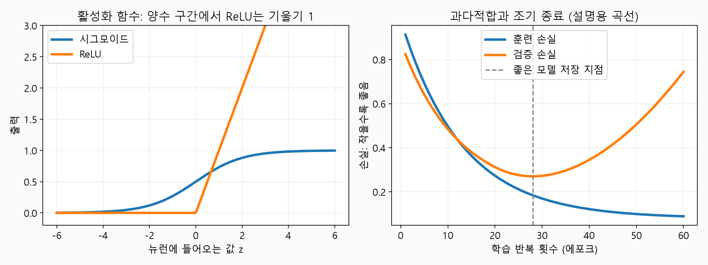
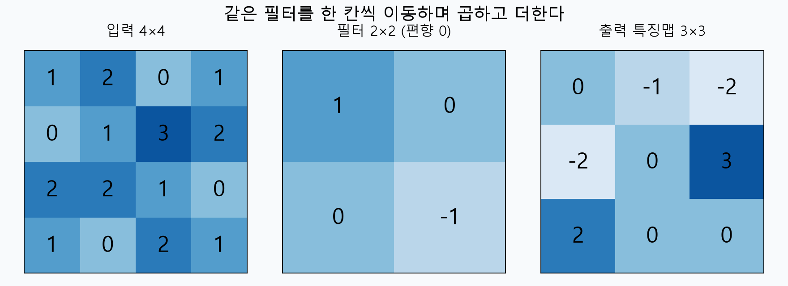
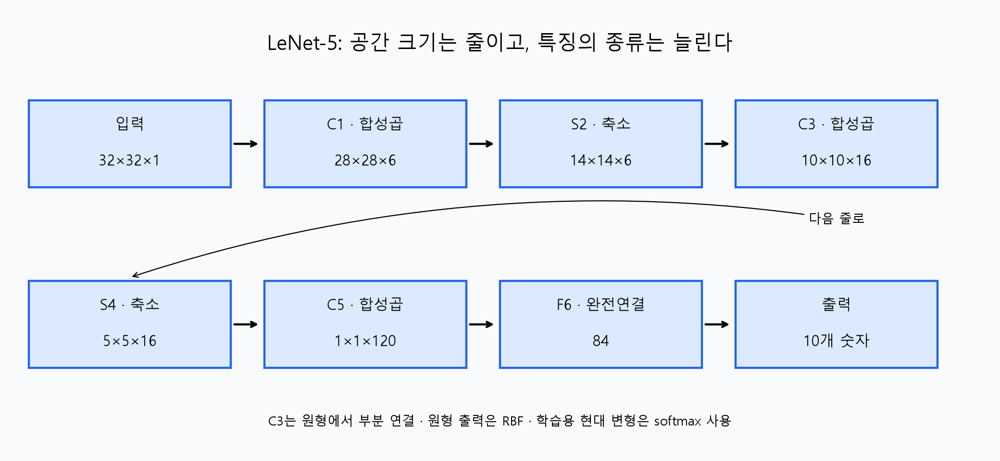

# 머신러닝 11강 — 딥러닝(1): 깊은 신경망은 어떻게 배우고, 그림을 어떻게 볼까?

> **대상:** 신경망과 딥러닝을 처음 배우는 사람  
> **바탕:** 사용자가 제공한 11강 학습개요·학습목표·정리하기. 강의 영상 전체를 확인한 문서는 아닙니다.  
> **읽는 순서:** 처음에는 설명과 그림 → 두 번째에는 계산 예제 → 마지막에는 복습 문제. 공식을 한 번에 외우려고 하지 않아도 됩니다.  
> 그림과 계산은 직접 구성한 교육용 예제입니다. 학습 곡선은 실제 모델을 훈련한 결과가 아니라 현상을 설명하는 모식도입니다.

## 0. 먼저 수업 전체의 지도를 봅시다

여러분, 컴퓨터에게 손글씨 숫자 `3`과 `8`을 구별하게 하고 싶다고 합시다. 사람은 보고 곧바로 알지만 컴퓨터가 받는 것은 **작은 칸마다 밝기를 적어 놓은 숫자 표**입니다. 딥러닝은 그 숫자들에서 획과 모양 같은 구별의 단서를 여러 단계에 걸쳐 배우는 방법입니다.

이번 강의의 흐름은 다음과 같습니다.

```text
신경망의 기본 계산
       ↓ 여러 층으로 쌓으면 복잡한 특징을 배울 수 있다
심층 신경망과 딥러닝
       ↓ 그런데 학습이 느리거나, 배운 문제만 잘 맞힐 수 있다
최적화 개선 + 과다적합 방지
       ↓ 특히 그림의 이웃 관계를 잘 이용하는 구조를 만들자
CNN: 합성곱 → 활성화 → 풀링 → 분류
       ↓ 실제 구조를 따라가 보기
LeNet-5: 손글씨 숫자 인식
```

**핵심 질문은 “무엇을 배우나?”, “어떻게 잘 배우나?”, “그림에는 어떤 구조가 맞나?” 세 가지입니다.**

## 1. 신경망을 전혀 모른다고 생각하고 시작하기

### 1.1 이미지도 결국 숫자다

흑백 영상의 픽셀 하나는 밝기 숫자 하나입니다. 예를 들어 0을 검정, 255를 흰색으로 표시할 수 있습니다. 학습할 때는 이를 255로 나누어 0~1 범위로 만들기도 합니다. 어느 쪽을 배경으로 쓰는지는 데이터에 따라 다릅니다.

`32×32×1`은 **세로 32칸, 가로 32칸, 밝기 채널 1개**라는 뜻입니다. RGB 컬러 사진은 빨강·초록·파랑 값이 필요하므로 보통 채널이 3개입니다. 이 문서는 크기를 `높이×너비×채널` 순서로 씁니다.

### 1.2 뉴런은 작은 계산기다

뉴런 하나가 하는 일은 세 단계입니다.

1. 입력마다 가중치를 곱한다.
2. 모두 더하고 편향을 더한다.
3. 활성화 함수를 통과시킨다.

$$
z=w_1x_1+w_2x_2+\cdots+w_nx_n+b,\qquad a=f(z)
$$

| 기호 | 쉬운 뜻 | 예 |
|---|---|---|
| 입력 $x$ | 주어진 관측값 | 픽셀 밝기 |
| 가중치 $w$ | 입력이 결과에 미치는 영향 | 어떤 획을 얼마나 중요하게 보는가 |
| 편향 $b$ | 입력과 별개로 더하는 조정값 | 반응 기준을 이동시키기 |
| 활성화 함수 $f$ | 합친 값을 다음 층에 어떻게 전달할지 정하는 변환 | ReLU |
| 파라미터 | 학습으로 바꾸는 내부 숫자 | 가중치와 편향 |

예를 들어 입력이 $(2,1)$, 가중치가 $(0.5,-1)$, 편향이 $0.2$라면 $z=2×0.5+1×(-1)+0.2=0.2$입니다. 활성화 함수가 ReLU라면 출력도 0.2입니다.

### 1.3 학습은 정답을 보고 내부 숫자를 고치는 과정

```text
이미지 입력 → 예측 → 정답과 비교하여 손실 계산
                                  ↓
다음 이미지로 반복 ← 가중치 수정 ← 역전파로 기울기 계산
```

**손실**은 틀린 정도를 나타내는 숫자입니다. 작을수록 좋습니다. **기울기**는 가중치를 조금 바꾸면 손실이 어느 방향으로 얼마나 변하는지 알려 줍니다. **역전파**는 그 기울기를 출력 쪽에서 입력 쪽으로 거슬러 계산하는 방법입니다. **최적화 알고리즘**은 계산된 기울기를 이용하여 실제로 가중치를 수정하는 방법입니다. 둘은 역할이 다릅니다.

기울기 강하의 가장 기본적인 수정식은 다음과 같습니다.

$$w_{새것}=w_{현재}-\eta\frac{\partial L}{\partial w}$$

$L$은 손실, $\eta$는 **학습률**, 즉 한 번에 얼마나 움직일지를 정하는 값입니다. $w=2$, 기울기 3, 학습률 0.1이면 새 가중치는 $2-0.1×3=1.7$입니다. 기울기 앞의 마이너스는 손실이 내려가는 쪽으로 움직이기 위해 붙습니다.

## 2. 다층 퍼셉트론에서 딥러닝으로

### 2.1 ‘깊다’는 말은 층이 많다는 뜻

입력층과 출력층 사이에서 계산하는 층이 은닉층입니다. 다층 퍼셉트론(MLP)은 여러 층의 뉴런을 연결한 신경망입니다. 은닉층을 여러 단계로 쌓은 심층 신경망(DNN)을 이용하는 머신러닝 분야가 딥러닝입니다.

MLP와 DNN이 완전히 별개의 발명품인 것은 아닙니다. 깊은 MLP도 DNN에 해당하며, CNN도 깊게 구성할 수 있습니다. “은닉층이 정확히 몇 개부터 딥러닝”이라는 보편적인 경계는 없습니다.

### 2.2 왜 층을 많이 쌓을까?

손글씨를 구별할 때 픽셀에서 곧바로 정답을 결정하기보다 중간 단서를 여러 단계로 조합할 수 있습니다.

```text
픽셀 → 짧은 선·경계 → 곡선·모서리 → 획의 조합 → 숫자 판단
```

이것이 **계층적인 표현 학습**입니다. 낮은 수준의 단서를 재사용해 복잡한 모양을 표현할 수 있어 효율적입니다. 다만 위 흐름은 직관을 위한 예시입니다. 특정 층이 반드시 사람이 이름 붙일 수 있는 특정 특징만 배우는 것은 아닙니다.

### 2.3 그럼 예전에는 왜 깊게 만들지 못했나?

| 걸림돌 | 왜 문제가 되나? | 발전을 가능하게 한 요인 |
|---|---|---|
| 데이터 부족 | 복잡한 모델이 제한된 예제를 외우기 쉽다 | 더 큰 학습 데이터 집합 |
| 연산량 증가 | 많은 층과 가중치를 반복 계산해야 한다 | 컴퓨팅 성능 향상, GPU 병렬 계산 |
| 학습 불안정·지연 | 앞쪽 층까지 수정 신호가 잘 전달되지 않을 수 있다 | 활성화 함수·초기화·최적화 기법 개선 |
| 데이터에 맞지 않는 구조 | 필요한 성질을 비효율적으로 배운다 | CNN 등 데이터 특성에 맞춘 구조 |

**깊으면 무조건 성능이 나쁜 것도, 무조건 좋은 것도 아닙니다.** 표현 능력이 커지는 만큼 데이터, 구조, 학습 방법이 함께 뒷받침되어야 합니다.

### 2.4 종단간 학습이 바꾼 것

전통적인 영상 분류에서는 사람이 “획의 방향, 구멍 개수 같은 특징을 먼저 계산하자”라고 정하고, 그 특징을 분류기에 넣는 경우가 많았습니다.

| 방식 | 처리 흐름 |
|---|---|
| 사람이 특징 설계 | 이미지 → 사람이 정한 특징 추출 → 분류기 학습 |
| 종단간 학습 | 이미지 → 특징을 만드는 층 → 분류하는 층 → 전체를 함께 학습 |

**특징추출이 사라진 것이 아니라, 특징을 추출하는 방법까지 학습하게 된 것**입니다. 정답과 예측의 차이가 특징추출층의 가중치까지 바꿉니다. 크기 조정이나 입력 정규화 같은 전처리는 여전히 할 수 있습니다.

## 3. 학습이 잘 안 되는 이유를 먼저 구분하자

| 문제 | 눈에 보이는 현상 | 핵심 질문 |
|---|---|---|
| 지역 극소·안장점 등 최적화의 어려움 | 손실이 충분히 줄지 않는다 | 현재 위치에서 어떻게 이동할까? |
| 플라토 | 손실 변화가 아주 작고 오래 정체된다 | 평평한 구간을 어떻게 지나갈까? |
| 기울기 소멸 | 앞쪽 층의 가중치가 거의 바뀌지 않는다 | 수정 신호를 어떻게 전달할까? |
| 과다적합 | 훈련 성능은 좋아지는데 검증 성능은 나빠진다 | 처음 보는 데이터에도 통할까? |

손실을 낮추는 **최적화**와 처음 보는 데이터에 잘 맞히는 **일반화**를 나누어 생각하면 뒤의 기법들이 정리됩니다.

### 3.1 지역 극소: 가까이에서는 가장 낮지만 전체에서는 아닐 수 있다

산을 내려가는 사람이 발밑 경사만 보고 움직인다고 합시다. 작은 웅덩이 바닥에 도착하면 사방이 오르막이므로 멈출 수 있습니다. 더 낮은 골짜기가 다른 곳에 있어도 모르는 것입니다. 이것이 지역 극소의 비유입니다. 전체에서 가장 낮은 곳은 전역 극소입니다.

단, 깊은 신경망의 어려움을 모두 지역 극소 탓으로 돌리면 부정확합니다. 어떤 방향으로는 오르막이고 다른 방향으로는 내리막인 **안장점**, 평평한 구간, 방향마다 곡률이 크게 다른 지형도 중요합니다. 좋은 일반화가 전역 최솟값 도달과 같은 뜻도 아닙니다.

- **확률적 기울기 강하(SGD):** 일부 데이터로 구한 기울기를 사용합니다. 기울기에 변동이 생겨 정체된 곳을 벗어나는 데 도움을 줄 수 있지만, 전역 최솟값 도달을 보장하지 않습니다.
- **시뮬레이티드 어닐링:** 초반에는 나빠지는 이동도 확률적으로 허용하고, 온도를 낮추듯 그 허용을 줄이는 탐색 방법입니다. 강의에서 제시한 대안으로 이해하면 됩니다. 현대 신경망 훈련의 일반적인 기본 선택이라고 생각할 필요는 없습니다.

전체 데이터를 한 번에 쓰면 배치 경사하강, 한 샘플씩 쓰면 좁은 뜻의 SGD, 수십·수백 개씩 묶어서 쓰면 미니배치 SGD입니다. 실제 설명에서는 미니배치 방식도 넓게 SGD라고 부릅니다. **배치 크기**는 한 번의 수정에 쓰는 샘플 수, **에포크**는 훈련 데이터 전체를 한 번 훑은 단위입니다.

### 3.2 플라토와 기울기 소멸은 어떻게 다를까?

플라토는 손실 지형의 경사가 작은 평평한 구간입니다. 기울기가 작으면 수정식에서 바뀌는 양도 작아져 학습이 더딥니다.

기울기 소멸은 역전파에서 여러 층의 미분값을 곱하다가 기울기가 매우 작아지는 현상입니다. 시그모이드의 미분은 최대 0.25입니다. 다른 요인을 잠시 무시하고 0.25를 열 번 곱하면 다음과 같습니다.

$$0.25^{10}\approx0.000000954$$

출력층에서 출발한 수정 신호가 앞쪽 층에 도착할 때 아주 약해질 수 있다는 뜻입니다. 실제 기울기는 가중치 등도 함께 곱해지므로 이 숫자 그대로라고 생각하면 안 됩니다. 반대로 곱이 지나치게 커지면 **기울기 폭발**도 생깁니다.

## 4. 더 빠르고 안정적으로 학습하는 여섯 가지 방법

### 4.1 활성화 함수: ReLU로 신호 전달 돕기

$$\operatorname{ReLU}(z)=\max(0,z)$$

입력이 -3이면 0, 0.7이면 0.7, 4이면 4입니다. 양수 영역에서는 미분이 1이므로 시그모이드처럼 큰 양수에서 기울기가 거의 0이 되는 포화가 없습니다. **포화**란 입력이 바뀌어도 출력이 거의 변하지 않는 상태입니다.



음수 영역에서는 ReLU의 미분이 0이어서 어떤 뉴런이 계속 꺼지는 문제가 생길 수 있습니다. Leaky ReLU는 음수 영역에도 작은 기울기를 줍니다. ReLU가 모든 기울기 문제를 해결하는 것은 아닙니다.

또한 비선형 활성화 함수 자체가 중요합니다. 비선형 변환 없이 선형 계산만 여러 번 쌓으면 결국 하나의 선형 계산으로 합쳐져 깊게 쌓는 표현상의 이점이 제한됩니다.

### 4.2 가중치 초기화: 출발점을 적절히 정하기

처음 가중치가 모두 같으면 같은 입력을 받는 같은 층의 뉴런들이 비슷한 계산과 수정을 반복하여 서로 다른 역할을 배우기 어렵습니다. 무작위로 다르게 초기화하여 이 대칭을 깨야 합니다.

그러나 **무조건 작을수록 좋지는 않습니다.** 너무 크면 포화나 폭발을 일으킬 수 있고, 너무 작으면 신호와 기울기가 약해질 수 있습니다. Xavier 초기화나 He 초기화는 연결 수와 활성화 함수에 맞춰 무작위 값의 분산을 정합니다. ReLU 계열에는 He 초기화가 흔히 쓰입니다.

강의의 “작고 서로 다른 랜덤 값”은 출발 직관으로 기억하고, 정확하게는 **층을 지나며 신호 크기가 지나치게 변하지 않도록 규모를 맞춘 초기화**라고 이해하세요. 편향은 0으로 초기화하는 경우도 있으므로 모든 파라미터가 반드시 무작위여야 하는 것은 아닙니다.

### 4.3 모멘텀: 이전 움직임을 기억하기

울퉁불퉁한 골짜기에서 매 순간의 경사만 따르면 좌우로 흔들리며 천천히 갈 수 있습니다. 모멘텀은 이전의 이동 방향을 일부 기억해 꾸준한 방향으로 이동하도록 돕습니다.

$$v_t=\beta v_{t-1}-\eta g_t,\qquad w_{t+1}=w_t+v_t$$

$g_t$는 현재 기울기, $v_t$는 이번 이동량, $\beta$는 이전 움직임을 얼마나 남길지 정하는 값입니다. 같은 방향의 기울기가 반복되면 속도가 붙고, 번갈아 나타나는 기울기는 상쇄되는 효과가 있습니다. 설정에 따라 지나치게 멀리 갈 수도 있습니다.

**NAG(Nesterov 가속 기울기)**는 관성대로 이동할 예상 위치에서 기울기를 평가하여 방향을 보정하는 방식입니다. “가던 방향을 고려하되, 앞을 보고 조정한다”라고 기억하세요.

### 4.4 적응적 학습률: 파라미터마다 보폭 조절하기

어떤 가중치는 기울기가 계속 크고, 어떤 가중치는 작습니다. 모두에게 같은 보폭만 적용하기보다 각 좌표의 기울기 이력을 이용해 유효한 수정 크기를 조절할 수 있습니다.

| 기법 | 중심 아이디어 |
|---|---|
| RMSProp | 최근 기울기 제곱의 지수이동평균으로 수정량의 규모 조절 |
| AdaDelta | 기울기 제곱뿐 아니라 과거 업데이트 제곱의 이동평균도 활용 |
| Adam | 기울기의 이동평균과 기울기 제곱의 이동평균을 함께 사용하고 초기 편향 보정 |

강의의 “변화량 누적합”은 이력을 활용한다는 큰 뜻입니다. 모든 기법이 단순 누적합만 쓰거나 실제 가중치 변화량만 저장하는 것은 아닙니다. Adam도 기본 학습률 등의 설정이 필요하며 항상 가장 좋은 결과를 보장하지는 않습니다. [Adam 설명](https://d2l.ai/chapter_optimization/adam.html)

### 4.5 배치 정규화(Batch Normalization): 중간값의 규모 조절하기

한 층의 입력 값들이 지나치게 큰 범위로 흔들리면 다음 계산이 불안정해질 수 있습니다. 배치 정규화는 중간 활성값을 미니배치 통계로 표준화한 뒤, 학습하는 배율과 이동값으로 다시 조정합니다.

$$\hat z=\frac{z-\mu_B}{\sqrt{\sigma_B^2+\epsilon}},\qquad y=\gamma\hat z+\beta$$

$\mu_B$와 $\sigma_B^2$는 배치에서 구한 평균과 분산입니다. $\epsilon$은 0으로 나누는 것을 막는 작은 수, $\gamma$와 $\beta$는 학습하는 값입니다. 활성화 함수 앞에 두는 구성이 흔합니다.

“셀 포화를 줄인다”는 강의 설명은 직관입니다. 모든 값을 항상 비포화 범위에 넣도록 보장하는 장치는 아닙니다. 추론할 때는 일반적으로 학습 중 모은 이동평균 통계를 사용합니다. CNN에서는 보통 채널별로 배치와 공간 위치에 걸쳐 통계를 계산합니다. [배치 정규화 설명](https://d2l.ai/chapter_convolutional-modern/batch-norm.html)

### 4.6 2차 미분: 경사뿐 아니라 휘어진 정도도 보기

1차 미분이 현재 경사라면, 2차 미분은 경사가 얼마나 빨리 바뀌는지, 즉 **곡률**입니다. 급하게 휘어진 방향과 완만한 방향을 구별하면 더 적절한 이동량을 정할 수 있습니다.

1차원 뉴턴 방법은 $w_{새것}=w-L'(w)/L''(w)$와 같습니다. 예를 들어 $L(w)=(w-3)^2$에서 현재 $w=0$이면 $L'=-6$, $L''=2$이므로 새 위치는 3입니다. 이 단순 이차함수에서는 한 번에 최소점에 갑니다.

일반 신경망에서는 이렇게 잘 풀리리라는 보장이 없고, 다차원의 곡률 행렬인 **헤시안**을 계산·저장하는 비용도 큽니다. 따라서 “곡률을 쓰면 도움이 될 수 있지만 계산 부담이 크다”까지 이해하면 충분합니다.

## 5. 배운 문제만 잘 맞히는 과다적합 막기

### 5.1 훈련 성적과 실전 성적은 다르다

교재의 문제와 답을 통째로 외운 학생을 떠올려 보세요. 똑같은 문제는 맞히지만 숫자만 바뀌어도 틀릴 수 있습니다. 신경망도 훈련 데이터의 우연한 무늬나 노이즈까지 맞추면 새로운 데이터에 약해집니다. 이것이 **과다적합(과적합)**입니다.

| 데이터 | 용도 | 공부 비유 |
|---|---|---|
| 훈련 데이터 | 가중치를 실제로 학습 | 연습 문제 |
| 검증 데이터 | 학습 종료 시점·설정 선택 | 모의고사 |
| 테스트 데이터 | 선택을 마친 모델의 최종 성능 평가 | 마지막 시험 |

테스트 성적을 보며 계속 설정을 바꾸면 테스트 데이터도 사실상 선택에 사용한 셈이 됩니다. 앞의 그래프 오른쪽처럼 훈련 손실은 계속 내려가는데 검증 손실이 다시 올라가면 과다적합을 의심합니다.

### 5.2 조기 종료: 검증 성능이 좋을 때의 모델 보관

검증 손실이 더 이상 개선되지 않으면 멈춥니다. 한 번의 작은 변동에 바로 멈추기보다 일정 횟수 기다리는 **patience**를 두기도 합니다. 마지막 가중치보다 **검증 성능이 가장 좋았던 시점의 가중치**를 복원하는 것이 핵심입니다.

### 5.3 정규항 추가: 복잡한 해에 비용 부과

가중치가 지나치게 커지는 것을 억제하려고 원래 손실에 벌점을 더합니다. 흔한 L2 정규화는 다음과 같습니다.

$$L_{전체}=L_{데이터}+\lambda\lVert w\rVert_2^2
=L_{데이터}+\lambda\sum_i w_i^2$$

$\lambda$는 벌점의 세기입니다. $(3,4)$의 제곱합은 25이고 $(0.3,0.4)$의 제곱합은 0.25이므로 전자가 더 큰 벌점을 받습니다. 너무 강하게 적용하면 필요한 패턴도 못 배우는 **과소적합**이 생깁니다.

엄밀히 $\lVert w\rVert_2$는 제곱합의 제곱근이고, 위 식은 **L2 노름의 제곱**입니다. 문헌에 따라 $1/2$ 같은 계수가 붙기도 합니다. 강의의 “2차 노름 항”을 볼 때 이 표기를 구별하세요.

### 5.4 드롭아웃: 특정 뉴런에만 의존하지 않게 하기

학습할 때 일부 뉴런의 출력을 무작위로 0으로 만듭니다. 매번 참여하는 조원이 바뀌는 조별 활동처럼, 한 뉴런만 믿지 않고 여러 경로에 유용한 정보를 나누게 합니다. 뉴런을 영구적으로 삭제하는 것이 아닙니다.

예를 들어 출력이 `[2,4,6,8]`이고 유지 확률이 0.5일 때, 첫째와 셋째만 남는 마스크를 뽑았다면 흔히 사용하는 inverted dropout 출력은 `[4,0,12,0]`입니다. 남은 값을 유지 확률로 나누어 기대 크기를 맞춥니다. **추론할 때는 드롭아웃을 끄고 별도 무작위 제거 없이 사용합니다.** [드롭아웃 설명](https://d2l.ai/chapter_multilayer-perceptrons/dropout.html)

### 5.5 데이터 증대: 의미를 보존하며 연습 문제 늘리기

기존 영상에 작은 이동·회전·크기 변화·밝기 변화 등을 가해 학습 예제를 만듭니다. 약간 기울어진 `3`도 `3`이라고 배우게 하는 것입니다.

중요한 조건은 **정답의 의미를 보존하는 변형**입니다. 숫자를 무작정 뒤집거나 크게 회전하면 `6`과 `9`처럼 정답이 달라질 수 있습니다. 훈련 데이터를 증대하고, 검증·테스트 데이터는 평가 목적에 맞게 별도로 관리합니다. 원본을 먼저 나눈 뒤 훈련 쪽에 증대를 적용해야 같은 이미지의 변형본이 양쪽에 섞이는 누수를 피할 수 있습니다.

### 5.6 기법을 목적별로 다시 정리

| 주된 목적 | 대표 기법 | 기억할 말 |
|---|---|---|
| 신호 전달·안정화 | ReLU, 초기화, 배치 정규화 | 계산이 잘 흐르게 |
| 이동 방법 개선 | 모멘텀·NAG, 적응적 학습률, 2차 미분 | 더 적절한 방향과 보폭 |
| 일반화 개선 | 조기 종료, L2 정규화, 드롭아웃, 데이터 증대 | 외우기보다 규칙 배우기 |

목적이 완전히 배타적인 것은 아닙니다. 예를 들어 배치 정규화에는 정규화 효과도 있을 수 있습니다. 처음에는 주된 목적을 기준으로 구분하세요.

## 6. CNN은 왜 그림에 잘 맞을까?

### 6.1 이미지를 일렬로 펴면 놓치기 쉬운 것

완전연결층은 입력을 벡터로 받아 모든 입력과 각 출력 뉴런을 연결합니다. 그런데 그림에서는 **이웃한 픽셀들이 만드는 작은 무늬**가 중요하고, 같은 획이 왼쪽과 오른쪽 어디에 나타나든 인식할 필요가 있습니다.

CNN(합성곱 신경망)은 시각계의 국소적인 정보처리에서 영감을 받아, 격자 데이터의 구조를 이용하도록 만든 모델입니다. 뇌를 그대로 복제한 것은 아닙니다.

핵심 설계는 두 가지입니다.

- **국소 연결:** 이미지 전체가 아니라 가까운 작은 영역을 먼저 본다.
- **가중치 공유:** 같은 탐지기를 여러 위치에서 반복 사용한다.

이 덕분에 위치마다 별도 가중치를 두는 방식보다 파라미터를 줄이고, 같은 패턴을 여러 위치에서 찾을 수 있습니다. 입력이 이동하면 특징맵도 대응해 이동하는 성질이 기본이며, CNN이 모든 위치 변화에 자동으로 완전히 무관한 것은 아닙니다.

### 6.2 CNN의 기본 처리 흐름

```text
입력 영상 → 합성곱 → 활성화(ReLU 등) → 풀링
               [이 묶음을 여러 번 반복할 수 있음]
         → 펼치기(Flatten) → 완전연결층 → 분류 출력
```

합성곱층은 무늬를 찾고, 활성화 함수는 비선형 변환을 하며, 풀링층은 공간 크기를 줄입니다. 완전연결층은 추출된 특징을 종합해 답을 냅니다. 모든 CNN에 반드시 이 순서와 모든 구성요소가 필요한 것은 아닙니다.

## 7. 합성곱을 손으로 직접 계산하기

### 7.1 필터는 작은 가중치 표

**필터(커널)**는 입력 위를 움직이며 특징을 찾는 작은 가중치 묶음입니다. 입력 조각과 같은 위치끼리 곱하고 모두 더한 뒤 편향을 더합니다. 이동하며 얻은 결과를 배열한 것이 **특징맵**입니다.

CNN에서 관례적으로 합성곱이라고 부르는 연산은 대개 필터를 뒤집지 않는 **상호상관**입니다. 신호처리의 엄밀한 합성곱 정의와 이 차이가 있지만, 지금은 곱하고 더하는 절차부터 익히면 됩니다. [연산 정의](https://d2l.ai/chapter_convolutional-neural-networks/conv-layer.html)



위 그림은 보폭 1, 패딩 0, 편향 0인 예입니다. 활성화 함수는 아직 적용하지 않았습니다.

```text
입력 X                  필터 K
1  2  0  1              1   0
0  1  3  2              0  -1
2  2  1  0
1  0  2  1
```

첫 위치의 입력 조각은 `[[1,2],[0,1]]`입니다. 계산하면 $1×1+2×0+0×0+1×(-1)=0$입니다. 오른쪽으로 한 칸 움직이면 `[[2,0],[1,3]]`이므로 $2-3=-1$입니다. 같은 방식으로 반복하면 다음과 같습니다.

```text
합성곱 결과              ReLU까지 적용하면
 0  -1  -2               0  0  0
-2   0   3               0  0  3
 2   0   0               2  0  0
```

이 필터는 작은 조각의 왼쪽 위와 오른쪽 아래 값의 차이를 봅니다. 모든 필터가 이런 단순한 의미로 해석되는 것은 아니지만, **어떤 값에 반응하는지는 필터의 가중치가 결정한다**는 점을 알 수 있습니다.

### 7.2 필터는 사람이 정하나, 모델이 배우나?

위 필터는 설명을 위해 사람이 정한 것입니다. 실제 CNN에서는 필터를 초기화한 후 역전파로 가중치를 바꿉니다. 최종 분류에 도움이 되는 무늬에 반응하도록 **필터 자체가 학습**됩니다. “CNN의 학습 대상은 필터”라는 문장이 바로 이 뜻입니다. 편향과 완전연결층 가중치 등도 함께 학습합니다.

### 7.3 필터가 여러 개면 특징맵도 여러 개

보통 합성곱층의 출력 채널 수는 필터 수와 같습니다. RGB 입력이면 필터 하나도 입력 채널 3개를 모두 보며 결과를 합산하여 특징맵 하나를 만듭니다.

```text
입력 32×32×3
  ↓ 3×3×3 크기 필터 16개, 보폭 1, 패딩 1
출력 32×32×16
```

출력 채널 16개는 색상이 16가지라는 뜻이 아니라 **학습한 특징 반응이 16종류**라는 뜻입니다. 풀링은 보통 이 채널 수를 유지하면서 높이와 너비를 줄입니다.

### 7.4 파라미터가 얼마나 줄까?

`32×32×3` 입력에서 `30×30×16` 출력을 만든다고 비교해 봅시다.

| 연결 방식 | 가중치와 편향 수 |
|---|---:|
| 입력 3,072개를 출력 뉴런 14,400개에 모두 연결 | $(3072+1)×14400=44,251,200$ |
| 3×3 합성곱 필터 16개, 입력 채널 3 | $(3×3×3+1)×16=448$ |

같은 출력 수를 만들더라도 국소 연결과 가중치 공유로 파라미터가 크게 줄어듭니다. 다만 가중치를 여러 위치에서 재사용해 계산하므로 **파라미터 수가 적다는 사실과 연산 횟수가 적다는 사실은 같지 않습니다.**

## 8. 패딩과 보폭: 출력 크기 정하기

### 8.1 패딩(Padding)

입력 가장자리에 값을 덧붙이는 것입니다. 흔히 0을 넣습니다. 패딩 없이 큰 필터를 적용하면 출력이 작아지고, 가장자리 픽셀은 가운데보다 적은 횟수로 계산에 참여합니다. 패딩은 크기 축소를 조절하고 경계 정보가 처리되는 방식을 바꿉니다. 경계와 내부가 완전히 같은 조건이 되는 것은 아닙니다.

### 8.2 보폭(Stride)

필터를 한 번에 몇 칸 움직이는지입니다. 보폭 1은 한 칸씩, 보폭 2는 두 칸씩입니다. 보폭이 커지면 보통 출력 공간 크기가 줄어듭니다.

### 8.3 출력 크기 공식

한 방향의 입력 크기가 $N$, 필터 크기가 $K$, 양쪽 각각의 패딩이 $P$, 보폭이 $S$이면 다음과 같습니다. 여기서는 팽창(dilation) 없는 일반 연산을 가정합니다.

$$N_{출력}=\left\lfloor\frac{N+2P-K}{S}\right\rfloor+1$$

높이와 너비에 각각 적용합니다. $\lfloor\cdot\rfloor$는 소수점 아래를 버리는 내림입니다.

| 입력 $N$ | 필터 $K$ | 패딩 $P$ | 보폭 $S$ | 출력 |
|---:|---:|---:|---:|---:|
| 5 | 3 | 0 | 1 | 3 |
| 5 | 3 | 1 | 1 | 5 |
| 5 | 3 | 1 | 2 | 3 |
| 32 | 5 | 0 | 1 | 28 |

예를 들어 마지막 행은 $(32-5)/1+1=28$입니다. “필터가 놓일 수 있는 시작 위치가 몇 개인가?”를 세는 공식이라고 생각하면 됩니다. [패딩과 보폭](https://en.d2l.ai/chapter_convolutional-neural-networks/padding-and-strides.html)

## 9. 풀링: 작은 구역을 대표값으로 요약하기

2×2 구역을 하나의 숫자로 바꾼다고 합시다. **최대 풀링**은 가장 큰 값을, **평균 풀링**은 평균을 남깁니다.

```text
입력 특징맵              2×2 최대 풀링, 보폭 2
1  3 | 2  0
4  2 | 1  5              4  5
-----+-----              8  9
0  1 | 3  2
2  8 | 1  9
```

왼쪽 위의 평균 풀링 값은 $(1+3+4+2)/4=2.5$입니다. `4×4`가 `2×2`로 줄어 다음 층의 계산 부담을 줄일 수 있습니다. 작은 위치 변화에 덜 민감하게 만들 수 있지만, 정보가 손실되고 완전한 이동 불변성을 보장하지는 않습니다.

| 비교 | 합성곱 | 일반적인 최대·평균 풀링 |
|---|---|---|
| 하는 일 | 학습한 가중치로 특징 반응 계산 | 정해진 규칙으로 구역 요약 |
| 학습할 가중치 | 있음 | 없음 |
| 채널 수 | 필터 수에 따라 변함 | 보통 그대로 |
| 공간 크기 | 필터·패딩·보폭에 따라 변함 | 보통 축소 |

“풀링에 파라미터가 없다”는 말은 **학습되는 가중치가 없다**는 뜻입니다. 창 크기와 보폭은 사람이 정하는 하이퍼파라미터입니다. 또한 최대값을 선택한 위치 등에 따라 기울기를 전달할 수 있으므로, 풀링 앞쪽 합성곱층도 역전파로 학습됩니다.

## 10. 완전연결층과 분류 출력

특징맵이 `5×5×16`이면 값이 총 400개입니다. **Flatten**은 이들을 길이 400인 벡터로 펼치는 동작입니다. 값의 배열 모양만 바꾸며 학습할 가중치는 없습니다.

완전연결층은 이 값들을 조합해 “둥근 부분과 아래쪽 획의 조합이 어떤 숫자에 가까운가?”를 판단하도록 학습합니다. 숫자 분류는 0부터 9까지 10개 점수를 낼 수 있습니다.

현대적인 분류 모델에서는 이 점수 $z_i$를 softmax로 바꿔 합이 1인 출력으로 만들 수 있습니다.

$$p_i=\frac{e^{z_i}}{\sum_j e^{z_j}}$$

가장 큰 값을 가진 클래스를 예측으로 고릅니다. 출력 0.8은 모델이 그 클래스에 부여한 확률값이며, 실제로 언제나 80% 정확하다는 보장은 아닙니다.

## 11. LeNet-5를 처음부터 끝까지 따라가기

LeNet-5는 1998년 LeCun과 공동연구자들의 논문에 제시된 대표적인 초기 CNN입니다. 손글씨 숫자 인식이 중요한 적용 사례였습니다. 큰 구조는 합성곱과 서브샘플링을 반복한 뒤 분류하는 방식입니다. [원 논문과 서지 정보](https://bottou.org/papers/lecun-98h)



### 11.1 각 층의 크기와 역할

| 단계 | 출력 크기 | 무엇을 하나? |
|---|---|---|
| 입력 | 32×32×1 | 흑백 이미지 |
| C1 | 28×28×6 | 5×5 필터로 6개 특징맵 생성 |
| S2 | 14×14×6 | 2×2 영역을 서브샘플링하여 공간 크기 절반 |
| C3 | 10×10×16 | 5×5 연산으로 더 복잡한 특징 조합 |
| S4 | 5×5×16 | 다시 공간 크기 절반 |
| C5 | 1×1×120 | 5×5 입력 영역 전체를 보고 120개 출력 생성 |
| F6 | 84 | 120개 값을 종합하는 완전연결층 |
| 출력 | 10 | 0~9에 대응하는 출력 |

C는 convolution, S는 subsampling, F는 fully connected를 나타냅니다. 숫자는 층의 순서를 나타냅니다.

크기 계산을 말로 따라가 봅시다.

1. 32칸짜리 입력에 패딩 없이 5칸짜리 필터를 보폭 1로 적용하니 28칸입니다.
2. 공간 크기를 절반으로 줄여 14칸입니다.
3. 다시 5칸짜리 연산을 하니 $14-5+1=10$칸입니다.
4. 다시 절반으로 줄여 5칸입니다.
5. 마지막 5칸짜리 필터는 시작할 위치가 하나이므로 공간 크기가 1이 됩니다.

**120개 값은 C5의 1×1×120을 펼친 결과와 같습니다.** 강의에서 “120–84–10”이라고 묶어 설명해도 C5와 별개로 120개짜리 완전연결층을 하나 더 추가하는 것은 아닙니다. 고정된 이 입력 크기에서 C5는 들어온 전체 영역을 보므로 완전연결과 비슷한 역할을 합니다.

### 11.2 원형과 현대적인 교육용 변형 구분하기

강의의 큰 흐름을 이해하되 아래 차이는 함께 알아 두세요.

| 항목 | 1998년 원형 | 현대 교육용 변형에서 흔한 방식 |
|---|---|---|
| 활성화 | tanh 계열의 스쿼싱 함수 | ReLU 등으로 대체하기도 함 |
| S2·S4 | 영역 평균에 학습 가능한 배율·편향을 적용한 뒤 비선형 변환 | 가중치 없는 평균·최대 풀링 |
| C3 연결 | 입력 특징맵 일부와 연결하는 부분 연결 | 모든 입력 채널과 연결하는 일반 합성곱 |
| 출력 | 10개의 유클리드 RBF 유닛 | 완전연결 10개 점수와 softmax |

따라서 **“LeNet-5 원형의 출력은 softmax”라는 표현은 역사적으로 정확하지 않습니다.** 강의의 32→28→14→10→5→1 크기 흐름과 120→84→10 분류 흐름은 기억하고, softmax는 현대적인 설명·변형과 구별하면 됩니다. 일반 풀링의 “학습 파라미터 없음”도 원형의 서브샘플링층에는 그대로 적용되지 않습니다. [원 논문](https://leon.bottou.org/publications/pdf/ieee-1998.pdf), [현대 교재의 LeNet 설명](https://d2l.ai/chapter_convolutional-neural-networks/lenet.html)

참고로 MNIST 원본 숫자 영상은 보통 28×28입니다. 이 LeNet-5 구조의 입력은 32×32이므로 두 크기를 혼동하지 마세요. 28×28 영상을 사방으로 2칸씩 패딩하면 32×32이 됩니다.

### 11.3 CNN도 같은 원리로 학습한다

```text
숫자 이미지와 정답
 → 필터로 특징맵 생성
 → 활성화·공간 축소·특징 조합
 → 클래스별 출력
 → 손실 계산
 → 역전파로 각 필터와 연결 가중치의 기울기 계산
 → 최적화 알고리즘으로 수정
```

CNN을 쓰면 오류 역전파 대신 별도의 신비한 학습법이 필요한 것이 아닙니다. **구조가 영상에 맞게 바뀐 것이고, 손실에서 기울기를 계산하여 가중치를 고치는 큰 원리는 같습니다.**

## 12. 강의 문장을 쉬운 말로 다시 읽기

| 강의 용어 | 풀어서 이해하면 |
|---|---|
| 효율적인 표현 | 단순한 단서를 여러 단계로 조합해 복잡한 규칙을 나타내기 |
| 종단간 학습 | 특징추출과 최종 예측을 같은 목표 아래 함께 배우기 |
| 일반화 | 학습 때 보지 못한 데이터에도 잘 맞히기 |
| 플라토 | 손실 지형이 평평해 수정이 더딘 구간 |
| 기울기 소멸 | 앞쪽 층으로 갈수록 수정 신호가 작아지는 현상 |
| 셀 포화 | 입력을 바꿔도 뉴런 출력이 거의 변하지 않는 상태 |
| 모멘텀 | 이전 이동 방향을 기억하여 수정하기 |
| 적응적 학습률 | 기울기 이력에 따라 가중치별 보폭 조절하기 |
| 과다적합 | 연습 문제의 우연한 특성까지 외워 새 문제에 약해지기 |
| 특징맵 | 특정 필터가 위치별로 얼마나 반응했는지 적은 표 |
| 가중치 공유 | 같은 필터 숫자를 여러 위치에서 재사용하기 |
| 패딩 | 경계에 값을 덧붙여 출력 크기와 경계 처리 조절하기 |
| 보폭 | 필터가 한 번에 이동하는 칸 수 |
| 풀링 | 작은 영역을 대표값으로 요약하기 |

## 13. 스스로 풀어 보는 복습 문제

문제를 보고 먼저 말로 답해 보세요. 공식을 그대로 외우는 것보다 이유를 설명할 수 있는지가 중요합니다.

1. 딥러닝에서 특징추출은 사라졌는가?
2. 역전파와 Adam은 각각 어떤 일을 하는가?
3. ReLU는 왜 시그모이드보다 기울기 전달에 도움이 될 수 있는가?
4. 모든 가중치를 아주 작은 같은 값으로 시작하면 좋은가?
5. 훈련 손실은 줄고 검증 손실은 늘어난다. 어떤 현상을 의심해야 하는가?
6. 7×7 입력에 3×3 필터, 패딩 0, 보폭 2를 적용하면 출력 공간 크기는?
7. 8×8×3 입력에 3×3 필터 10개, 패딩 1, 보폭 1을 적용하면 출력과 파라미터 수는?
8. `[[1,7],[3,5]]`의 최대 풀링과 평균 풀링 값은?
9. 풀링에 학습 가중치가 없으면 그 앞의 합성곱층도 학습하지 못하는가?
10. LeNet-5의 C5 출력이 1×1×120인 이유는?
11. 드롭아웃은 추론할 때도 임의로 뉴런을 끄는가?
12. 원형 LeNet-5의 출력은 softmax인가?

### 정답과 해설

1. **아니다.** 특징추출 방법을 모델이 함께 학습한다.
2. 역전파는 **기울기를 계산**하고, Adam은 그 기울기 이력으로 **가중치 수정량을 정한다**.
3. ReLU는 **양수 구간의 미분이 1**이어서 양수 방향의 포화로 신호가 작아지는 문제를 줄일 수 있다. 음수에서는 미분이 0이라는 한계가 있다.
4. 아니다. 같은 입력을 받는 뉴런의 대칭을 깨야 하고, 신호가 지나치게 작아지지 않도록 **적절한 분산**도 필요하다.
5. **과다적합.** 검증 성능이 좋았던 가중치 복원, 정규화, 데이터 증대 등을 검토한다.
6. $\lfloor(7-3)/2\rfloor+1=3$이므로 **3×3**이다.
7. 출력은 **8×8×10**. 파라미터는 편향 포함 $(3×3×3+1)×10=280$개다. 출력 픽셀 수를 곱하지 않는 이유는 가중치를 공유하기 때문이다.
8. 최대는 **7**, 평균은 $(1+7+3+5)/4=\mathbf4$이다.
9. 아니다. **기울기가 풀링을 지나 전달**되므로 앞의 학습 가능한 가중치를 바꿀 수 있다.
10. 입력 5×5 영역에 5×5 필터를 패딩 없이 적용하면 위치가 하나이고, **필터가 120개**이기 때문이다.
11. 일반적으로 **끈다**. 학습 시 inverted dropout을 썼다면 추론 시 별도의 축소도 필요 없다.
12. 아니다. **원형은 유클리드 RBF 출력**이며 softmax는 현대적인 변형에서 흔하다.

## 14. 시험 전에 보는 한 장 요약

- **딥러닝:** 깊은 신경망으로 표현과 예측을 학습하는 머신러닝 분야.
- **발전 요인:** 큰 데이터, GPU 등 계산 능력, 학습 기법, 정교한 구조.
- **종단간:** 정답에 맞추어 특징추출층과 분류층을 함께 수정.
- **학습 개선:** ReLU·적절한 초기화·모멘텀/NAG·적응적 학습률·배치 정규화·곡률 활용.
- **과다적합 대책:** 검증 기반 조기 종료·L2 정규화·드롭아웃·의미를 보존한 데이터 증대.
- **CNN의 핵심:** 국소 연결과 가중치 공유. 학습한 필터로 위치별 특징맵 생성.
- **패딩:** 가장자리에 값 추가. **보폭:** 이동 간격. **풀링:** 지역 대표값으로 공간 축소.
- **출력 크기:** $\lfloor(N+2P-K)/S\rfloor+1$.
- **일반 합성곱 파라미터 수:** $(K_hK_wC_{in}+1)C_{out}$, 출력 채널마다 편향 1개인 경우.
- **LeNet-5 크기:** `32²×1 → 28²×6 → 14²×6 → 10²×16 → 5²×16 → 1²×120 → 84 → 10`.
- **원형 구별:** 학습 가능한 서브샘플링 계수, C3 부분 연결, RBF 출력. 강의의 softmax 설명과 구별.

## 15. 더 확인하고 싶을 때

본문은 제공된 강의 요약을 중심으로 재구성했습니다. 아래는 연산 정의와 역사적 세부사항을 보충 확인한 자료입니다. 영어 자료를 지금 전부 읽을 필요는 없습니다.

- [LeCun 외(1998), 원 논문 저자 페이지](https://bottou.org/papers/lecun-98h): LeNet-5 원형 확인.
- [CNN의 합성곱 계산](https://d2l.ai/chapter_convolutional-neural-networks/conv-layer.html): 필터 이동과 상호상관.
- [패딩과 보폭](https://en.d2l.ai/chapter_convolutional-neural-networks/padding-and-strides.html): 출력 크기 계산.
- [현대 교재의 LeNet](https://d2l.ai/chapter_convolutional-neural-networks/lenet.html): 층의 역할과 구현.
- [배치 정규화](https://d2l.ai/chapter_convolutional-modern/batch-norm.html), [드롭아웃](https://d2l.ai/chapter_multilayer-perceptrons/dropout.html), [Adam](https://d2l.ai/chapter_optimization/adam.html): 학습 향상 기법.

문서를 다른 폴더로 옮길 때는 **`11강_그림` 폴더도 같은 위치에 함께 옮겨야 그림이 표시됩니다.**
