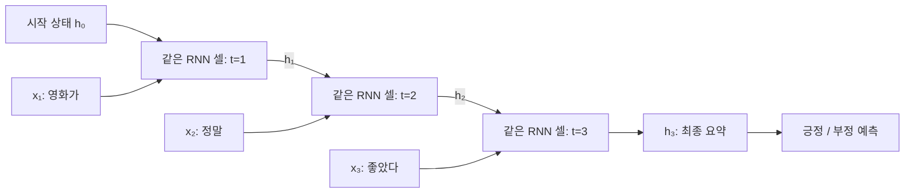
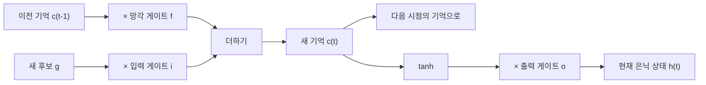

# 머신러닝 12강 — 딥러닝(2): RNN은 어떻게 기억하고, LSTM과 GRU는 왜 필요할까?

> **대상:** 이 강의를 처음 듣고, 신경망 용어도 아직 낯선 사람  
> **바탕:** 사용자가 제공한 학습개요·학습목표·정리하기. 실제 강의 영상 전체를 확인한 문서는 아닙니다.  
> **공부 방법:** 첫 번째에는 이야기와 그림을, 두 번째에는 계산 예제를, 세 번째에는 공식과 복습 문제를 읽으세요.  
> 숫자와 문장은 이해를 위해 만든 교육용 예제입니다. 기울기 그래프는 실제 학습 결과가 아니라 단순한 곱셈 모형입니다.

---

## 0. 오늘 강의가 하려는 말부터 잡아 봅시다

여러분, 다음 두 문장을 보세요.

- “영화가 **좋다**.”
- “영화가 좋을 줄 알았는데, **별로였다**.”

컴퓨터가 단어를 하나씩 읽는다고 합시다. `좋다`라는 단어만 보고 긍정이라고 결정하면 두 번째 문장을 잘못 판단할 수 있습니다. 뒤에 오는 말까지 읽으며 **앞에서 읽은 내용과 지금 읽는 내용을 함께 해석**해야 합니다.

이번 강의는 이 문제를 다룹니다.

```text
순서가 중요한 데이터를 처리하고 싶다
               ↓
RNN: 앞에서 만든 요약을 다음 단계에 전달하자
               ↓
그런데 멀리 떨어진 정보는 학습하기 어렵다
               ↓
LSTM: 기억을 지우고, 쓰고, 꺼내는 장치를 두자
               ↓
GRU: 비슷한 목적을 더 간단한 구조로 구현하자
```

**한 문장으로:** RNN은 이전 상태를 전달하는 신경망이고, LSTM과 GRU는 그 상태를 더 잘 관리하도록 만든 RNN 셀입니다.

## 1. 순차 데이터란 무엇인가?

### 1.1 같은 재료라도 순서가 바뀌면 의미가 바뀐다

“개가 사람을 물었다”와 “사람이 개를 물었다”는 등장하는 주요 단어가 같아도 뜻이 다릅니다. 이렇게 **요소의 순서가 정보의 일부인 데이터**를 순차 데이터, 또는 시퀀스라고 부릅니다.

| 데이터 | 순서대로 들어오는 요소 | 앞뒤 관계가 필요한 이유 |
|---|---|---|
| 문장 | 단어 또는 토큰 | 주어·목적어·부정 표현 등이 의미를 바꿈 |
| 음성 | 짧은 시간 구간의 소리 특징 | 앞뒤 발음을 함께 봐야 말을 구별하기 쉬움 |
| 동영상 | 프레임 | 정지 장면뿐 아니라 움직임의 방향이 중요함 |
| 주식 시세 | 시간별 가격·거래량 | 시간에 따른 변화가 분석 대상임 |

**토큰**은 모델이 읽는 텍스트 조각입니다. 단어일 수도 있고 단어보다 작은 조각일 수도 있습니다. 이 문서에서는 이해를 위해 단어 단위로 설명합니다.

순차 데이터에는 세 가지 특징이 있습니다.

1. **순서가 중요합니다.** 순서를 바꾸면 의미나 해석이 달라집니다.
2. **길이가 달라질 수 있습니다.** 문장은 3단어일 수도, 30단어일 수도 있습니다.
3. **요소 사이에 의존성이 있습니다.** 지금의 해석에 앞의 정보가 필요할 수 있습니다.

여기서 의존성이란 “A를 이해하려면 B를 참고해야 한다”는 뜻입니다.

### 1.2 CNN과는 관심사가 어떻게 다른가?

지난 강의의 CNN은 이미지에서 가까이 있는 픽셀의 패턴을 찾는 데 적합한 구조였습니다. 이번 강의의 RNN은 순서를 따라 상태를 이어 가는 구조입니다.

| 비교 | CNN의 대표적 사용 | RNN의 대표적 사용 |
|---|---|---|
| 먼저 떠올릴 관계 | 공간에서 가까운 부분의 관계 | 순서상 앞뒤 요소의 관계 |
| 예 | 획 → 눈·코 → 얼굴 | 앞의 단어 → 문맥 → 다음 해석 |
| 핵심 장치 | 필터를 이동하며 특징 추출 | 이전 은닉 상태를 다음 계산에 전달 |

이것은 대표적인 쓰임새의 비교입니다. CNN도 순차 데이터에 사용할 수 있고, 동영상에서는 CNN과 RNN을 결합할 수도 있습니다.

## 2. RNN의 출발점: 작은 요약 메모를 계속 고쳐 쓰기

### 2.1 은닉 상태는 ‘지금까지 읽은 내용의 요약’이다

여러분이 긴 이야기를 듣는다고 해 봅시다. 매 순간 이야기 전체를 처음부터 다시 떠올리기보다는, 머릿속에 남은 요약을 새 정보와 합쳐 갱신합니다.

RNN도 비슷한 방식으로 계산합니다.

> **이번 요약 = 새 입력과 직전 요약을 합쳐 계산한 결과**

이 요약을 **은닉 상태(hidden state)**라고 부릅니다. `은닉`은 내부에서 사용하는 값이라는 뜻입니다. 실제로는 문장으로 쓴 메모가 아니라 여러 숫자를 모은 **벡터**입니다.

예를 들어 은닉 상태가 `[0.2, -0.7, 0.4]`일 수 있습니다. 각 칸을 사람이 반드시 “주어”, “긍정”처럼 해석할 수 있는 것은 아닙니다. 어떤 정보를 담을지는 학습으로 정해집니다.

```text
현재 입력 xₜ ─────┐
                 ├─→ [RNN 셀] ─→ 현재 은닉 상태 hₜ ─→ 다음 시점
이전 상태 hₜ₋₁ ──┘                       │
                                        └─→ 출력 계산 → 예측 ŷₜ
```

여기서 **셀**은 한 시점에서 수행하는 계산 묶음입니다. 생물학적 세포라는 의미로 받아들이지 않아도 됩니다.

### 2.2 ‘시간 t’는 꼭 시계 시간이 아니다

| 기호 | 읽는 방법 | 뜻 |
|---|---|---|
| $t$ | 티 | 시퀀스에서 몇 번째 단계인지 |
| $x_t$ | 엑스 티 | 현재 입력의 숫자 표현 |
| $h_{t-1}$ | 에이치 티 마이너스 일 | 직전 단계의 은닉 상태 |
| $h_t$ | 에이치 티 | 현재 단계에서 만든 은닉 상태 |
| $\hat y_t$ | 와이 햇 티 | 현재 예측 |
| $h_0$ | 에이치 영 | 시작 상태. 흔히 0 벡터로 설정 |

문장을 읽을 때 `t=3`은 세 번째 단어를 뜻할 수 있습니다. 음성에서는 세 번째 짧은 소리 구간일 수 있습니다.

### 2.3 순환 그림과 펼친 그림은 같은 계산이다

RNN을 간단히 그리면 셀에서 나온 상태가 다시 셀로 돌아가는 화살표가 있습니다. 이것을 시간 순서대로 펼치면 아래처럼 됩니다.



Mermaid를 지원하지 않는 뷰어에서는 다음처럼 읽으세요.

```text
입력:         영화가          정말           좋았다
                ↓             ↓               ↓
상태: h₀ → [같은 셀] → h₁ → [같은 셀] → h₂ → [같은 셀] → h₃
                                                               ↓
                                                          문장 감정 예측
```

**핵심은 모든 시점에서 같은 가중치를 쓴다는 점입니다.** 단어가 늘어날 때마다 새 모델을 만드는 것이 아니라, 같은 계산 규칙을 반복 적용합니다. 그래서 다양한 길이의 시퀀스를 처리할 수 있습니다. 실제 구현에서는 여러 문장을 묶기 위해 패딩과 마스킹 같은 보조 처리를 쓰기도 합니다.

## 3. 기본 RNN 셀의 계산을 직접 따라가 보기

### 3.1 먼저 뉴런의 계산을 복습하자

신경망은 보통 입력에 가중치를 곱하고, 편향을 더하고, 활성화 함수를 적용합니다.

- **가중치:** 어떤 입력을 얼마나 반영할지 정하는 숫자.
- **편향:** 입력과 별도로 더하는 조정값.
- **활성화 함수:** 합산 결과를 변환하는 함수. 비선형 관계를 배우게 해 줍니다.
- **학습:** 예측이 정답에 가까워지도록 가중치와 편향을 바꾸는 과정.

RNN은 여기에 **이전 은닉 상태도 입력으로 넣는다**는 특징이 있습니다.

$$
h_t=\tanh(W_xx_t+W_hh_{t-1}+b_h)
$$

말로 읽으면 다음과 같습니다.

> 현재 입력을 반영한 값과 이전 상태를 반영한 값을 더하고, 편향을 더한 뒤 tanh를 통과시켜 새 상태를 만든다.

실제 $W_x, W_h$는 여러 가중치를 모은 행렬입니다. $W_xx_t$는 행렬과 벡터의 곱입니다. 지금은 “입력을 여러 기준으로 섞는 가중합”으로 이해하면 됩니다.

### 3.2 tanh와 softmax는 서로 다른 일을 한다

**tanh(하이퍼볼릭 탄젠트)**는 값을 -1과 1 사이로 바꾸는 함수입니다.

| 입력 $a$ | $\tanh(a)$, 대략 |
|---:|---:|
| -3 | -0.995 |
| -1 | -0.762 |
| 0 | 0 |
| 1 | 0.762 |
| 3 | 0.995 |

입력의 절댓값이 커지면 출력이 -1 또는 1 근처에 붙습니다. 이를 **포화**라고 하며, 나중에 기울기 소멸을 이해할 때 중요합니다.

분류 문제의 출력에서는 다음 계산을 쓸 수 있습니다.

$$
o_t=W_yh_t+b_y,\qquad \hat y_t=\operatorname{softmax}(o_t)
$$

**softmax**는 여러 점수를 합이 1인 양수들로 바꿉니다. 예를 들어 `[긍정 0.8, 부정 0.2]`처럼 분류 확률로 해석할 수 있게 만듭니다. 단, 숫자 0.8이 현실에서 항상 정확히 80%의 신뢰도를 보장하는 것은 아닙니다.

기본 RNN 은닉 상태에는 tanh, 다중 분류 출력에는 softmax가 흔히 쓰입니다. 회귀라면 출력에 softmax를 쓰지 않을 수 있고, 이진 분류에는 sigmoid를 쓸 수도 있습니다. **출력 함수는 문제에 맞춰 고릅니다.**

### 3.3 숫자가 하나뿐인 아주 작은 RNN

복잡한 벡터 대신 입력도 상태도 숫자 하나라고 가정합시다.

$$
h_t=\tanh(x_t+0.5h_{t-1}),\qquad h_0=0
$$

입력은 `[1, 0, 1]`입니다. 여기의 1과 0은 교육용 숫자이며 실제 단어의 의미를 뜻하지 않습니다.

| 단계 | 현재 입력 | 이전 상태 | tanh에 넣는 값 | 새 상태 |
|---|---:|---:|---:|---:|
| 1 | 1 | 0 | $1+0.5\times0=1$ | 약 0.762 |
| 2 | 0 | 0.762 | $0+0.5\times0.762=0.381$ | 약 0.363 |
| 3 | 1 | 0.363 | $1+0.5\times0.363=1.182$ | 약 0.828 |

두 번째 입력이 0인데도 상태는 0이 아닙니다. **이전 입력의 영향이 상태를 통해 남아 있기 때문입니다.**

이 모델은 각 입력을 독립적으로 처리하지 않습니다. 같은 입력 1이 들어와도 앞에 어떤 상태가 있었는지에 따라 결과가 달라집니다.

## 4. 입력과 출력의 개수는 과제에 따라 달라진다

`m`, `n`은 개수를 나타냅니다. 각각 반드시 다른 값이어야 한다는 뜻은 아닙니다.

| 대응 관계 | 모양 | 대표 예 | 출력 시점 |
|---|---|---|---|
| 1:m | 하나 → 여러 개 | 이미지 캡셔닝 | 사진 정보로 단어를 차례대로 생성 |
| m:1 | 여러 개 → 하나 | 문장 감정 분류 | 문장을 읽고 최종 분류 |
| m:m | 여러 개 → 같은 수 | 단어별 품사 분류, 프레임별 비디오 분류 | 각 입력 단계마다 출력 |
| m:n | 여러 개 → 여러 개 | 기계번역 | 입력을 읽고 다른 길이의 문장 생성 가능 |

```text
1:m     [사진]         →  “개가” → “뛰고” → “있다”
m:1     “정말” → “좋다” →  [긍정]
m:m     “나는” → “밥을” → “먹는다”
           ↓       ↓         ↓
         [품사]  [품사]    [품사]
m:n     [한국어 입력 문장] → [영어 출력 문장]
```

이미지 캡셔닝에서는 사진 특징을 CNN 등으로 추출해 RNN에 조건으로 주고 단어를 생성할 수 있습니다. 번역에서는 입력을 읽는 **인코더**와 출력을 만드는 **디코더**를 구성할 수 있습니다.

강의에 나온 온라인 필기 인식도 짧은 입력을 하나의 문자로 분류하면 m:1로 설명할 수 있습니다. 다만 단어나 문장 전체를 인식하여 문자 여러 개를 출력하는 과제라면 m:n이 됩니다. **응용 이름보다 실제 입력과 출력 단위를 보고 구분하세요.**

## 5. 다층 RNN과 양방향 RNN

### 5.1 다층 RNN: 같은 시점에서 위로도 깊게 쌓기

지금까지는 한 층의 상태가 시간에 따라 전달되었습니다. 다층 RNN은 그 위에 RNN 층을 더 쌓습니다.

```text
시간 →        1              2              3
2층       [상태] ─────→ [상태] ─────→ [상태]
             ↑              ↑              ↑
1층       [상태] ─────→ [상태] ─────→ [상태]
             ↑              ↑              ↑
입력         x₁             x₂             x₃
```

**가로 화살표는 시간의 흐름**, **세로 화살표는 층 사이의 전달**입니다. 두 방향을 구별하세요. 각 층은 보통 서로 다른 파라미터를 가지며, 한 층 안에서는 시간 전체에 걸쳐 파라미터를 공유합니다.

### 5.2 양방향 RNN: 앞 문맥과 뒤 문맥을 함께 보기

“나는 배를 ___”에서 `배`가 과일인지 탈것인지 판단하려면 뒤의 `먹었다` 또는 `탔다`가 도움이 됩니다.

양방향 RNN은 입력을 앞에서 뒤로 읽는 RNN과 뒤에서 앞으로 읽는 RNN을 둡니다. 각 위치에서 두 상태를 결합해 앞뒤 문맥을 활용합니다.

```text
정방향:   x₁ → x₂ → x₃ → x₄
역방향:   x₁ ← x₂ ← x₃ ← x₄
                 ↓
       각 위치에서 양쪽 상태를 결합
```

전체 문장이 주어진 분석에는 유용합니다. 반면 미래 입력이 아직 오지 않은 실시간 처리에서는 전체 뒤 문맥을 즉시 사용할 수 없습니다. 입력을 얼마나 기다릴 수 있는지가 중요해집니다.

## 6. RNN은 어떻게 배우나? — BPTT

### 6.1 추론과 학습은 다르다

- **추론:** 정해진 가중치로 입력을 읽고 예측하는 일.
- **학습:** 예측과 정답을 비교해 가중치를 수정하는 일.

예를 들어 긍정 문장에 대해 모델이 긍정 확률을 0.2라고 예측하면 정답과 차이가 큽니다. 이 차이를 **손실(loss)**이라는 숫자로 측정합니다. 정답이 긍정인 경우의 교차 엔트로피 손실은 $-\log p(\text{긍정})$로 나타낼 수 있습니다.

**기울기**는 “이 가중치를 조금 바꾸면 손실이 어느 방향으로 얼마나 변하는가”를 나타냅니다. 학습은 보통 손실이 줄어드는 방향으로 가중치를 조금씩 바꿉니다.

$$
\theta\leftarrow\theta-\eta\frac{\partial L}{\partial\theta}
$$

$\theta$는 학습할 파라미터, $L$은 손실, $\eta$는 한 번에 얼마나 움직일지 정하는 학습률입니다.

### 6.2 시간 역전파는 펼쳐진 계산을 거꾸로 따라가는 것이다

BPTT는 **Backpropagation Through Time**, 즉 시간 역전파입니다.

```text
앞으로 계산: x₁ → h₁ → h₂ → h₃ → 예측 → 손실
                            ↑
                 각 단계에는 해당 입력도 들어옴

오차의 영향:      h₁ ← h₂ ← h₃ ← 예측 ← 손실
```

마지막 예측에 문제가 있었다면, 마지막 상태뿐 아니라 그 상태를 만드는 데 영향을 준 이전 상태들까지 거슬러 올라가 책임을 계산합니다. 이것은 과거의 입력을 수정한다는 뜻이 아니라, **그 입력을 처리한 가중치의 수정 방향을 계산한다**는 뜻입니다.

모든 시점에서 같은 가중치를 썼으므로 각 시점에서 계산된 기여를 합쳐 그 가중치를 갱신합니다. 출력이 매 시점에 있으면 여러 시점의 손실을 합치거나 평균내어 학습할 수 있습니다.

긴 시퀀스의 비용을 줄이려고 일정 구간까지만 거슬러 올라가는 **절단 BPTT**도 사용합니다. 이 경우 상태는 이어 전달하더라도, 기울기가 거슬러 가는 범위는 제한될 수 있습니다.

## 7. 왜 멀리 있는 정보를 배우기 어려울까?

### 7.1 장기의존성 문제

다음 문장을 생각해 봅시다.

> “나는 프랑스에서 태어나서 … 아주 긴 이야기 … 지금도 **프랑스어**를 쓴다.”

뒤의 말을 예측하는 데 한참 앞의 `프랑스`가 도움이 됩니다. 이처럼 먼 위치의 정보가 필요한 관계를 **장기의존성**이라고 합니다.

기본 RNN은 상태 크기가 제한되어 있고 새 입력을 받을 때마다 상태를 계속 변환합니다. 여기에 학습 과정에서 기울기가 작아지는 문제까지 생기면, 먼 과거의 정보가 중요하다는 사실을 배우기 어려워집니다.

### 7.2 기울기 소멸과 폭발: 같은 비율을 여러 번 곱한다고 생각하자

기울기는 여러 시간 단계를 통과하며 미분값들이 곱해지는 형태를 포함합니다. 단순화해서 매 단계마다 0.5가 곱해지면 어떻게 될까요?

$$
0.5^{10}\approx0.000977,\qquad0.5^{20}\approx0.000000954
$$

반대로 1.5가 반복해 곱해지면 $1.5^{20}\approx3325$로 커집니다.

| 거슬러 간 단계 수 $k$ | 소멸 예: $0.5^k$ | 폭발 예: $1.5^k$ |
|---:|---:|---:|
| 0 | 1 | 1 |
| 5 | 0.03125 | 7.594 |
| 10 | 0.000977 | 57.665 |
| 15 | 0.0000305 | 437.894 |
| 20 | 0.000000954 | 3325.257 |

아래는 같은 표를 로그 눈금으로 그린 개념 그래프입니다. 세로축 한 칸 차이는 같은 덧셈이 아니라 **10배 정도의 차이**를 뜻합니다.

```text
반복 곱의 크기 (로그 눈금, ● 소멸 / ▲ 폭발)
 10⁴ |                                          ▲
 10³ |                                ▲
 10² |                      ▲
 10¹ |            ▲
 10⁰ |  ◆
 10⁻¹|            ●
 10⁻²|
 10⁻³|                      ●
 10⁻⁴|
 10⁻⁵|                                ●
 10⁻⁶|                                          ●
     +---------------------------------------------
        0         5        10        15        20
                   거슬러 간 단계 수
◆: 두 곡선이 모두 1에서 출발. 점 위치는 개략적이며 정확한 수치는 위 표 참고.
```

이 그래프가 “기억이 정확히 반씩 사라진다”는 뜻은 아닙니다. **학습 신호가 여러 단계를 지날 때 반복 곱 때문에 약해지거나 커질 수 있다**는 설명입니다. 실제 RNN에서는 행렬과 활성화 함수의 미분이 함께 관여합니다.

| 문제 | 학습에서 일어나는 일 | 대표적인 대응 |
|---|---|---|
| 기울기 소멸 | 먼 시점의 가중치에 유용한 수정 신호가 잘 전달되지 않음 | LSTM·GRU 등 구조 개선 |
| 기울기 폭발 | 수정 신호가 너무 커져 학습이 불안정해짐 | 기울기 클리핑 등 |

**기울기 클리핑**은 기울기가 정한 기준보다 크면 크기를 줄이는 방법입니다. 소멸한 기울기를 되살리는 방법은 아닙니다.

## 8. LSTM: 기억을 지우고, 쓰고, 꺼내는 장치

### 8.1 상태를 두 종류로 나누자

LSTM은 Long Short-Term Memory의 약자입니다. 기본 RNN보다 먼 정보의 보존과 학습을 쉽게 하도록 설계된 셀입니다.

| 상태 | 비유 | 역할 |
|---|---|---|
| 셀 상태 $c_t$ | 이어지는 메모장 | 다음 시점으로 넘길 내부 기억 |
| 은닉 상태 $h_t$ | 지금 꺼내 보여 주는 요약 | 다음 셀과 출력층 등에 전달할 표현 |

비유상 $c_t$를 장기 기억, $h_t$를 단기 표현이라고 부를 수 있지만, 둘이 실제로 기억하는 기간이 고정되어 있는 것은 아닙니다. 그리고 $h_t$는 최종 정답 자체가 아닙니다. 보통 별도의 출력층이 $h_t$에서 예측을 만듭니다.

### 8.2 게이트는 0~1 사이의 통과 비율이다

게이트는 정보를 얼마나 통과시킬지 계산하는 장치입니다. 일반적으로 sigmoid 함수를 사용합니다.

$$
\sigma(a)=\frac{1}{1+e^{-a}}
$$

- 0에 가까우면 거의 막습니다.
- 1에 가까우면 거의 그대로 통과시킵니다.
- 0.3이면 그 성분을 30%만 반영합니다.

실제 게이트는 숫자 하나가 아니라 벡터입니다. 메모장 전체에 한 개의 수도꼭지를 다는 것이 아니라 **각 숫자 칸마다 다른 통과 비율**을 정하는 셈입니다. 게이트 값도 현재 입력과 이전 은닉 상태로 계산하며, 그 계산에 쓰는 가중치를 학습합니다.

### 8.3 세 게이트를 문장으로 먼저 이해하자

| 게이트 | 기호 | 묻는 질문 | 작동 대상 |
|---|---|---|---|
| 망각 게이트 | $f_t$ | 이전 기억을 얼마나 남길까? | 이전 셀 상태 $c_{t-1}$ |
| 입력 게이트 | $i_t$ | 새로 제안된 내용을 얼마나 쓸까? | 후보 기억 $g_t$ |
| 출력 게이트 | $o_t$ | 현재 기억을 얼마나 드러낼까? | $\tanh(c_t)$ |

**주의:** 망각 게이트 값이 1이면 많이 잊는 것이 아니라 **많이 보존**합니다. 이름 때문에 거꾸로 외우기 쉽습니다.

### 8.4 LSTM 구조도



그림에서는 기억의 흐름을 강조했습니다. 실제로 $f_t,i_t,o_t,g_t$는 모두 현재 입력 $x_t$와 이전 은닉 상태 $h_{t-1}$로 계산합니다.

Mermaid가 보이지 않으면 아래 두 줄이 같은 구조를 설명합니다.

```text
새 기억 = (이전 기억 × 보존 비율) + (새 후보 × 기록 비율)
현재 은닉 상태 = tanh(새 기억) × 드러낼 비율
```

### 8.5 공식을 이야기와 연결하기

이 문서에서는 후보 기억을 $g_t$라고 쓰겠습니다. 교재에 따라 $\tilde c_t$라고도 씁니다.

$$
\begin{aligned}
f_t&=\sigma(W_fx_t+U_fh_{t-1}+b_f)\\
i_t&=\sigma(W_ix_t+U_ih_{t-1}+b_i)\\
g_t&=\tanh(W_gx_t+U_gh_{t-1}+b_g)\\
o_t&=\sigma(W_ox_t+U_oh_{t-1}+b_o)\\
c_t&=f_t\odot c_{t-1}+i_t\odot g_t\\
h_t&=o_t\odot\tanh(c_t)
\end{aligned}
$$

$\odot$는 **같은 위치의 숫자끼리 곱한다**는 기호입니다. `[0.2, 0.8] ⊙ [10, 5] = [2, 4]`입니다. 행렬곱과 구별하세요.

처음에는 아래 두 식만 읽을 수 있으면 됩니다.

1. $c_t=f_t\odot c_{t-1}+i_t\odot g_t$: **남긴 과거 + 받아들인 새 정보**.
2. $h_t=o_t\odot\tanh(c_t)$: **기억에서 지금 드러낼 표현**.

망각·입력 게이트는 각각 계산되므로 보통 $f_t+i_t=1$이라는 제약이 없습니다.

### 8.6 숫자로 보는 기억 갱신

한 성분만 보겠습니다. 이전 기억이 0.8, 망각 게이트가 0.9, 새 후보가 -0.5, 입력 게이트가 0.2, 출력 게이트가 0.6이라고 합시다.

$$
c_t=0.9\times0.8+0.2\times(-0.5)=0.72-0.10=0.62
$$

$$
h_t=0.6\times\tanh(0.62)\approx0.6\times0.551=0.331
$$

| 순서 | 계산 | 해석 |
|---|---|---|
| 과거 보존 | $0.9\times0.8=0.72$ | 이전 기억 대부분을 유지 |
| 새 내용 반영 | $0.2\times(-0.5)=-0.10$ | 반대 방향의 새 정보를 일부 반영 |
| 기억 갱신 | $0.72-0.10=0.62$ | 새 셀 상태 |
| 외부 표현 | $0.6\times\tanh(0.62)\approx0.331$ | 현재 은닉 상태 |

**기억에 남아 있는 양과 지금 드러내는 양이 다르다**는 점을 확인하세요.

### 8.7 LSTM은 왜 도움이 되나?

기본 RNN은 상태 전체를 매번 가중합과 tanh로 변환합니다. LSTM에는 셀 상태를 **곱해서 보존하고 새 정보를 더하는 경로**가 있습니다.

망각 게이트가 1에 가깝고 입력 게이트가 0에 가까우면 다음 관계가 됩니다.

$$
c_t\approx c_{t-1}
$$

이 경로 덕분에 정보를 유지하고 기울기를 전달하기가 쉬워집니다. 직접적인 셀 상태 경로만 보면 전달 비율은 망각 게이트와 연결됩니다. 전체 미분에는 게이트 계산을 통한 다른 경로도 있으므로, 전체 기울기가 단순히 망각 게이트 하나와 같다는 뜻은 아닙니다.

강의의 “원하는 만큼 기억”, “장기의존성 해결”은 **오래 기억할 수 있는 구조적 장치를 마련했다**고 이해하면 정확합니다. 무한히 완벽하게 기억한다거나 기울기 문제가 항상 사라진다는 보장은 없습니다.

## 9. GRU: 기억과 표현을 하나로 합쳐 단순화하기

GRU는 Gated Recurrent Unit의 약자입니다. LSTM처럼 게이트를 사용하지만, 표준적인 GRU에는 별도의 셀 상태 $c_t$가 없고 **은닉 상태 $h_t$ 하나**로 기억을 전달합니다.

### 9.1 두 게이트는 서로 다른 질문을 한다

| 게이트 | 기호 | 질문 | 주된 역할 |
|---|---|---|---|
| 리셋 게이트 | $r_t$ | 새 후보를 만들 때 과거를 얼마나 참고할까? | 후보 계산에 들어가는 과거 정보 조절 |
| 갱신 게이트 | $z_t$ | 최종 상태에서 과거와 새 후보를 어떻게 섞을까? | 이전 상태와 후보 상태의 혼합 |

**리셋 게이트가 0이라고 이전 상태가 최종 출력에서 반드시 전부 사라지는 것은 아닙니다.** 후보를 만드는 데 과거를 덜 참고하게 하는 것이며, 이전 상태는 갱신 게이트가 조절하는 보존 경로로 남을 수 있습니다.

### 9.2 이 문서의 갱신 게이트 약속

GRU는 자료에 따라 $z_t$의 의미를 반대로 표기합니다. 이 문서에서는 **$z_t$가 클수록 이전 상태를 많이 보존**하는 식을 사용합니다.

$$
\begin{aligned}
r_t&=\sigma(W_rx_t+U_rh_{t-1}+b_r)\\
z_t&=\sigma(W_zx_t+U_zh_{t-1}+b_z)\\
\tilde h_t&=\tanh(W_hx_t+U_h(r_t\odot h_{t-1})+b_h)\\
h_t&=z_t\odot h_{t-1}+(1-z_t)\odot\tilde h_t
\end{aligned}
$$

$\tilde h_t$는 **후보 상태**, 즉 새 상태로 쓸 수 있는 제안입니다. GRU 구현에 따라 리셋을 곱하는 위치와 편향 구성에는 변형이 있습니다. 위 식은 개념을 설명하는 한 가지 널리 쓰이는 형태입니다.

교재가 $h_t=(1-z_t)\odot h_{t-1}+z_t\odot\tilde h_t$라고 쓰면, 그 교재에서는 $z_t$가 클수록 새 후보를 많이 반영합니다. **이름만 외우지 말고 이전 상태 앞의 계수를 확인하세요.**

### 9.3 GRU 구조도

```text
                         ┌─ × z ──────────────────┐
이전 상태 hₜ₋₁ ──────────┤                         ↓
                         └─ × r → 후보 계산 ──→ [더하기] → 새 상태 hₜ
현재 입력 xₜ ──────────────────────↑        │       ↑
                                          └─ × (1-z)

r: 후보를 만들 때 과거를 참고하는 비율
z: 최종 상태에서 과거를 보존하는 비율 (이 문서의 표기)
```

입력과 이전 상태는 두 게이트를 계산하는 데도 사용됩니다. 그림에서는 상태의 두 전달 경로를 강조했습니다.

### 9.4 숫자로 비교하기

이전 상태가 0.8이고, 리셋 게이트 등을 통해 계산한 후보가 -0.4라고 합시다.

| 갱신 게이트 $z_t$ | 계산 | 결과 | 의미 |
|---:|---|---:|---|
| 0.9 | $0.9(0.8)+0.1(-0.4)$ | 0.68 | 과거를 많이 유지 |
| 0.2 | $0.2(0.8)+0.8(-0.4)$ | -0.16 | 새 후보를 많이 반영 |

후보 상태의 계산과 최종 혼합을 구별하세요. **리셋은 후보 만들기, 갱신은 최종 섞기**라고 기억하면 좋습니다.

## 10. RNN·LSTM·GRU를 한 표로 정리하기

엄밀히는 LSTM과 GRU도 RNN 계열입니다. 아래의 ‘기본 RNN’은 게이트 없는 단순 RNN을 뜻합니다.

| 항목 | 기본 RNN | LSTM | GRU |
|---|---|---|---|
| 다음 시점에 전달하는 상태 | $h_t$ | $c_t$, $h_t$ | $h_t$ |
| 표준적인 게이트 수 | 없음 | 3개 | 2개 |
| 게이트 이름 | 해당 없음 | 망각·입력·출력 | 리셋·갱신 |
| 기억 갱신의 핵심 | 입력과 과거를 비선형 변환 | 과거 기억 보존 + 새 정보 추가 | 과거 상태와 새 후보 혼합 |
| 먼 정보 학습 | 어려울 수 있음 | 개선하도록 설계 | 개선하도록 설계 |
| 같은 입력·상태 크기에서 구조 규모 | 상대적으로 작음 | 상대적으로 큼 | 보통 LSTM보다 작음 |
| 기억할 비유 | 매번 고쳐 쓰는 요약 | 메모장과 보여 줄 요약 | 하나의 요약을 선택적으로 교체 |

같은 입력 차원 $d$, 은닉 차원 $H$이고 각 계산에 편향 하나를 쓰는 단순 구성에서는 셀 파라미터 수가 다음과 같습니다. 출력층은 제외합니다.

$$
\begin{aligned}
\text{기본 RNN}&: H(d+H+1)\\
\text{LSTM}&:4H(d+H+1)\\
\text{GRU}&:3H(d+H+1)
\end{aligned}
$$

LSTM은 게이트가 3개인데 왜 4배일까요? **게이트 3개에 후보 기억 계산 1개**가 더 필요하기 때문입니다. GRU도 게이트 2개와 후보 계산 1개입니다. 실제 라이브러리는 편향을 나누는 등 구현 차이로 개수가 달라질 수 있습니다.

GRU가 더 단순하다고 항상 더 정확하거나 항상 더 빠른 것은 아닙니다. 성능은 데이터, 크기, 학습 조건과 구현에 따라 달라집니다.

## 11. 흔히 헷갈리는 문장을 바로잡아 봅시다

| 헷갈리는 생각 | 정확한 이해 |
|---|---|
| RNN은 과거 입력을 전부 그대로 저장한다 | 고정 크기 상태에 필요한 정보를 담도록 학습함 |
| 펼친 RNN 그림의 셀은 각각 다른 모델이다 | 같은 셀 계산과 같은 파라미터를 시간에 따라 반복함 |
| 은닉 상태는 예측 정답이다 | 내부 표현이며, 보통 출력층을 거쳐 예측을 만듦 |
| 기울기 소멸은 입력 숫자가 0이 되는 현상이다 | 학습 중 전달되는 미분 신호가 작아지는 현상임 |
| LSTM 망각 게이트가 1이면 모두 잊는다 | 1에 가까우면 이전 기억을 많이 보존함 |
| LSTM의 입력·망각 게이트 합은 항상 1이다 | 표준 LSTM에서는 각각 계산하여 그런 제약이 없음 |
| 출력 게이트가 닫히면 기억 자체가 삭제된다 | $h_t$로 드러내는 양을 줄이며, $c_t$의 직접 삭제와 다름 |
| GRU 리셋 게이트는 최종 상태를 무조건 0으로 만든다 | 새 후보 계산에서 과거 참고를 조절함 |
| LSTM과 GRU는 BPTT를 쓰지 않는다 | 이 셀을 쓰는 RNN도 시간에 걸쳐 역전파로 학습 가능 |
| 양방향 RNN은 미래를 예측해 미리 안다 | 이미 주어진 뒤쪽 입력도 읽어 활용함 |

## 12. 교수님이 시험에 물었다고 생각하고 답해 보기

먼저 답을 가리고 자기 말로 한두 문장씩 설명하세요.

1. 문장이 순차 데이터인 이유를 예로 설명하세요.
2. 기본 RNN에서 현재 상태를 계산할 때 필요한 두 정보는 무엇인가요?
3. 시간에 따라 펼친 RNN에서 가중치는 시점마다 다른가요?
4. `[단어 여러 개] → [감정 하나]`는 어떤 입력·출력 관계인가요?
5. BPTT에서 ‘시간을 거슬러 간다’는 말은 무엇을 뜻하나요?
6. 기울기 소멸과 폭발은 각각 어떤 문제인가요?
7. LSTM의 두 상태와 세 게이트를 말해 보세요.
8. LSTM에서 $f_t=1$, $i_t=0$이면 셀 상태는 어떻게 되나요? 이상화한 값으로 계산하세요.
9. GRU의 리셋 게이트와 갱신 게이트는 어떻게 다른가요?
10. 이 문서의 GRU 식에서 $z_t$가 1에 가까우면 무엇을 많이 유지하나요?
11. 실시간 입력에서 양방향 RNN을 바로 쓰기 어려운 이유는 무엇인가요?
12. LSTM이 긴 의존성을 항상 완벽하게 해결한다고 말해도 될까요?

### 답과 해설

1. **순서에 의미가 있기 때문입니다.** “개가 사람을 물었다”와 “사람이 개를 물었다”는 의미가 다릅니다.
2. **현재 입력 $x_t$와 이전 은닉 상태 $h_{t-1}$**입니다.
3. **같은 가중치를 공유합니다.** 시간 단계가 늘어나도 같은 규칙을 반복합니다.
4. **m:1**입니다. 여러 입력을 읽고 결과 하나를 냅니다.
5. 펼친 계산을 거꾸로 따라가며 **과거 시점의 계산이 손실에 미친 영향을 미분으로 계산**한다는 뜻입니다.
6. 소멸은 기울기가 너무 작아 먼 과거에 대한 학습이 어려워지는 문제, 폭발은 너무 커져 학습이 불안정해지는 문제입니다.
7. 상태는 **셀 상태 $c_t$, 은닉 상태 $h_t$**, 게이트는 **망각·입력·출력**입니다.
8. $c_t=1\odot c_{t-1}+0\odot g_t=c_{t-1}$입니다. 기억을 유지합니다. 실제 sigmoid의 유한 입력에서는 정확한 0·1보다 그에 가까운 값이 나옵니다.
9. 리셋은 **후보 계산에서 과거 참고량**, 갱신은 **최종 상태에서 과거와 후보의 혼합 비율**을 조절합니다.
10. **이전 은닉 상태**입니다. 교재에서 반대 표기를 쓰면 의미가 달라지므로 식을 확인해야 합니다.
11. 아직 도착하지 않은 뒤쪽 입력은 읽을 수 없기 때문입니다.
12. 아닙니다. 오래 기억하고 기울기를 전달하기 쉬운 구조이지만, 모든 조건에서 완벽한 기억이나 학습을 보장하지는 않습니다.

## 13. 계산 복습 문제

### 문제 A: 기본 RNN

$h_t=\tanh(x_t+0.5h_{t-1})$에서 $x_t=0$, $h_{t-1}=0.6$입니다. 새 상태는?

**풀이:** $h_t=\tanh(0.3)\approx0.291$. 현재 입력이 0이어도 과거의 영향은 남습니다.

### 문제 B: LSTM

$c_{t-1}=0.5$, $f_t=0.8$, $i_t=0.3$, $g_t=-0.2$일 때 새 셀 상태는?

**풀이:** $c_t=0.8(0.5)+0.3(-0.2)=0.4-0.06=0.34$.

### 문제 C: GRU

이 문서의 표기에서 $h_{t-1}=0.6$, $\tilde h_t=-0.2$, $z_t=0.75$일 때 새 상태는?

**풀이:** $h_t=0.75(0.6)+0.25(-0.2)=0.45-0.05=0.40$.

## 14. 시험 직전에 다시 읽을 한 장 요약

```text
[순차 데이터]
순서가 중요함 / 길이가 달라질 수 있음 / 앞뒤 요소가 서로 의존함

[기본 RNN]
현재 입력 + 이전 은닉 상태 → 현재 은닉 상태
hₜ = tanh(Wₓxₜ + Wₕhₜ₋₁ + b)
시점마다 같은 가중치 사용
분류 출력에는 softmax 등을 문제에 맞게 사용

[입력·출력 관계]
1:m 이미지 캡셔닝 / m:1 감정 분류
m:m 위치별 분류 / m:n 번역

[확장]
다층 = 층을 위로 쌓음
양방향 = 앞뒤 두 방향의 문맥을 결합

[학습]
BPTT = 시간을 펼친 계산에 역전파 적용
기울기 소멸·폭발 때문에 긴 의존성 학습이 어려울 수 있음

[LSTM]
상태 두 개: c(기억), h(현재 표현)
게이트 세 개: 망각 / 입력 / 출력
새 기억 = 남긴 과거 + 받아들인 후보
f가 클수록 과거 보존, i가 클수록 새 후보 반영
o가 클수록 현재 기억을 더 드러냄

[GRU]
상태 한 개: h
게이트 두 개: 리셋 / 갱신
리셋 = 후보 만들 때 과거를 얼마나 참고?
갱신 = 과거와 후보를 최종적으로 얼마나 섞음?
z의 방향은 교재 식에서 확인!
```

**마지막 확인:** “왜 순서가 중요하지?” → “RNN은 무엇을 전달하지?” → “왜 먼 과거는 배우기 어렵지?” → “LSTM과 GRU는 어떻게 정보를 골라 남기지?” 이 네 질문에 자기 말로 답할 수 있다면 이번 강의의 큰 줄기를 이해한 것입니다.
