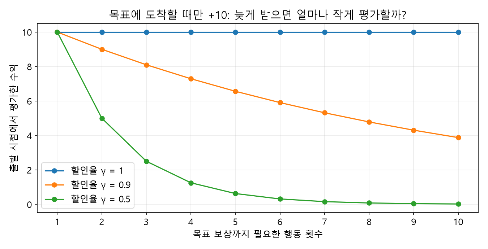
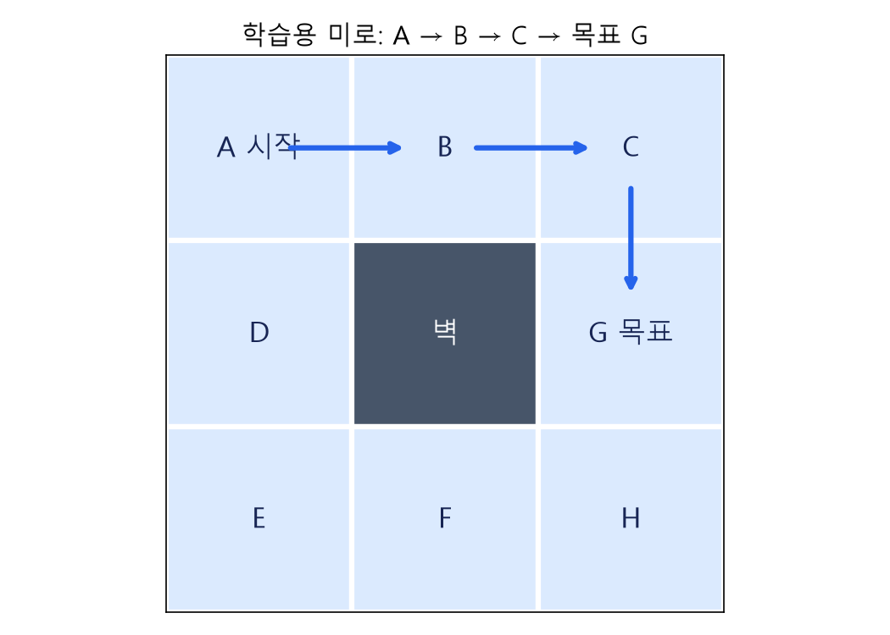

# 머신러닝 15강 — 강화학습: 시행착오로 좋은 행동을 배우는 방법

> **대상:** 강화학습을 처음 듣는 학습자.  
> **범위:** 제공된 강의 개요·목표·정리 내용을 풀어 쓴 해설입니다. 강의 영상 전체를 확인한 문서는 아닙니다.  
> **학습 순서:** 1~6절에서 개념 → 7~10절에서 직접 계산 → 11~14절에서 신경망과 DQN → 마지막 복습 문제.  
> **그림:** 직접 만든 설명용 그림입니다. 그래프는 명시한 가정에 따라 계산했으며 실제 학습 실험 결과가 아닙니다. 그림 폴더를 이 파일과 함께 보관하세요.

---

## 1. 오늘은 이것 하나로 시작합시다

여러분이 처음 가 보는 미로에 들어갔다고 생각해 봅시다. 지도도 없고, 누가 옆에서 “지금 오른쪽으로 가세요”라고 알려 주지도 않습니다. 움직이다가 막다른 길에 부딪치기도 하고, 우연히 출구를 찾기도 합니다.

몇 번 반복하면 이런 생각이 생깁니다.

> “이 갈림길에서는 오른쪽으로 가는 게 나중에 출구에 도착하기 좋았어.”

**행동을 해 보고, 결과를 평가받고, 다음에 더 좋은 행동을 선택하도록 배우는 것**이 강화학습입니다. 여기서 중요한 말은 **‘나중에’**입니다. 지금 당장 점수를 못 받아도 나중의 성공에 도움이 되는 행동을 배워야 합니다.

강화학습의 목표는 매 순간의 보상만 크게 만드는 것이 아니라, **앞으로 받을 보상까지 합친 수익을 크게 만드는 행동 규칙을 배우는 것**입니다.

```text
행동해 본다 → 결과와 보상을 받는다 → 그 행동의 평가를 고친다
     ↑                                      │
     └──────── 다음 행동에 반영한다 ──────────┘
```

### 지도학습·비지도학습과 무엇이 다른가?

| 구분 | 주로 주어지는 정보 | 배우는 내용 | 예시 |
|---|---|---|---|
| 지도학습 | 입력과 목표 정답 | 입력에서 정답을 예측하는 관계 | 사진 → 고양이/강아지 |
| 비지도학습 | 정답 없는 데이터 | 데이터의 구조·묶음·표현 | 비슷한 고객끼리 묶기 |
| 강화학습 | 행동 뒤의 보상과 다음 상황 | 장기적으로 유리한 행동 규칙 | 게임에서 어떤 버튼을 누를지 |

지도학습에서는 “이 사진의 정답은 고양이”라고 알려 줍니다. 강화학습에서는 보통 “이 상황의 정답 행동은 오른쪽”이라고 알려 주지 않습니다. 대신 행동 결과에 점수를 줍니다. **보상은 행동의 정답표가 아니라 결과에 대한 평가 신호**입니다.

또한 강화학습에서는 내가 고른 행동이 다음에 보게 될 상황도 바꿉니다. 이 때문에 단순한 정답 맞히기보다 ‘연속된 결정’을 다루는 성격이 강합니다.

> 강의의 “최근 딥러닝 성공에 강화학습이 큰 몫”이라는 표현은 게임·제어 분야의 성과를 이해하는 맥락으로 읽으세요. 딥러닝 전체의 성공이 모두 강화학습 덕분이라는 뜻은 아닙니다.

## 2. 에이전트와 환경: 누가 무엇을 하는가?

미로에서 **움직임을 결정하는 프로그램**은 에이전트(agent), **이동 결과와 점수를 정하는 미로 세계**는 환경(environment)입니다.

| 용어 | 쉬운 뜻 | 미로 예시 |
|---|---|---|
| 에이전트 | 행동을 고르는 주체 | 미로를 푸는 프로그램 |
| 환경 | 행동의 결과를 돌려주는 세계 | 벽·통로·출구가 있는 미로 |
| 상태 s | 현재 결정에 필요한 상황 정보 | 현재 위치, 필요하면 열쇠 보유 여부 |
| 행동 a | 선택할 수 있는 동작 | 위·아래·왼쪽·오른쪽 |
| 보상 r | 방금 행동 결과에 주어진 점수 | 출구 도착 +10, 일반 이동 0 |
| 전이 | 행동 뒤 상태가 바뀌는 것 | A에서 오른쪽으로 움직여 B로 이동 |
| 에피소드 | 시작부터 종료까지 한 번의 경험 | 출발해서 출구에 도착할 때까지 |

```text
                   행동 a_t
       에이전트 ─────────────────→ 환경
          ↑                         │
          └─────────────────────────┘
               다음 상태 s_(t+1)
               보상 r_(t+1)
```

시간 순서는 **현재 상태 s_t → 행동 a_t → 보상 r_(t+1)과 다음 상태 s_(t+1)**입니다. t는 순서를 나타내는 번호입니다. 책에 따라 보상을 r_t로 쓰기도 있지만, 이 문서에서는 행동 뒤에 받는 보상을 r_(t+1)로 통일합니다.

### 어디에 쓰일까?

| 분야 | 상태 | 행동 | 보상 설계의 예 |
|---|---|---|---|
| 바둑 | 바둑판과 차례 등 | 돌 놓기 | 최종 승패 |
| 아타리 게임 | 최근 게임 화면들 | 이동·발사 버튼 | 게임 점수 변화 |
| 로봇 제어 | 관절 위치·속도 등 | 모터 제어 | 목표 달성, 에너지·충돌 비용 반영 |
| 시스템 제어 | 온도·부하 등 | 냉각·설비 조절 | 목표 유지와 전력 절감 |

이 분야들은 상황마다 이상적인 제어값을 정답으로 붙이기 어렵지만, 실행 결과가 좋은지는 평가할 수 있습니다. 다만 로봇 등의 실제 시행착오는 비용이 크므로 시뮬레이션 등을 활용하기도 합니다.

알파고는 강화학습의 사례이지만 **알파고가 곧 DQN은 아닙니다.** 강화학습 안에는 여러 방법이 있습니다.

## 3. MDP: 문제의 규칙을 수학적으로 정리한 것

MDP는 Markov Decision Process, **마르코프 결정 과정**입니다. 어려운 이름을 잠시 내려놓으면 “어떤 상황에서 무엇을 하면 어떻게 바뀌고 몇 점을 받는가”를 적은 문제 명세입니다.

**MDP = (S, A, P, R, γ)**

| 기호 | 이름 | 미로에서의 질문 |
|---|---|---|
| S | 상태 집합 | 서 있을 수 있는 칸은 어디인가? |
| A | 행동 집합 | 어떤 방향으로 움직일 수 있는가? |
| P | 상태 전이확률 | 오른쪽을 누르면 어느 칸으로 몇 % 확률로 가는가? |
| R | 보상 함수 | 그 이동 결과에 몇 점을 주는가? |
| γ | 할인율 | 먼 미래의 보상을 지금 얼마나 반영할 것인가? |

강의는 유한한 상태·행동 집합을 다루지만, 일반적인 강화학습에는 위치나 속도처럼 연속적인 상태·행동도 있습니다.

**MDP로 문제를 표현한다고 해서 에이전트가 P와 R을 미리 알고 있어야 하는 것은 아닙니다.** Q-학습은 실제로 겪은 전이를 이용하므로 전이확률표를 미리 받지 않아도 됩니다. 이를 모델 프리(model-free) 방법이라고 합니다.

### 마르코프 성질: ‘현재 상태에 필요한 정보가 들어 있다’

강의 요약의 “이전 선택들이 영향을 미치지 않는다”는 문장은 조심해서 해석해야 합니다.

정확한 핵심은 **현재 상태와 행동이 주어지면, 다음 상태와 보상의 확률을 예측할 때 과거 기록을 추가로 알 필요가 없다**는 것입니다.

```text
과거의 전체 기록 + 현재 상태 + 현재 행동
                  ↓ 예측
          다음 상태와 보상의 분포

현재 상태가 충분한 정보를 담았다면,
과거 기록을 빼도 같은 예측을 할 수 있다.
```

열쇠가 있어야 출구가 열리는 미로라면, ‘현재 위치’만으로는 상태가 부족합니다. 같은 출구 앞이라도 열쇠가 있는지에 따라 결과가 달라지기 때문입니다. 상태를 **(현재 위치, 열쇠 보유 여부)**로 만들면 필요한 과거의 결과를 현재 상태에 담을 수 있습니다.

따라서 마르코프 성질은 “과거가 현실에 영향을 안 준다”거나 “반드시 현재 상태만 보고 결정하는 정책을 사용해야 한다”는 정의가 아닙니다. **환경의 다음 결과를 예측하기에 상태 정보가 충분한가**에 관한 성질입니다.

## 4. 정책: 점수표가 아니라 행동을 고르는 규칙

정책(policy)은 상태를 보고 행동을 선택하는 규칙이며, π(파이)로 씁니다.

```text
예시 정책:
A에서는 오른쪽, B에서도 오른쪽, C에서는 아래쪽으로 간다.
```

항상 같은 행동을 고르면 결정론적 정책입니다. “오른쪽 80%, 아래쪽 20%”처럼 확률로 고르면 확률적 정책입니다. π(a|s)는 “상태 s에서 행동 a를 고를 확률”입니다.

**강화학습의 최종 목표는 수익을 크게 만드는 정책을 찾는 것**입니다. Q-학습은 행동마다 점수를 매기고, 그 점수가 높은 행동을 고르는 방식으로 정책을 얻습니다.

## 5. 보상과 수익: 방금 받은 점수와 앞으로의 총점

보상(reward)은 한 번의 점수, 수익(return)은 앞으로 받을 보상을 할인해서 더한 총점입니다.

$$G_t = r_{t+1} + \gamma r_{t+2} + \gamma^2 r_{t+3} + \cdots$$

| 기호 | 의미 |
|---|---|
| G_t | 시점 t부터의 수익 |
| r_(t+1) | 지금 행동 직후 받는 첫 보상 |
| γ | 한 단계 늦어질 때마다 곱하는 할인율 |
| γ² | 두 단계 더 늦는 보상에 붙는 가중치 |

첫 보상에는 할인을 하지 않습니다. 다음 보상부터 γ, γ² 순서로 곱합니다.

### 숫자로 확인

앞으로 받을 보상이 **0, 0, 10**, 할인율이 **0.9**라면:

```text
G = 0 + 0.9 × 0 + 0.9² × 10 = 8.1
```

반대로 보상이 **2, 2, 2**라면:

```text
G = 2 + 0.9 × 2 + 0.9² × 2 = 5.42
```

두 번째가 당장 2점을 주더라도, 이 예에서는 첫 번째의 장기 수익이 더 높습니다.

### 할인율이 짧은 경로를 선호하게 하는 이유

목표에 도착할 때만 +10이고 나머지 보상이 0이라면, N번 행동 후 도착하는 경로의 출발점 수익은 **10 × γ^(N−1)**입니다.



γ=0.9에서 3번 만에 도착하면 8.1, 5번 만에 도착하면 6.561입니다. 같은 목표 점수라면 빨리 받는 쪽이 유리합니다.

- **γ=0:** 다음에 받는 즉시 보상만 고려합니다.
- **γ가 1에 가까움:** 먼 미래도 비교적 크게 고려합니다.
- **γ=1:** 할인하지 않습니다. 종료하는 과제 등 수익이 잘 정의되는 조건이 필요합니다.

할인율이 있다고 무조건 최단 경로를 배우는 것은 아닙니다. 보상 크기·실패 위험·중간 보상까지 고려한 **할인 수익**을 최대화합니다. 또한 할인은 시간 선호를 표현하며, 계속되는 과제에서 무한합을 다루기 쉽게 하는 역할도 합니다.

## 6. V와 Q: ‘좋은 장소’와 ‘좋은 행동’의 차이

### 상태 가치 V

**V^π(s)**는 “상태 s에서 시작해 정책 π를 따르면 앞으로 평균적으로 얼마의 수익을 얻을까?”입니다.

### 행동 가치 Q

**Q^π(s,a)**는 “상태 s에서 첫 행동으로 a를 하고, 그 뒤 정책 π를 따르면 앞으로 평균적으로 얼마의 수익을 얻을까?”입니다.

| 구분 | 질문 | 입력 |
|---|---|---|
| V^π(s) | 이 상황은 얼마나 좋은가? | 상태 |
| Q^π(s,a) | 이 상황에서 이 행동은 얼마나 좋은가? | 상태와 행동 |

수식으로는 다음과 같습니다. E는 여러 번 해 보았을 때의 평균을 뜻하는 ‘기댓값’입니다.

$$V^\pi(s)=\mathbb{E}_\pi[G_t\mid s_t=s]$$
$$Q^\pi(s,a)=\mathbb{E}_\pi[G_t\mid s_t=s,a_t=a]$$

**보상은 방금 받은 실제 점수이고, Q값은 미래까지 포함한 수익의 예상치입니다.** 한 번 +10을 받았다고 그 상태·행동의 진짜 Q값이 언제나 10인 것은 아닙니다. 실패 가능성이 있으면 그 가능성도 평균에 반영해야 합니다.

### 별표 *는 ‘최선의 정책을 기준으로’를 뜻한다

$$V^*(s)=\max_\pi V^\pi(s),\qquad Q^*(s,a)=\max_\pi Q^\pi(s,a)$$

Q*(s,a)는 첫 행동 a는 고정하고 **그 뒤에는 최선으로 행동했을 때**의 기대 수익입니다. Q*를 알면 상태마다 Q*가 가장 큰 행동을 고르면 됩니다.

$$\pi^*(s)\in\arg\max_a Q^*(s,a)$$

max는 ‘가장 큰 점수’, argmax는 ‘그 점수를 만드는 행동’입니다. 동점이면 최적 행동이 여러 개일 수 있습니다.

## 7. Q-테이블: 상태마다 행동 점수를 적는 공책



이제 이 미로 하나를 계속 사용하겠습니다.

```text
+-------+-------+-------+
| A 시작|   B   |   C   |
+-------+-------+-------+
|   D   |  벽   | G 목표|
+-------+-------+-------+
|   E   |   F   |   H   |
+-------+-------+-------+
```

**예제 규칙:** 상하좌우로 한 칸 이동합니다. 벽이나 미로 밖으로 가려 하면 같은 칸에 남고 보상은 0입니다. 목표 G에 들어가는 순간 +10을 받고 에피소드가 끝납니다. 나머지 이동 보상은 0입니다. γ=0.9이며, 초기 Q값은 모두 0입니다.

| 상태 | 위 | 아래 | 왼쪽 | 오른쪽 |
|---|---:|---:|---:|---:|
| A | 0 | 0 | 0 | 0 |
| B | 0 | 0 | 0 | 0 |
| C | 0 | 0 | 0 | 0 |
| D | 0 | 0 | 0 | 0 |
| E | 0 | 0 | 0 | 0 |
| F | 0 | 0 | 0 | 0 |
| H | 0 | 0 | 0 | 0 |

이 표가 Q-테이블입니다. 각 칸은 하나의 (상태, 행동) 쌍입니다. **0으로 시작한 것은 ‘아직 모른다’는 초기 설정이지, 모든 행동의 진짜 가치가 0이라는 뜻은 아닙니다.** 종료 상태 G에서는 더 행동하지 않으므로 미래 가치를 0으로 처리합니다.

## 8. Q-학습의 핵심: 현재 점수를 경험으로 고친다

최적 Q값에는 다음 관계가 있습니다. 이를 벨만 최적 방정식이라고 합니다.

$$Q^*(s,a)=\mathbb{E}[r+\gamma\max_{a'}Q^*(s',a')\mid s,a]$$

말로 바꾸면 **‘지금 행동의 가치 = 바로 받을 보상 + 다음 상태에서 최선으로 행동할 미래 가치’의 평균**입니다. Q-학습은 실제 경험으로 이 관계를 조금씩 맞춥니다.

$$Q(s,a)\leftarrow Q(s,a)+\alpha\left[r+\gamma\max_{a'}Q(s',a')-Q(s,a)\right]$$

여기서 r은 방금 받은 보상, s'는 방금 도착한 다음 상태입니다. a'는 다음 상태에서 고려하는 행동들을 나타내는 기호입니다.

공식은 아래 세 줄로 나누어 읽으세요.

```text
목표값 = 방금 보상 + 할인율 × 다음 상태의 최고 Q값
오차   = 목표값 − 기존 Q값
새 Q값 = 기존 Q값 + 학습률 × 오차
```

| 기호 | 역할 | 혼동 주의 |
|---|---|---|
| α 알파 | 이번 경험을 얼마나 반영할지 | 학습률 |
| γ 감마 | 미래 보상을 얼마나 반영할지 | 할인율 |
| ε 엡실론 | 무작위로 행동할 확률 | 다음 절의 탐험 설정 |

### 일반적인 숫자 예제

기존 Q=2, 보상=0, 다음 상태의 최고 Q=6, γ=0.9, α=0.5라면:

```text
목표값 = 0 + 0.9 × 6 = 5.4
오차   = 5.4 − 2 = 3.4
새 Q값 = 2 + 0.5 × 3.4 = 3.7
```

새로운 목표값을 곧바로 전부 믿는 대신 기존 판단을 절반만 수정했습니다. 같은 식을 **새 Q = (1−α)×기존 Q + α×목표값**으로 써도 됩니다.

**다음 상태가 진짜 종료 상태라면 목표값은 r뿐입니다.** 종료 뒤에 받을 보상이 없기 때문입니다. 종료 여부 d를 0/1로 쓰면 목표값은 r + γ(1−d) max Q(s',a')로 표현할 수 있습니다.

### 미로에서 보상이 뒤로 전달되는 과정

원리를 선명하게 보기 위해 여기서는 **α=1**로 둡니다. 학습 중 A→B→C→G를 반복해서 경험했다고 가정합니다. 각 이동 직후 바로 갱신하고, 앞의 칸을 거슬러 재갱신하지 않습니다.

| 반복 | Q(A,오른쪽) | Q(B,오른쪽) | Q(C,아래쪽) | 이유 |
|---|---:|---:|---:|---|
| 시작 | 0 | 0 | 0 | 아직 경험 없음 |
| 1회 통과 후 | 0 | 0 | 10 | C에서 G로 갈 때 처음 +10을 경험 |
| 2회 통과 후 | 0 | 9 | 10 | B가 다음 칸 C의 10을 반영 |
| 3회 통과 후 | 8.1 | 9 | 10 | A가 다음 칸 B의 9를 반영 |

```text
목표 보상 +10
     ↓ C에서 목표로 들어가는 행동의 점수가 됨
Q(C,아래) = 10
     ↓ 한 단계 할인
Q(B,오른쪽) = 0 + 0.9×10 = 9
     ↓ 한 단계 더 할인
Q(A,오른쪽) = 0 + 0.9×9 = 8.1
```

이렇게 **끝에서 얻은 보상이 앞선 행동의 평가까지 바꿉니다.** 중간 행동에 직접 보상이 없어도 배울 수 있는 이유입니다.

위 표는 선택한 경로의 점수가 전파되는 과정을 보인 것입니다. 다른 행동을 모두 학습한 완성 표는 아닙니다. 탐험으로 아래 경로 A→D→E→F→H→G도 경험하면 그쪽 점수도 생깁니다. 이 경로는 5번 이동하므로 출발점 수익은 6.561로, 위 경로의 8.1보다 작습니다.

### Q-학습 전체 흐름

```text
1. Q-테이블을 초기화한다.
2. 시작 상태에서 한 에피소드를 시작한다.
3. 현재 상태에서 행동을 고른다.
4. 행동하고 보상, 다음 상태, 종료 여부를 받는다.
5. 종료면 목표값 = 보상
   아니면 목표값 = 보상 + γ × 다음 상태의 최고 Q값
6. Q(현재 상태, 고른 행동)를 목표값 쪽으로 α만큼 수정한다.
7. 다음 상태로 이동한다.
8. 종료까지 3~7을 반복하고, 여러 에피소드를 학습한다.
```

## 9. 탐험과 활용: 새 길을 찾아볼까, 아는 좋은 길로 갈까?

처음 우연히 찾은 길만 계속 쓰면 더 좋은 길을 못 찾을 수 있습니다. 반대로 언제까지나 무작위로만 움직이면 배운 내용을 제대로 활용하지 못합니다.

| 전략 | 영어 | 행동 방식 |
|---|---|---|
| 탐험·탐색 | exploration | 다른 행동을 시도해 정보를 얻는다 |
| 활용·이용 | exploitation | 현재 Q값이 가장 높은 행동을 고른다 |

> 제공된 요약은 무작위를 ‘탐험’, 현재 최선 선택을 ‘탐사’라고 적었습니다. ‘탐사’는 다른 자료에서 exploration의 뜻으로도 쓰이므로, 이 문서에서는 **탐험(exploration) / 활용(exploitation)**으로 구분합니다. 시험에서 강의 용어를 쓰더라도 각각의 행동 의미를 함께 기억하세요.

### ε-탐욕 방법

ε=0.1이면 **10% 확률로 가능한 행동 중 무작위 선택**, **90% 확률로 현재 최고 Q값 행동 선택**을 합니다.

```text
                    ┌─ 확률 ε ───── 무작위 행동
현재 상태에서 선택 ─┤
                    └─ 확률 1−ε ── 현재 최고 Q 행동
```

무작위 선택에서도 우연히 최고 행동이 나올 수 있습니다. 행동 4개 중 최고가 하나라면 그 행동이 선택될 전체 확률은 **0.9 + 0.1/4 = 0.925**, 즉 92.5%입니다.

보통 처음에는 많이 탐험하고 점차 ε를 줄입니다. 다만 **ε를 줄이는 것은 흔한 운용 방식이며 ε-탐욕 방법의 정의 자체는 아닙니다.** 고정 ε도 가능합니다. 너무 빨리 0으로 줄이면 좋은 행동을 충분히 시험하지 못할 수 있습니다.

Q-학습의 목표값은 실제 다음 행동이 무엇이었는지와 관계없이 **다음 상태의 max Q**를 씁니다. 경험을 모으는 정책과 학습하려는 최적의 탐욕 정책이 달라도 된다는 점에서 **오프 폴리시(off-policy)** 방법입니다.

## 10. 결정론적 환경과 확률적 환경: 왜 학습률이 필요한가?

| 환경 | 같은 상태에서 같은 행동을 하면 |
|---|---|
| 결정론적 | 같은 결과가 나온다 |
| 확률적·강의의 비결정론적 | 여러 결과가 확률적으로 나올 수 있다 |

예를 들어 미끄러운 바닥에서 ‘오른쪽 이동’을 눌러도 80%는 오른쪽, 20%는 아래로 갈 수 있습니다. 이때 한 번 성공했다고 그 행동의 가치를 성공 결과 하나로 고정하면 부정확합니다.

α가 작으면 새 경험 하나에 덜 흔들리고, α가 크면 새 경험을 빠르게 반영합니다. **강의의 ‘신뢰 요소’는 이 갱신에서 학습률 α에 대응한다고 이해하면 됩니다.** 통계적 신뢰도나 성공확률 그 자체는 아닙니다.

결정론적 예제에서 α=1로 단순화할 수 있지만, **결정론적 환경에서도 일반 Q-학습 식에 α를 사용할 수 있습니다.** 확률적 환경만의 별개 알고리즘으로 외울 필요는 없습니다.

### 무한 반복하면 무조건 최적이 되나?

표 형태의 Q-학습도 수렴에는 조건이 있습니다. 유한 MDP의 표준적인 설정에서 모든 필요한 상태·행동을 충분히 방문하고, 학습률을 적절히 줄이는 등의 조건이 필요합니다. 예컨대 각 상태·행동별 학습률이 합은 무한대지만 제곱합은 유한한 조건을 만족하도록 할 수 있습니다.

입문 단계에서는 **‘충분한 탐험과 적절한 학습률이 필요하다’**만 기억해도 됩니다. 무작정 오래 돌리기만 하면 항상 성공한다는 뜻은 아닙니다.

## 11. Q-신경망: 점수표가 너무 크면 함수를 배우자

미로에는 상태가 몇 칸뿐이니 표로 적을 수 있습니다. 그러나 게임 화면의 픽셀 조합마다 한 행을 만들면 상태 수가 너무 큽니다. 아직 보지 못한 화면의 점수도 추정하고 싶습니다.

그래서 **Q-테이블 대신 신경망이 상태를 받아 행동별 Q값을 계산하도록 합니다.**

```text
                            ┌─ 위:     1.2
현재 상태 ──→ Q-신경망 ──────┼─ 아래:   4.8  ← 현재 최고
                            ├─ 왼쪽:  -0.5
                            └─ 오른쪽: 2.0
```

위 숫자는 구조를 설명하기 위한 가상의 출력입니다. 입력은 상태, 출력은 각 행동의 예상 수익입니다. θ(세타)는 신경망의 가중치들을 묶어 부르는 기호이며 **Q(s,a;θ)**처럼 씁니다.

| Q-테이블 | Q-신경망 |
|---|---|
| 상태·행동별 값을 직접 저장 | 가중치로 Q함수를 근사 |
| 방문한 한 칸을 주로 수정 | 가중치 변경이 여러 상태의 예측에 영향 |
| 큰 상태 공간에서 저장이 어려움 | 비슷한 상태에 일반화 가능 |
| 표준 조건에서 수렴 이론 존재 | 단순히 신경망으로 바꿨다고 수렴 보장 안 됨 |

### 출력은 행동 확률이 아니다

Q값 4.8은 ‘아래로 갈 확률 48%’라는 뜻이 아닙니다. Q값은 음수도 가능하고 합이 1일 필요도 없습니다. **회귀처럼 수익 숫자를 예측**하는 것입니다. 행동별 출력 방식 외에 (상태, 행동)을 함께 넣고 Q값 하나를 출력하는 구조도 가능하지만, 이 강의는 전자를 중심으로 보면 됩니다.

### 정답표가 없는데 신경망을 어떻게 학습할까?

환경에서 받은 보상과 다음 상태의 Q 추정치를 조합해 **임시 학습 목표값**을 만듭니다.

```text
경험 (s, a, r, s', 종료 여부)
            ↓
목표값 y = r + γ × 다음 상태의 최고 Q 추정값
            ↓
현재 Q(s,a)의 예측을 y에 가깝게 수정
```

종료 경험에서는 y=r입니다. 대표적인 설명용 손실은 **(목표값−현재 예측값)²**입니다. 모든 행동을 같은 값으로 맞추는 것이 아니라 **그 경험에서 실제 선택한 행동의 출력**에 목표값을 적용합니다. 공유된 가중치 때문에 다른 출력도 간접적으로 변할 수 있습니다.

## 12. 왜 그냥 Q-신경망만 쓰면 불안정할까?

일반 지도학습에서는 정답표가 비교적 고정되어 있습니다. 그런데 Q-신경망은 **자신의 다음 상태 예측을 재료로 자신의 목표값을 만듭니다.** 이를 부트스트래핑이라고 합니다.

```text
가중치 수정 → 현재 예측이 바뀜
           → 다음 상태의 예측도 바뀜
           → 그 예측으로 만든 목표값도 바뀜
           → 다시 수정 ...
```

움직이는 답안지를 계속 따라가는 셈입니다. 여기에 연속된 게임 화면은 서로 매우 비슷하고, 정책이 달라지면 수집하는 경험도 달라집니다. 근사 오차가 퍼지면서 Q값이 흔들리거나 발산할 수 있습니다.

## 13. DQN: 깊은 Q-신경망을 안정적으로 학습시키는 대표 방법

DQN은 **Deep Q-Network**, 심층 Q-신경망입니다. 아타리 게임을 다룬 대표 모델에서는 CNN으로 화면 특징을 추출하고 행동별 Q값을 예측합니다. 대표적인 안정화 장치가 **경험 재현과 목표망**입니다. 아래 설명은 이 두 장치를 사용하는 2015년 DQN을 중심으로 합니다. [원논문](https://deepmind-media.storage.googleapis.com/dqn/DQNNaturePaper.pdf)

```text
최근 화면 여러 장 → CNN → 특징 → 완전연결층 → 행동별 Q값
                                                     ↓
                                                행동 선택
                                                     ↓
                                                게임 환경
                                                     ↓
                                      보상·다음 화면·종료 여부
```

한 장의 화면만 보면 공이 어느 방향으로 움직이는지 알기 어렵습니다. 최근 여러 프레임을 함께 주면 움직임 정보를 추론하는 데 도움이 됩니다. 화면은 환경 내부의 완전한 상태와 다를 수 있다는 점도 기억하세요.

### 장치 1. 경험 재현: 지난 경험을 저장하고 섞어 다시 학습

```text
게임을 하며 얻은 경험
 (상태, 행동, 보상, 다음 상태, 종료 여부)
                    ↓ 저장
             경험 저장소
                    ↓ 무작위로 여러 개 추출
             작은 묶음으로 학습
```

연속된 경험을 그대로 쓰기보다 무작위로 뽑으면 인접한 경험 사이의 강한 상관을 줄일 수 있고, 한 경험을 여러 번 활용할 수 있습니다. 저장소를 쓴다고 데이터가 완전히 독립이 되는 것은 아닙니다.

### 장치 2. 목표망: 목표값 계산용 신경망을 잠시 고정

| 신경망 | 기호 | 역할 | 갱신 |
|---|---|---|---|
| 온라인 Q망 | θ | 현재 행동별 점수 예측과 학습 | 학습 단계마다 수정 |
| 목표 Q망 | θ⁻ | 다음 상태의 목표값 계산 | 일정 주기마다 온라인망 복사 |

$$y = r+\gamma(1-d)\max_{a'}Q(s',a';\theta^-)$$
$$L(\theta)=\text{묶음 평균}\left[(y-Q(s,a;\theta))^2\right]$$

d=1은 종료, d=0은 계속 진행입니다. 온라인망만 손실을 줄이도록 학습하고, 목표값 y는 그 업데이트에서 고정된 값으로 취급합니다. 목표망은 구조가 전혀 다른 망이 아니라 **같은 구조의 가중치 복사본**입니다.

```text
저장 경험 ── 현재 상태 s ──→ 온라인망 ──→ Q(s,a;θ) ───┐
                                                       ├─ 차이를 줄여 온라인망 학습
         └─ 다음 상태 s' ─→ 목표망 ───→ 목표값 y ──────┘

주기적으로: 온라인망의 가중치 ── 복사 ──→ 목표망
```

경험 재현은 **비슷한 경험이 연달아 들어오는 문제**, 목표망은 **목표값이 매번 같이 움직이는 문제**를 줄입니다. 두 기법이 모든 과제에서 수렴을 보장하는 것은 아닙니다.

### DQN 학습 과정을 한 번에 보기

1. 온라인망·목표망·경험 저장소를 준비합니다. 목표망은 온라인망에서 복사합니다.
2. 현재 화면들을 입력해 온라인망의 Q값을 얻습니다.
3. ε-탐욕 방법으로 행동하고 보상과 다음 화면을 받습니다.
4. 경험을 저장소에 넣습니다.
5. 저장소에서 무작위 경험 묶음을 뽑습니다.
6. 목표망으로 y를 계산하고 온라인망의 예측 오차를 줄입니다.
7. 정해진 주기마다 온라인망 가중치를 목표망으로 복사합니다.
8. 여러 에피소드에 걸쳐 반복합니다.

## 14. 초기 DQN과 후속 DQN의 구조를 구분하자

강의의 **‘초기에는 합성곱층 2개와 완전연결층 2개’**는 초기 모델을 가리키는 설명입니다. DQN이라는 이름이 특정 층 개수 하나를 뜻하는 것은 아닙니다.

| 논문 버전 | 대표 구조 | 읽을 때 주의 |
|---|---|---|
| 2013년 초기 모델 | 합성곱층 2개 + 완전연결층 2개 | 초기 구조라는 강의 설명과 연결 |
| 2015년 Nature 모델 | 합성곱층 3개 + 완전연결층 2개 | 경험 재현·별도 목표망을 함께 설명하는 대표 모델 |

완전연결층 개수는 출력층을 포함한 표기입니다. [2013년 원논문](https://arxiv.org/pdf/1312.5602), [2015년 원논문](https://deepmind-media.storage.googleapis.com/dqn/DQNNaturePaper.pdf)

2015년 연구는 같은 기본 학습 방식과 구조를 여러 아타리 게임에 적용한 성과를 보였습니다. **하나의 학습된 가중치가 모든 게임을 동시에 잘한다는 뜻으로 읽으면 안 됩니다.** 게임별로 학습합니다.

입문 단계에서는 층 개수보다 **화면 → CNN → 행동별 Q값**, 그리고 **경험 재현 + 목표망**의 역할을 먼저 이해하세요. 기본 DQN은 위·아래·발사처럼 선택지가 이산적인 행동에 적합하며, 연속적인 모터 출력에는 다른 방법이나 변형이 흔히 쓰입니다.

## 15. 전체 내용을 한 장으로 연결하기

```text
강화학습: 행동하고 결과를 경험하며 장기 수익을 높인다
  │
  ├─ MDP: 상태·행동·전이확률·보상·할인율로 문제를 표현
  ├─ 정책 π: 상태에서 행동을 고르는 규칙
  └─ 가치: 앞으로 받을 할인 수익의 기댓값
       ├─ V(s): 상태의 가치
       └─ Q(s,a): 상태에서 특정 행동을 하는 가치
            │
            ├─ Q-학습: 경험으로 최적 Q함수를 추정하는 갱신 방법
            ├─ Q-테이블: 상태·행동별 값을 표에 저장
            └─ Q-신경망: 신경망으로 Q값을 근사
                 └─ DQN: 깊은 신경망으로 Q값을 추정
                     대표 안정화 장치: 경험 재현 + 목표망
```

**Q-학습은 학습 방법, Q-테이블과 Q-신경망은 Q값을 표현하는 방식**이라는 차이를 잡으면 용어들이 정리됩니다.

## 16. 자주 헷갈리는 질문

**Q. 보상 함수와 Q함수는 같은가요?**  
A. 보상 함수는 한 번의 결과에 점수를 줍니다. Q함수는 그 행동 뒤의 미래까지 고려한 기대 수익을 평가합니다.

**Q. 행동을 고를 때마다 Q값을 학습하나요?**  
A. 학습 중에는 경험으로 갱신합니다. 학습이 끝나고 사용하는 단계에서는 망이나 표를 고정하고 행동만 고를 수도 있습니다.

**Q. 보상은 꼭 양수여야 하나요?**  
A. 아닙니다. 충돌 −10이나 매 이동 −1처럼 비용을 음수로 표현할 수 있습니다. 다만 보상 설계를 바꾸면 최적 행동도 달라질 수 있습니다.

**Q. 무작위로 움직이면 학습을 안 하는 것 아닌가요?**  
A. 무작위 행동도 경험을 줍니다. Q-학습에서는 그 경험으로 Q값을 갱신할 수 있습니다.

**Q. 환경이 확률적이라는 것과 정책이 무작위라는 것은 같은가요?**  
A. 다릅니다. 환경의 확률성은 같은 행동의 결과가 달라지는 것이고, 정책의 확률성은 에이전트가 고르는 행동이 달라지는 것입니다.

**Q. Q값은 앞으로 받은 보상을 그대로 기록한 값인가요?**  
A. 학습 도중에는 추정치입니다. Q-학습은 다음 상태의 추정치까지 이용하므로, 한 에피소드의 실제 총점과 반드시 일치하지 않습니다.

## 17. 스스로 확인하는 복습 문제

답을 가리고 먼저 말이나 손계산으로 풀어 보세요.

1. 지도학습과 달리 강화학습에서 보통 직접 주어지지 않는 것은 무엇인가요?
2. 열쇠 미로에서 위치만 상태로 쓰면 왜 정보가 부족한가요?
3. 보상이 0, 0, 10이고 γ=0.5일 때 수익은 얼마인가요?
4. V(s)와 Q(s,a)는 무엇을 다르게 평가하나요?
5. 기존 Q=4, 보상=1, 다음 최고 Q=8, α=0.5, γ=0.9일 때 새 Q는?
6. 위 문제에서 다음 상태가 종료라면 새 Q는?
7. ε=0.2일 때 탐험과 활용의 확률은 각각 얼마인가요?
8. Q-테이블을 게임 화면에 그대로 쓰기 어려운 이유는?
9. 경험 재현과 목표망은 각각 어떤 문제를 줄이나요?
10. 출력 Q값 [2, −1, 5, 0]을 행동 확률로 해석해도 되나요? 탐욕 선택은 몇 번째 행동인가요?

### 정답과 해설

1. **현재 상태에서 해야 할 정답 행동.** 대신 보상과 다음 상태를 경험합니다.
2. 같은 위치에서도 열쇠 유무에 따라 다음 결과가 달라지므로, 열쇠 정보를 상태에 포함해야 합니다.
3. **2.5.** 0 + 0.5×0 + 0.5²×10입니다.
4. V는 상태의 기대 수익, Q는 상태에서 특정 행동을 먼저 한 경우의 기대 수익입니다. 둘 다 이후의 정책에 의존합니다.
5. 목표값은 1+0.9×8=8.2. 새 Q는 4+0.5×(8.2−4)=**6.1**입니다.
6. 종료면 목표값이 1이므로 4+0.5×(1−4)=**2.5**입니다.
7. 무작위 탐험 20%, 최고 Q 행동을 고르는 활용 분기 80%입니다. 탐험 중에도 최고 행동이 나올 수 있으므로 ‘최고 행동의 전체 선택 확률’과는 구별합니다.
8. 가능한 화면 조합이 너무 많고, 보지 못한 화면의 값을 표가 바로 일반화하지 못하기 때문입니다.
9. 경험 재현은 연속 경험의 상관과 경험 재사용 문제를, 목표망은 학습 목표값의 급격한 변화를 줄입니다.
10. 확률이 아닙니다. 기대 수익의 추정치이며 가장 큰 5를 출력한 **세 번째 행동**을 고릅니다.

## 18. 시험 직전 다시 읽을 핵심 문장

1. 강화학습은 에이전트와 환경의 상호작용으로 기대 누적 할인 보상을 높이는 정책을 학습한다.
2. MDP는 (S, A, P, R, γ)로 문제를 표현한다.
3. 마르코프 성질은 현재 상태·행동이 다음 상태·보상 예측에 충분하다는 뜻이다.
4. 보상은 한 번의 점수, 수익은 미래 보상을 할인해 합친 값이다.
5. V는 상태 가치, Q는 상태·행동 가치이다.
6. Q-학습은 ‘보상 + 할인된 다음 최고 Q값’을 목표로 현재 Q값을 수정한다.
7. α는 학습률, γ는 할인율, ε는 무작위 탐험 확률이다.
8. 진짜 종료 상태에서는 미래 Q값을 더하지 않는다.
9. Q-신경망은 Q함수를 신경망으로 근사하며 출력은 행동별 수익 예측값이다.
10. 대표 DQN은 경험 재현과 목표망으로 학습 불안정을 줄인다.

## 참고 자료와 확인 범위

- 사용자가 제공한 15강 학습개요·학습목표·정리하기: 문서의 구성과 학습 범위의 기준입니다.
- [Mnih 외, Playing Atari with Deep Reinforcement Learning (2013)](https://arxiv.org/pdf/1312.5602): 초기 CNN 기반 Q모델의 구조 확인.
- [Mnih 외, Human-level control through deep reinforcement learning (2015)](https://deepmind-media.storage.googleapis.com/dqn/DQNNaturePaper.pdf): 경험 재현·목표망과 후속 구조 확인.

미로·표·손계산과 비유는 이 문서에서 학습을 위해 구성한 예제입니다. 실제 강의의 미로 그림이나 수치와 동일하다고 가정하지 않았습니다.
